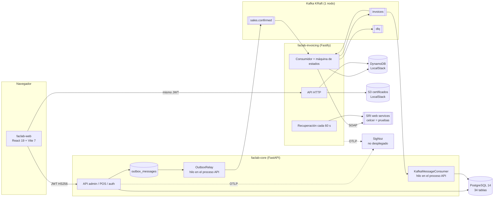
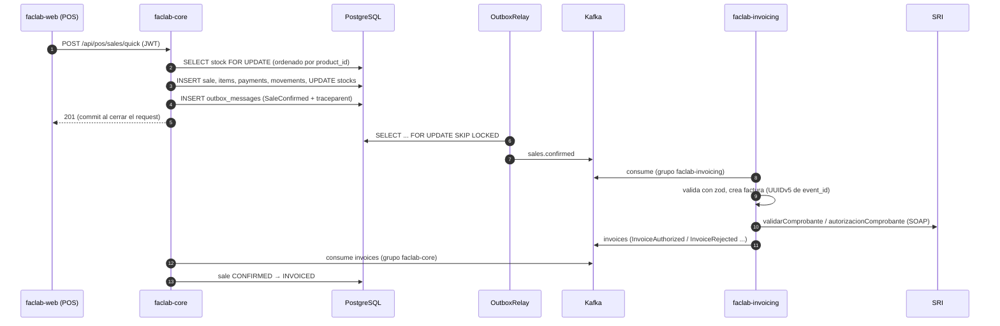

# Estado actual del ecosistema Faclab

> Auditoría de solo lectura realizada el 2026-10-14 sobre `master` de cada repositorio
> (core `522600d`, web `da9c4e8`, invoicing `52c1e68`, infra `8af83e8`).
> Leyenda: **[V]** verificado (código, configuración o ejecución), **[P]** parcialmente verificado,
> **[PV]** pendiente de validar. Las rutas `archivo:línea` reflejan ese commit y pueden haber cambiado.

## 1. Resumen

Faclab es hoy un sistema **de una sola empresa** compuesto por un monolito modular en Python
(faclab-core), un microservicio de facturación electrónica en Node/TypeScript (faclab-invoicing) y una
SPA en React (faclab-web). Se comunican por HTTP (frontend → servicios) y por Kafka (core ↔ invoicing).
Solo existe entorno de desarrollo local: no hay CI, imágenes publicadas, tags, infraestructura de
producción ni datos productivos [V]. *Actualización S1.1 (2026-10-14):* los cuatro repos tienen CI en
GitHub Actions.

## 2. Componentes

| Componente | Tecnología | Responsabilidad | Evidencia |
|---|---|---|---|
| faclab-core (remoto `faclab-ec/faclab-api`) | Python 3.12 (Docker) / 3.11 (`.venv`), FastAPI 0.135, SQLAlchemy 2.0, Alembic, wireup 2.9, aiokafka 0.12, structlog, OTel SDK 1.32 | Catálogo, inventario, clientes, proveedores, compras, ventas, POS, reportes, auth, integración con facturación | `requirements.txt`, `main.py` [V] |
| faclab-invoicing | Node/TS, Fastify 5, `@confluentinc/kafka-javascript` (API compatible con KafkaJS), AWS SDK v3 (DynamoDB, S3), zod, pino, xmlbuilder2, xml-crypto, node-forge, strong-soap, OTel sdk-node | Factura electrónica SRI: XML, firma XAdES-BES, recepción y autorización, reintentos, configuración del emisor y certificados | `package.json`, `src/container.ts` [V] |
| faclab-web | React 19.2, Vite 7.3, react-router 6.30, TanStack Query 5, Zustand 5, axios, zod 4, Tailwind 3, Vitest 4, Playwright 1.64 | Panel de administración, POS, facturación | `package.json`, `src/features/*` [V] |
| faclab-infra | docker-compose | Kafka 7.9 (KRaft, un nodo), kafka-ui, LocalStack 4.3 (DynamoDB, S3), dynamodb-admin. Solo local | `docker-compose.yml` [V] |
| Telemetry | Clon limpio de `SigNoz/signoz` (HEAD 2026-04-10) | Referencia para desplegar SigNoz (compose: signoz v0.118.0, collector v0.144.2, ClickHouse 25.5.6). No está levantado ni conectado a `faclab_network` | `deploy/docker/docker-compose.yaml` [V] |

## 3. faclab-core

### 3.1 Estructura

Arquitectura limpia con CQRS por módulo (`domain/`, `app/`, `infra/`), inyección con wireup y routers
como clases. Detalle en [`../architecture.md`](../architecture.md) y [`../modules.md`](../modules.md).

- **170 rutas** [V, contadas sobre `main.app`]: 124 en `/api/admin`, 41 en `/api/pos`, 5 en `/api/auth`
  (76 GET, 56 POST, 21 PUT, 17 DELETE). Sin versionado en la URL.
- **34 tablas** [V]: `users`, `auth_sessions`, `categories`, `products`, `units_of_measure`, `customers`,
  `customer_contacts`, `suppliers`, `supplier_contacts`, `supplier_products`, `warehouses`, `locations`,
  `stocks`, `movements`, `movement_lot_items`, `lots`, `serial_numbers`, `inventory_adjustments`,
  `adjustment_items`, `stock_transfers`, `stock_transfer_items`, `purchase_orders`,
  `purchase_order_items`, `purchase_receipts`, `purchase_receipt_items`, `sales`, `sale_items`,
  `payments`, `pos_shifts`, `pos_cash_movements`, `pos_refunds`, `pos_refund_items`,
  `pos_refund_payments`, `outbox_messages`.
- **15 migraciones** Alembic en cadena lineal [V].

### 3.2 Flujo de una venta POS hasta la factura

Puntos fuertes verificados:

- Una sesión SQLAlchemy por request; commit al final, rollback ante excepción
  (`src/shared/infra/database.py:23-33`) [V].
- Outbox transaccional: el mensaje se guarda en la misma transacción y un hook despierta al relay tras
  el commit (`src/shared/infra/outbox/writer.py:26-42`) [V]. El relay usa `FOR UPDATE SKIP LOCKED` y
  respeta el orden por `id` (`src/shared/infra/outbox/relay.py:73-106`) [V].
- El contexto de traza W3C se guarda con el mensaje y viaja en los headers de Kafka
  (`writer.py:29-30`, `relay.py:87-91`) [V].
- El POS bloquea filas de stock ordenadas por producto (`src/pos/sales/app/commands/quick_sale.py:125-131`)
  y existe prueba de sobreventa concurrente en Postgres (`tests/integration/postgres/test_pos.py`) [V].
- El consumidor de `invoices` confirma el offset solo si el handler termina bien y el comando es
  idempotente (`src/sales/app/commands/invoice_sale.py:38-39`) [V].

### 3.3 Inventario y POS

- **El POS no elige ubicación**: `stock_repo.first_for_update(product_id=...)` sin ubicación ni orden
  (`src/pos/sales/app/commands/confirm_sale.py:66,83`, `quick_sale.py:128,157`) y el movimiento OUT
  se escribe sin `location_id` (`confirm_sale.py:75-80`) [V].
- **Un solo turno abierto en todo el sistema**: `first(status="OPEN")`
  (`src/pos/shift/app/commands/open_shift.py:32`); `pos_shifts` no tiene usuario, terminal ni bodega;
  `cashier_name` llega en el cuerpo de la solicitud [V].
- La validación de disponibilidad usa `quantity` y no `available_quantity`, así que se puede vender
  stock reservado para transferencias (`confirm_sale.py:67`) [V].
- El handler de `MovementCreated` crea una fila nueva con cantidad negativa si no existía stock
  (`src/inventory/stock/infra/event_handlers.py:50-61`) [V].
- **Cantidades enteras** en stock, movimientos, ítems de venta, compra, ajuste, transferencia y
  devolución (`src/inventory/stock/infra/models.py:30`, `src/sales/infra/models.py:77`) [V].
- **Dinero `Numeric(12,6)`**: máximo 999.999,999999 por campo (`src/shared/infra/precision.py:5-10`) [V].
  En JSON se serializa como `float` (`src/shared/infra/validators.py:7-10`) [V].
- Los handlers de `SaleConfirmed`/`SaleCancelled` para ventas de administración
  (`src/inventory/infra/event_handlers.py:22-121`) no se ejecutan nunca: todos los publicadores usan
  `source="pos"` y las ventas de administración no tienen confirmar ni cancelar [V].

### 3.4 Numeración de documentos

- Órdenes de compra: `PO-{año}-{secuencia}` calculado con `MAX(...)`; en concurrencia el segundo recibe
  409 sin reintento (`src/purchasing/app/commands/purchase_order.py:39-42`,
  `src/purchasing/infra/repositories.py:45-54`) [V].
- Ventas, devoluciones, ajustes y transferencias no tienen número de documento; los recibos usan el id
  (`confirm_sale.py:79`) [V].

### 3.5 Autenticación y autorización

- JWT HS256 con PyJWT; claims `sub, sid, username, role, typ, iat, exp, iss, mcp` y `perms` en el
  access token (`src/auth/infra/token_service.py:17,51-65`) [V].
- Access 15 min, refresh 7 días (`config/base.py:66-67`). La sesión (`auth_sessions`) se extiende al
  refrescar, pero **el refresh token anterior sigue siendo válido** (no hay rotación con detección de
  reutilización) (`src/auth/app/commands/refresh_token.py:32-51`) [V].
- `AuthMiddleware` solo verifica la firma; revocar una sesión o desactivar un usuario tarda hasta 15 min
  en surtir efecto (`src/auth/infra/middleware.py:18-35`) [V].
- 5 roles fijos y 27 permisos (`src/auth/domain/permissions.py`); `require_permission` en cada ruta,
  con prueba que lo exige (`tests/integration/auth/test_all_*_routes_require_auth.py`) [V].
- faclab-invoicing valida los mismos tokens con el **mismo secreto HS256**: puede emitir tokens válidos
  para el core [V por diseño, `faclab-invoicing/src/shared/infra/http/auth.ts:45-109`].
- El login devuelve sin calcular hash cuando el usuario no existe (`src/auth/app/commands/login.py:39-43`):
  permite enumerar usuarios por tiempo de respuesta [P].
- Sin límite de intentos de login, cabeceras de seguridad, límite de tamaño de solicitud ni rate
  limiting [V, búsqueda sin resultados].
- CORS fijo en código a `localhost:3000` y `localhost:5173` (`main.py:70`) [V].
- `DOCS_ENABLED` es `True` por defecto y producción no lo cambia (`config/base.py:73`) [V].
- Los campos de actor (`created_by`, `cashier_name`, `performed_by`, `refunded_by`, `adjusted_by`,
  `requested_by`) vienen del cuerpo de la solicitud, no del usuario autenticado
  (`src/pos/sales/infra/validators.py:69-73`, `src/pos/cash/infra/validators.py:16-20`) [V].

### 3.6 Errores

- Envelope estable `{data, meta}` / `{errors:[{code,message,field?,detail?}], meta}`
  (`src/shared/infra/validators.py:28-114`) [V].
- `ValueError` devuelve su texto al cliente (`src/shared/infra/middlewares.py:188-195`) y los errores de
  PyJWT también (`token_service.py:80`) [V].
- El handler de validación registra `str(exc)`, que incluye el `input` de cada error de Pydantic
  (`middlewares.py:127`): una contraseña nueva demasiado corta quedaría en el log [P, por lectura de
  código; no se ejecutó].

### 3.7 Mensajería

- Consumidor de `invoices` (grupo `faclab-core`): actúa solo ante `InvoiceAuthorized`;
  `InvoiceRejected` solo se registra (`src/invoicing/infra/invoice_messages.py:36-42`) [V].
- Ante un fallo del handler hace `seek` al mismo offset y reintenta cada 5 s **sin límite**
  (`src/shared/infra/kafka/consumer.py:102-106`) [V].
- El relay **se detiene en el primer mensaje que falla**, cuenta intentos sin máximo, no tiene estado de
  fallo definitivo y nunca borra mensajes publicados (`relay.py:86-102`) [V].
- Relay, productor y consumidor corren como hilos dentro de cada proceso del API (`main.py:80-110`) [V].
- Los mensajes se publican sin clave de partición (`src/shared/infra/kafka/producer.py:100`) [V].
- Si Kafka no está disponible al arrancar, el hilo del productor termina; los mensajes quedan pendientes
  hasta reiniciar [P, registrado en la revisión de octubre].

### 3.8 Configuración y despliegue

- `ENVIRONMENT` elige `local`, `staging` o `production`; staging y producción exigen `JWT_SECRET` de 32
  caracteres o más (`config/production.py:7-18`) [V].
- `DATABASE_URL` cae por defecto a SQLite (`config/base.py:39`) [V].
- Dockerfile multietapa (`python:3.12-slim`): la imagen de producción conserva `build-essential` y
  `git`, corre como root, con un solo proceso uvicorn y sin `HEALTHCHECK` (`Dockerfile:31-37`) [V].
- **No hay `.dockerignore`** y se hace `COPY . .`: `.env`, `.venv`, `.data` (datos de Postgres) y `.git`
  entran en la imagen [V].
- `pytest` está en `requirements.txt` de runtime [V].
- El healthcheck de compose usa `curl`, que no existe en la imagen: el contenedor queda siempre
  `unhealthy` [V, `docker inspect`]. No hay endpoints de salud; `/` redirige a `/docs` (`main.py:409-411`).
- PostgreSQL 14 en compose: su soporte termina el **12 de noviembre de 2026** [V, política de versiones
  de PostgreSQL].
- La página de documentación Scalar carga un script sin versión fija desde jsDelivr (`main.py:173`) [V].

*Actualización S1.2 (2026-10-14):*

- **Configuración**:
  - Staging y producción (`config/deployed.py`) no arrancan sin `DATABASE_URL`, `CORS_ORIGINS` y
    `JWT_SECRET`. El mensaje nombra las que faltan.
  - SQLite queda solo como valor por defecto de `local`.
  - CORS sale de `CORS_ORIGINS`, y fuera de local no admite `*`.
  - `DOCS_ENABLED` es falso por defecto fuera de local, y también controla `/openapi.json` y la
    redirección de `/`.
  - Scalar queda fijado en `@scalar/api-reference@1.74.0`.
- **Imagen**:
  - `.dockerignore` deja fuera los secretos, `.venv`, `.git`, `.data`, `tests` y `docs`.
  - Las etapas son `builder` → `runtime` → `development` / `production`.
  - La imagen de producción no trae compiladores (solo `libpq5`) y corre como `app` (uid 10001) con
    código de solo lectura.
  - `uvicorn --workers $WEB_CONCURRENCY` (2 por defecto) corre con `--proxy-headers`.
  - `HEALTHCHECK` llama a `/health/live`.
  - La configuración se valida antes de levantar los workers [V, `docker run`].
- **Salud**: `/health/live` y `/health/ready` son públicos y quedan fuera de la documentación y del log
  de acceso. Ready devuelve 503 si la base de datos falla y `degraded` si solo falla el productor de
  Kafka.
- **Entorno local**:
  - El healthcheck de compose usa Python contra `/health/live`, y el contenedor pasa a `healthy` [V].
  - compose usa `postgres:17`.
  - `pytest` pasó a `requirements_dev.txt`.
  - `scripts/seed.py` solo corre con `ENVIRONMENT=local`.

## 4. faclab-invoicing

### 4.1 Proceso

- Solo **factura** (codDoc `01`), XML versión `1.1.0` (`src/modules/invoice/domain/invoice-xml-builder.ts:99-100`) [V].
  No hay nota de crédito, nota de débito, retención, guía de remisión ni liquidación de compra [V].
- Clave de acceso de 49 dígitos con módulo 11 (`access-code-generator.ts:37-51`); el código numérico
  de 8 dígitos es el `saleId` con relleno (`:16`), así que un id mayor a 99.999.999 rompe la clave [V].
- Firma XAdES-BES propia con RSA-SHA1 (`src/modules/invoice/infra/signing/xades-signer.ts`) [V].
- Estados: recibida, firmada, enviada, autorizada, rechazada; `EN PROCESO` se reintenta. Reintentos a
  1, 5, 15 y 60 minutos, máximo 10 automáticos (`issue.ts:34-60`). Si falta configuración o certificado,
  la factura queda `pending` hasta que el emisor esté listo [V].
- El consumidor de Kafka llama al SRI dentro de `eachMessage` (timeout 30 s por llamada): un SRI lento
  frena el consumo de nuevas ventas [P].
- No se guardan la fecha ni el XML de autorización (`invoice.mapper.ts:29-55`) [V]. No hay RIDE
  (Representación Impresa del Documento Electrónico), correo al cliente ni contingencia [V].

### 4.2 Configuración y datos

- **URLs del SRI de pruebas (`celcer.sri.gob.ec`) también en producción** y broker `localhost:29092`
  fijo (`src/config/production.ts:27-34`) [V].
- **Un solo emisor**: `CompanyConfig.SINGLETON_ID = 'default'` (`company-config.ts:11`) [V].
- Secuencial con contador atómico de DynamoDB (`ADD invoice_sequence`), pero guardar la configuración
  lee el contador y reescribe todo el registro (`company-config.commands.ts:40-46`): puede retroceder el
  contador y repetir secuenciales [V]. La primera factura sale con secuencial `000000002` [V].
- `GET /api/invoices` recorre toda la tabla con `Scan`, sin paginación
  (`dynamo-invoice.repository.ts:84-95`) [V].
- Certificado `.p12` en S3; su contraseña cifrada con AES-256-GCM (`src/shared/infra/secret-cipher.ts`) [V].
  No se valida que el certificado pertenezca al RUC configurado [V].
- No hay Dockerfile ni CI; `package-lock.json` está ignorado por git, así que los builds no son
  reproducibles [V]. La dependencia de desarrollo `pettier` (`package.json:68`) parece un error de
  tipeo de `prettier` y es un paquete que altera el formato al azar [V]. *Actualización S1.1:* CI en
  GitHub Actions, `package-lock.json` versionado y `pettier` eliminado; el Dockerfile queda para S1.3.

*Actualización S1.3 (2026-10-15):*

- **Configuración** (`src/config/`, zod):
  - `NODE_ENV` acepta `local` (por defecto) o `production`.
  - Las URLs del SRI salen de una sola tabla (`src/config/sri.ts`) elegida por `SRI_ENVIRONMENT`:
    `test` (`celcer`) o `production` (`cel`). Local solo admite `test`.
  - Producción no arranca sin `SRI_ENVIRONMENT`, `KAFKA_BROKERS`, `AWS_REGION`, los tres nombres de
    tabla, `S3_CERTIFICATES_BUCKET`, `CORS_ORIGINS` (sin `*`), `JWT_SECRET` y
    `CERTIFICATE_PASSWORD_KEY`. El mensaje sale por stderr y nombra las variables, nunca sus valores.
  - Cada arranque registra `sriEnvironment` y el host del SRI. Con `NODE_ENV=production` y
    `SRI_ENVIRONMENT=test` emite un aviso.
  - `npm run dev` y `npm start` cargan `.env` si existe (`--env-file-if-exists`), y hay
    `.env.example`.
- **Build**: `npm start` no funcionaba porque `tsc` no reescribía el alias `#/` [V]. Ahora el build
  corre `tsc-alias`.
- **Imagen**:
  - `node:22-bookworm-slim` en tres etapas: `build`, `deps` (solo producción, con el binario nativo de
    Kafka) y `production`.
  - Corre como `app` (uid 10001) con código de solo lectura.
  - `HEALTHCHECK` contra `/health`.
  - El job `image` de CI la construye y comprueba que no arranque sin configuración [V, `docker run`
    contra faclab-infra].
- **Pendiente**: nada cruza todavía `CompanyConfig.environment` (el `ambiente` del comprobante) con
  `SRI_ENVIRONMENT` (S2.8).

### 4.3 Contrato `sales.confirmed`

| Campo | Core envía | Invoicing exige | Estado |
|---|---|---|---|
| `customer.email`, `phone`, `address` | `str \| None` (`src/invoicing/infra/event_handlers.py:47-49`) | `z.string()` (`schemas.ts:23-25`) | **Incompatible**: la venta va a la DLQ y no se factura [V] |
| `items[].sku`, `product_name` | `None` si falta el producto | `z.string()` | Incompatible [V] |
| Montos | Decimal como string | string → centavos | Compatible [V] |
| `payments[].amount` | lo entregado, puede superar el total | se escribe tal cual en `pagos` | Riesgo de rechazo [PV] |
| Versión del esquema | no existe | no existe | Sin versionado [V] |

*Actualización S1.6 (2026-10-15):*

- **Contrato**: `faclab-core/contracts/events/` tiene JSON Schema v1 y ejemplos de `sales.confirmed`
  e `invoices`; `contracts/README.md` documenta cada campo y la política de compatibilidad
  (ADR-0006). Los dos mensajes llevan `schema_version: 1`; uno sin el campo se lee como v1.
- **Nulos**: `customer.email`, `phone`, `address`, `items[].sku` y `product_name` son nulables en
  el contrato y en el zod de invoicing. El XML omite los datos de contacto que faltan (sin
  `infoAdicional` vacío), omite `codigoAuxiliar` sin SKU y describe un producto inexistente como
  `Producto <id>`. Los XML de los cuatro ejemplos validan contra `factura_V1.1.0.xsd` [V,
  `xmllint`, prueba manual]; la validación XSD automática queda para S4.1.
- **Pruebas de contrato**: el core valida lo que escribe en el outbox (`tests/contract`, y ventas
  POS reales en `tests/integration/postgres`); invoicing valida cada ejemplo con zod, genera su XML
  y valida con ajv lo que publica en `invoices`. Invoicing guarda una copia de `contracts/` fijada a
  un commit del core y su CI la compara con el core en ese commit.
- **Sigue igual**: `payments[].amount` es lo entregado y puede superar el total (riesgo de rechazo
  [PV]); `FOREIGN_ID` se mapea a `07` (consumidor final) en vez de `08` [V].

## 5. faclab-web

- Arquitectura por features con reglas de límites documentadas ([`faclab-web/docs/architecture.md`]) [V].
- **Tokens de acceso y refresh en `localStorage`** (`src/shared/lib/auth/tokenStorage.ts`) [V].
- Refresco proactivo 60 s antes de expirar y reactivo ante `TOKEN_EXPIRED` [V].
- No hay selección de empresa, sucursal, bodega ni terminal; el POS solo conoce el turno [V].
- Sin instrumentación: ni OTel web, ni reporte de errores, ni web vitals; el `ErrorBoundary` solo hace
  `console.error` [V].
- `check:contract` compara 18 enums con el OpenAPI del core; se omite si no hay `OPENAPI_URL` y no
  cubre facturación [V].
- Sin Dockerfile ni configuración de servidor estático [V].

*Actualización S1.3 (2026-10-15):*

- **Imagen**:
  - Build con Node 22 y Caddy en Alpine, de unos 60 MB.
  - Corre como `app` en el puerto 8080, sin capacidades extra, así que arranca con `cap_drop: ALL`.
  - Para las rutas del SPA (`/pos`) devuelve `index.html` con `no-cache`; un asset inexistente da 404.
  - Assets con hash en caché `immutable` y compresión zstd o gzip [V, `docker run`].
- **URLs de API en tiempo de ejecución**:
  - `index.html` carga `/config.js` antes del bundle. El contenedor lo escribe al arrancar desde
    `API_BASE_URL` e `INVOICING_API_URL`, que son obligatorias y se validan, y lo sirve con `no-store`.
  - En desarrollo `public/config.js` está vacío y mandan los `VITE_*`.
- **CI**: el job `image` construye la imagen y prueba el fallback, `config.js` y el 404.
- **Pendiente**: sin CSP ni otras cabeceras de seguridad aparte de `X-Content-Type-Options`.

## 6. Observabilidad

| Aspecto | Core | Invoicing | Web |
|---|---|---|---|
| Trazas | OTLP gRPC; FastAPI, SQLAlchemy, spans manuales por handler y evento | sdk-node; HTTP, AWS SDK, Fastify; spans manuales de Kafka y SOAP | No |
| Métricas | `handler.*`, `events.*`, `kafka.*` (etiquetas acotadas) | `kafka.consumer.*`, `dlq.message.count`, `soap.call.duration` | No |
| Logs | structlog (JSON fuera de local) + exportador OTLP | pino (+ instrumentación de pino) | No |
| `service.version` | Falta | Fijo en `1.0.0` | — |
| Estado local | `OTEL_ENABLED=false` en `.env` | Activo, apunta a `localhost:4317` | — |

Defectos verificados en el core:

- `FastAPIInstrumentor.instrument_app` usa `add_middleware` (`.venv/.../instrumentation/fastapi/__init__.py:287`)
  y se llama antes de registrar los middlewares propios (`main.py:227` vs `:360-368`). El middleware de
  OTel queda **dentro** del de errores: los logs HTTP no llevan `trace_id` y los errores de dominio
  marcan el span como error [V].
- `remove_processors_meta` corre antes de `_extract_otel_context` y borra `_record`, por lo que el
  procesador que agrega `trace_id`/`span_id` a los logs nunca hace nada (`src/shared/infra/logging.py:42-49`) [V].
- `database.py` importa `create_engine` antes de la instrumentación: las consultas SQL probablemente no
  generan spans [P].
- Sampler `TraceIdRatioBased` sin `ParentBased`; exportador con `insecure=True` fijo
  (`src/shared/infra/adapters/telemetry.py:50-58`) [V].
- Los errores de dominio se registran con nivel ERROR en cada handler (`src/shared/app/commands.py`) [V].

En invoicing: no se llama a `sdk.shutdown()` antes de `process.exit` (`src/server.ts:30`) y el span del
productor queda huérfano porque se inyecta el contexto activo en lugar del span
(`kafka-producer.ts:25-35`) [V].

SigNoz: no hay dashboards ni alertas versionados (`deploy/common/dashboards` solo tiene `.gitkeep`) [V].

## 7. Pruebas

| Repo | Ejecución 2026-10-14 | Tipo |
|---|---|---|
| core | **983 pasan, 67 omitidas** (las de PostgreSQL necesitan `make test-integration`) [V] | Unitarias con repositorios simulados; integración de guardas de permisos; 64 pruebas sobre Postgres (sobreventa, outbox, facturación) |
| invoicing | **31 pasan** en 6 archivos [V] | Dominio, readiness, idempotencia, mapeo SRI, cifrado. **Sin pruebas** de XML, firma, SOAP, Kafka, JWT ni repositorios |
| web | **234 pasan, 18 omitidas** (Vitest) [V]; 66 pruebas Playwright con backend simulado [V, no ejecutadas] | Hooks, esquemas, cliente HTTP, totales del POS |

Cobertura del core: el último `.coverage` es de abril 2026 y da ~66,8 % al reubicar rutas; está
desactualizado [P]. *Actualización S1.1 (2026-10-14):* **95 %** de `src` (10 738 sentencias, 511 sin
cubrir) sumando la corrida sin base de datos (983 pruebas) y la de PostgreSQL (67) [V]. El job `test`
del CI la mide igual en cada run (95 % también en el run de faclab-api#111) y la publica como artefacto
`coverage-report`.
No hay pruebas de carga, de contrato entre servicios ni E2E contra servicios reales [V].

## 8. Coordinación entre repositorios

- Cuatro repositorios en `github.com/faclab-ec`, sin tags ni releases [V].
- Versiones fijas en código: core `1.0.0` (`config/base.py:76`), invoicing `1.0.0`, web `2.0.1` [V].
- El orden de despliegue se acuerda a mano en cada PR (por ejemplo, infra → invoicing → core → web) [V,
  historial de PRs].
- La única verificación cruzada automática es `check:contract` (solo enums, manual) [V].

## 9. Requisitos de ferretería ya cubiertos

| Capacidad | Estado |
|---|---|
| Stock por bodega y ubicación, transferencias con reserva, ajustes, lotes y series | Existe [V] |
| Caja: movimientos de efectivo, reportes X y Z, reportes diario y por medio de pago | Existe; el Z se calcula al consultar [V] |
| Medios de pago: efectivo, tarjeta de crédito, tarjeta de débito, transferencia, otro | Existe [V] |
| Órdenes de compra con recepción parcial | Existe [V]; IVA de compras fijo en 0 [P] |
| Devoluciones POS con reingreso a stock | Existe, sin nota de crédito [V] |
| Descuento global, cambio de precio con motivo | Existe [V] |
| Unidades con conversión, cantidades decimales, listas de precios, cotizaciones, crédito y cuentas por cobrar, cuentas por pagar, devoluciones a proveedor, costo promedio, kárdex valorizado, importación masiva, bitácora de auditoría | **No existe** [V] |
