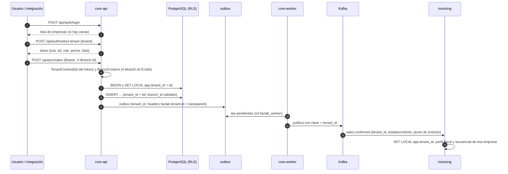

# Modelo multiempresa y multisucursal

> Decisiones: 1 empresa (tenant) = 1 RUC; base compartida con `tenant_id` y Row-Level Security
> ([ADR-0002](ADR/0002-multiempresa-base-compartida-con-rls.md)); identidad global con membresías
> ([ADR-0003](ADR/0003-identidad-global-y-contexto-de-sucursal.md)). Hoy no existe nada de esto
> (G-01 a G-06). Este documento es conceptual: el esquema se implementa en las sesiones S2.1 a S2.9.

## 1. Niveles

| Nivel | Qué es | Ejemplos |
|---|---|---|
| **Plataforma** | La operación SaaS de Faclab | Planes, suscripciones, empresas, usuarios de soporte, límites de uso |
| **Empresa (tenant)** | Un contribuyente con un RUC | Catálogo, clientes, proveedores, usuarios y roles, listas de precios, integraciones, perfil fiscal |
| **Sucursal** | Un establecimiento SRI (código de 3 dígitos) con dirección | Bodegas, puntos de emisión, terminales, cajas, turnos, ventas, stock |

## 2. Modelo conceptual


Del lado de facturación (base `faclab_invoicing`, ver [ADR-0004](ADR/0004-persistencia-de-facturacion-en-postgresql.md)):
`issuers (tenant_id, ruc, ambiente, contribuyente_especial, rimpe, obligado_contabilidad…)`,
`certificates (tenant_id, …)`, `sequences (tenant_id, establishment, emission_point, doc_type)`,
`invoices (tenant_id, sale_id, establishment, emission_point, sequential, …)`.

## 3. Clasificación de entidades

| Entidad actual o nueva | Nivel | Compartida entre sucursales | Notas |
|---|---|---|---|
| `tenants`, `plans`, `subscriptions` | Plataforma | — | Nuevas |
| `users` | Plataforma (identidad global) | — | Usuario y email únicos globalmente |
| `memberships`, `user_branch_access` | Empresa | — | Nuevas; rol por empresa |
| `auth_sessions` | Empresa | — | Se agrega `tenant_id` |
| `products`, `categories`, `units_of_measure` | Empresa | Sí | SKU y código de barras únicos por empresa |
| Presentaciones y conversiones (Etapa 5) | Empresa | Sí | |
| `price_lists` (Etapa 5) | Empresa | Sí, con lista opcional por sucursal | |
| `customers`, `customer_contacts` | Empresa | Sí | `tax_id` único por empresa |
| `suppliers`, `supplier_contacts`, `supplier_products` | Empresa | Sí | |
| `branches`, `emission_points`, `pos_terminals` | Sucursal | — | Nuevas |
| `warehouses`, `locations` | Sucursal | No | `warehouses.branch_id` obligatorio |
| `stocks`, `movements`, `lots`, `serial_numbers` | Sucursal (vía ubicación) | No | Serie única por empresa |
| `inventory_adjustments`, `adjustment_items` | Sucursal | No | |
| `stock_transfers` | Empresa (origen y destino pueden ser sucursales distintas) | — | Validar que ambas bodegas sean de la misma empresa |
| `purchase_orders`, recepciones | Empresa, con sucursal de destino | — | Número por empresa |
| `sales`, `sale_items`, `payments` | Sucursal | No | Con `branch_id`, `emission_point_id`, `terminal_id`, `shift_id` |
| `pos_shifts`, `pos_cash_movements` | Sucursal (terminal) | No | Un turno abierto por terminal |
| `pos_refunds` | Sucursal | No | |
| `document_sequences` | Empresa y sucursal | — | Ver ADR-0012 |
| `outbox_messages`, `dead_letters` | Infraestructura con `tenant_id` | — | Sin RLS; solo los usa el rol `faclab_worker` |
| `audit_log`, `idempotency_keys` | Empresa | — | Nuevas (Etapa 3) |
| `integration_clients`, `webhook_endpoints`, `webhook_deliveries` | Empresa | — | Nuevas (Etapa 6) |
| Perfil fiscal, certificados, secuenciales SRI, comprobantes | Empresa (en invoicing) | — | Secuencial por establecimiento y punto de emisión |

## 4. Propagación del contexto



| Punto | Mecanismo |
|---|---|
| Autenticación | Claim `tid` emitido por el core tras validar la membresía. El frontend no envía `tenant_id` |
| Sucursal | Encabezado `X-Branch-Id` validado contra `user_branch_access` (o `bids` del token) |
| API | `TenantContext` y `BranchContext` en el scope de wireup; el repositorio base asigna y filtra |
| Base de datos | `SET LOCAL app.tenant_id` en `after_begin` de la sesión; RLS como segunda barrera |
| Eventos de dominio | Cada `DomainEvent` lleva `tenant_id` del contexto |
| Outbox y Kafka | Columna `tenant_id`, clave de partición y header `faclab-tenant-id`; envelope con `tenant_id` (ADR-0006) |
| Consumidores | Abren el contexto con el `tenant_id` del mensaje antes de tocar la base |
| Tareas periódicas | Recorren empresas explícitamente y abren un contexto por empresa |
| Archivos | Claves `tenants/{tenant_id}/...` en el almacenamiento de objetos; nunca rutas que el cliente arme |
| Reportes | Corren dentro del contexto (RLS). Los consolidados de la empresa agregan todas las sucursales permitidas; los de plataforma usan el rol `faclab_worker` |
| Logs y trazas | Atributo `faclab.tenant.id` en spans y logs; nunca como etiqueta de métrica (ver OBSERVABILITY.md) |
| Webhooks y API pública | El token de la integración tiene `tid` fijo; los webhooks se entregan solo a endpoints de esa empresa |

## 5. Restricciones e integridad

- Restricciones únicas compuestas: `(tenant_id, sku)`, `(tenant_id, barcode)`, `(tenant_id, tax_id)`
  en clientes y proveedores, `(tenant_id, code)` en bodegas, `(tenant_id, establishment_code)` en
  sucursales, `(tenant_id, branch_id, code)` en puntos de emisión, `(tenant_id, serial_number)`.
- Claves foráneas compuestas `(tenant_id, x_id)` en relaciones críticas (venta → cliente, ítem →
  producto, stock → ubicación, terminal → ubicación), con `UNIQUE (tenant_id, id)` en la tabla
  referida. Así la base impide mezclar empresas aunque falle la aplicación.
- Índice único parcial: un turno `OPEN` por terminal.
- Índices que empiezan por `tenant_id` en todas las consultas de listado.

## 6. Row-Level Security

```sql
-- Ilustrativo; se define en S2.4
ALTER TABLE products ENABLE ROW LEVEL SECURITY;
ALTER TABLE products FORCE ROW LEVEL SECURITY;
CREATE POLICY tenant_isolation ON products
  USING (tenant_id = current_setting('app.tenant_id', true)::uuid)
  WITH CHECK (tenant_id = current_setting('app.tenant_id', true)::uuid);
```

- Sin `app.tenant_id` definido, `current_setting(..., true)` devuelve null y la política no deja ver
  filas: **falla cerrada**.
- Roles:
  - `faclab_owner` es dueño de las tablas y ejecuta migraciones.
  - `faclab_app` es el que usa el API, sin `BYPASSRLS`.
  - `faclab_worker` tiene `BYPASSRLS` y lo usan el relay, las tareas de plataforma y el onboarding.
- `SET LOCAL` (no `SET`) para que el valor muera con la transacción y no se filtre a otra solicitud que
  reutilice la conexión del pool.

## 7. Autorización

Tres preguntas en cada solicitud:

1. **¿Qué empresa?** `tid` del token. Imposible cambiarla sin un token nuevo.
2. **¿Qué puede hacer?** `perms` según el rol de la membresía (`require_permission`, ya existente).
3. **¿En qué sucursal?** `X-Branch-Id` dentro de los accesos permitidos. Los recursos de sucursal
   (stock, ventas, turnos) se filtran además por las sucursales permitidas en los listados.

Casos:

- Usuario con acceso a varias sucursales: el frontend muestra un selector; los reportes pueden
  consolidar todas las sucursales permitidas.
- Contador externo con varias empresas: elige la empresa al iniciar sesión y puede cambiarla.
- Integración: scopes más restricción opcional por sucursal (ADR-0008).
- Último administrador: la regla actual `LAST_ADMIN` pasa a evaluarse por empresa.

## 8. Pruebas negativas de aislamiento (S2.4)

- Fixture con dos empresas, cada una con datos completos (productos, clientes, ventas, stock, turnos,
  facturas).
- **Por cada ruta** de `main.app`, igual que las pruebas actuales de guardas de permisos:
  - GET de un recurso de la otra empresa devuelve 404.
  - PUT, DELETE y POST que referencian ids ajenos devuelven 404 o 422.
  - Los listados nunca devuelven filas ajenas.
- A nivel de base, con el rol `faclab_app` y otra empresa en `app.tenant_id`: un `SELECT` directo no
  devuelve filas ajenas y un `INSERT` con `tenant_id` ajeno falla.
- Sin contexto, una consulta no devuelve filas.
- Mensajes Kafka: un `sales.confirmed` de la empresa A nunca usa el perfil fiscal ni el secuencial de B.
- Sucursal: un cajero con acceso solo a la sucursal 1 no puede abrir turno ni vender en la 2.

## 9. Incorporación de empresas y migración de datos

1. **Alta** (comando de plataforma, S2.1; asistente en S8.5):
   - Crea la empresa con RUC validado (`TaxId` ya existe en `src/shared/domain/value_objects.py`).
   - Crea la sucursal matriz (establecimiento 001), el punto de emisión 001, una bodega con su ubicación
     por defecto y una terminal.
   - Crea la membresía del primer administrador.
2. **Perfil fiscal y certificado** en facturación; el emisor queda listo según el readiness existente.
3. **Datos iniciales**: importación de productos, clientes, proveedores y saldos de inventario (S5.8).
   Los saldos entran como movimientos de ajuste auditados, no como escritura directa de stock.
4. **Secuencial inicial** por establecimiento y punto de emisión, para continuar la numeración de un
   sistema anterior.
5. **Datos existentes de desarrollo**: no hay datos productivos (decisión del 2026-10-14); la nueva
   línea base de migraciones parte de cero y el seed crea dos empresas de ejemplo.

## 10. Suscripciones y límites

- `plans` define límites como sucursales, terminales, usuarios, comprobantes por mes y acceso a la API
  pública.
- La verificación ocurre en los comandos que crean esos recursos (por ejemplo, `CreateBranchCommand`)
  con un error de dominio específico (`PLAN_LIMIT_REACHED`, 409).
- El uso mensual de comprobantes se mide en facturación y se publica como evento agregado. No se
  bloquea la emisión de una venta ya hecha: se avisa y se gestiona comercialmente (S8.4).
