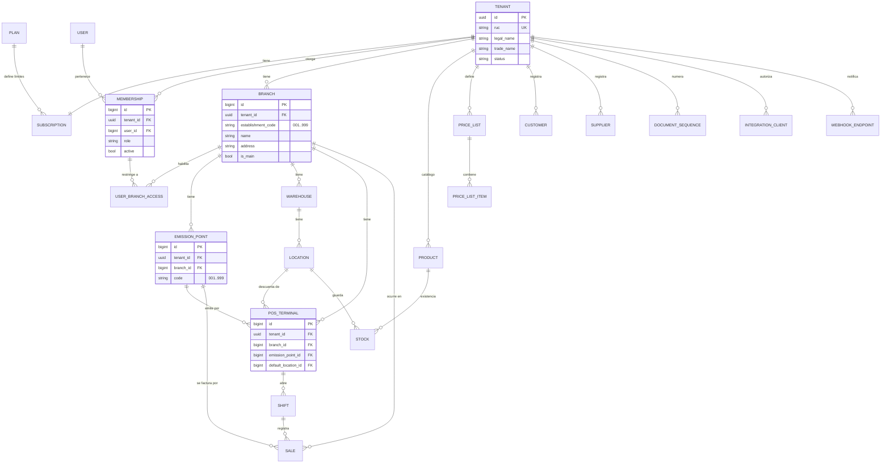
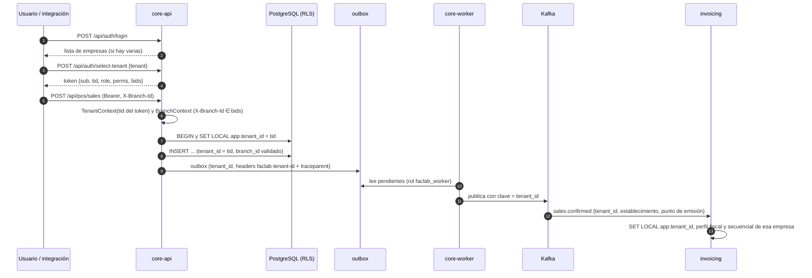

# Modelo multiempresa y multisucursal

> Decisiones: 1 empresa (tenant) = 1 RUC; base compartida con `tenant_id` y Row-Level Security
> ([ADR-0002](ADR/0002-multiempresa-base-compartida-con-rls.md)); identidad global con membresías
> ([ADR-0003](ADR/0003-identidad-global-y-contexto-de-sucursal.md)). Hoy no existe nada de esto
> (G-01 a G-06). Este documento es conceptual: el esquema se implementa en las sesiones S2.1 a S2.9.

**Implementado (S2.1, 2026-10-15):**

- `tenants` (UUID, RUC validado y único, razón social, nombre comercial, estado `active`/`suspended`) y
  `memberships` (usuario, empresa, rol, activo; única por usuario y empresa), en el módulo
  `src/tenancy/`.
- `users` como identidad global, sin rol. `auth_sessions.tenant_id`.
- Login con selección de empresa, `POST /api/auth/select-tenant` (también para cambiar de empresa),
  token con `tid` y `role`/`perms` de la membresía.
- Administración de usuarios y regla `LAST_ADMIN` por empresa.
- Alta por CLI (`python -m src.tenancy.provision`).

**Implementado (S2.2, 2026-10-15):**

- `TenantContext` (empresa, origen, usuario y, desde S2.5, sucursal) en un `ContextVar`
  (`src/shared/domain/tenant.py`). Lo fijan `AuthMiddleware` desde el `tid`, el consumidor de Kafka desde
  el header `faclab-tenant-id` (o el `tenant_id` del sobre) y las tareas con
  `create_sync_scope(tenant=...)`. Wireup lo inyecta como `TenantContext` (scoped).
- `SET LOCAL app.tenant_id` (como `set_config(..., true)`) en `after_begin` de cada sesión.
- Repositorio base: en un modelo con `__tenant_scoped__ = True`, `create` asigna la empresa del contexto y
  todas las lecturas, `update` y `delete` filtran por ella; sin contexto falla.
- `DomainEvent.tenant_id`, `outbox_messages.tenant_id` y el header `faclab-tenant-id` en cada mensaje.
- Logs y span del request con `faclab.tenant.id`.

**Implementado (S2.3, 2026-10-16):**

- Las 31 tablas de negocio tienen `tenant_id UUID NOT NULL` con FK a `tenants` y la marca de empresa
  (mixin `TenantScoped` en `src/shared/infra/database.py`). La clasificación quedó como en §3, con tres
  grupos: plataforma sin empresa (`tenants`, `users`, `login_failures`); con `tenant_id` pero leídas
  entre empresas por auth, la provisión y el relay (`memberships`, `auth_sessions`, `outbox_messages`,
  esta última ya `NOT NULL`); y negocio. Las sucursales llegan en S2.5.
- Restricciones únicas por empresa: SKU, código de barras, símbolo de unidad, `tax_id` de clientes y
  proveedores, código de bodega, serie y número de orden de compra (`uq_<tabla>_tenant_<columna>`). Las
  que dependen de un padre de la empresa (código de ubicación por bodega, lote por producto, stock por
  producto y ubicación) no cambian. El número de orden de compra es correlativo por empresa.
- FKs compuestas `(tenant_id, x_id)` (`fk_<tabla>_<destino>_tenant`) en venta → cliente, ítem de
  venta → producto, stock → producto y ubicación, movimiento → producto y ubicaciones, orden de compra
  → proveedor y transferencia → ubicaciones, con `UNIQUE (tenant_id, id)` en clientes, productos,
  ubicaciones y proveedores.
- Hook `before_flush` en cada sesión: toda fila nueva de una tabla por empresa recibe la empresa del
  contexto, aunque no pase por el repositorio base. Las consultas escritas a mano (reportes de inventario
  y POS, resumen de caja, recibo, número de orden de compra) filtran cada tabla con `tenant_criteria`.
- Nueva línea base de migraciones (`80ccdab134c7`) en lugar de la cadena anterior.
- `make seed` crea dos empresas con el mismo catálogo y el administrador del seed en ambas.
- Temporal hasta S2.8: un mensaje de `invoices` sin empresa corre en la de su venta (búsqueda por id).
  Retirado en S2.8.

**Implementado (S2.4, 2026-10-18):**

- Roles de base: `faclab_owner` (dueño de las tablas; migraciones con `DATABASE_URL_MIGRATIONS`),
  `faclab_app` (el API, `DATABASE_URL`, sin `BYPASSRLS`) y `faclab_worker` (`DATABASE_URL_WORKER`, con
  `BYPASSRLS`: el relay del outbox y, hasta S2.8, `_tenant_of_sale`). Ninguno es superusuario. Los crea
  `python -m src.shared.infra.db_roles` (`make db-roles`), idempotente, con el superusuario de
  `DATABASE_URL_ADMIN`; también crea la base con dueño `faclab_owner`.
- Permisos por migración (`80bfd3a8c63b`): app y worker leen y escriben todas las tablas y secuencias,
  también las de migraciones futuras; nadie más que el dueño puede `TRUNCATE` ni tocar
  `alembic_version`; en `outbox_messages`, `faclab_app` solo inserta (y lee el `id` que devuelve).
- RLS activo y forzado en las 31 tablas de negocio (`798891c3feea`) con una política por tabla (§6).
- Las tablas de plataforma no tienen RLS: `tenants`, `users`, `login_failures`, `memberships`,
  `auth_sessions` y `outbox_messages`. Decisión del usuario: auth las lee entre empresas (login, refresh,
  `/me`, cambio de empresa y de contraseña) y las protege el filtro explícito de la aplicación.
- FKs compuestas también en las 19 relaciones que una ruta podía llenar con un id de otra empresa
  (`3df55a3cc8fb`; decisión del usuario): PostgreSQL revisa las FKs sin aplicar RLS. Quedan simples solo
  20 FKs hijo → padre internas, listadas con su motivo en `tests/unit/shared/test_tenant_schema.py`.
- El seed borra los datos de cada empresa dentro de su contexto, en la misma transacción que los siembra.
- Suite de aislamiento por ruta y pruebas SQL de RLS (§8), obligatorias en el CI.

**Implementado (S2.5, 2026-10-19):**

- Módulo `src/organization/` con `branches` (código de establecimiento de tres dígitos, `001` a `999`,
  único por empresa; una matriz por empresa, índice único parcial `uq_branches_tenant_main`),
  `emission_points` (código único por sucursal) y `pos_terminals` (código único por sucursal, punto de
  emisión y ubicación por defecto). Las tres son de negocio, con RLS forzado (migración
  `c7f9919e67c0`). Rutas en `/api/admin/branches`, `/emission-points` y `/pos-terminals`, con
  `organization:read` (todos los roles menos CASHIER) y `organization:write` (solo ADMIN).
- `warehouses.branch_id` obligatorio, con FK compuesta. La migración pasa las bodegas existentes a una
  matriz `001` de su empresa. La sucursal de una bodega, un punto de emisión o una terminal se fija al
  crearlos: un PUT no la cambia.
- Una terminal emite por un punto de emisión de su sucursal y descuenta de una ubicación de una bodega
  de esa sucursal (`EMISSION_POINT_OUTSIDE_BRANCH`, `LOCATION_OUTSIDE_BRANCH`). Las FKs compuestas
  (`fk_pos_terminals_*_tenant`) la mantienen en su empresa; la sucursal de la ubicación la revisa el
  comando, porque `locations` no tiene sucursal.
- `user_branch_access(membership_id, branch_id)` en `src/tenancy/`, con `tenant_id` y sin RLS, como
  `memberships`: auth la lee al emitir tokens. FK compuesta a la membresía (CASCADE) y a la sucursal
  (sin cascada: borrar una sucursal con accesos responde `RECORD_IN_USE`, y así el usuario no pasa a
  entrar a todas). Se administra con `GET`/`PUT /api/admin/users/{id}/branches`; sin filas, todas.
- El access token lleva `bids` solo cuando la membresía está limitada, siempre con la lista completa
  (sin umbral: una ferretería tiene pocas sucursales). Login, `select-tenant` y refresh lo calculan;
  un cambio rige desde el próximo refresh, como un cambio de rol.
- `X-Branch-Id`: `AuthMiddleware` lo lee y, si el usuario puede entrar a esa sucursal, la solicitud
  corre en ella (`TenantContext.branch_id`, logs y span con `faclab.branch.id`). Toda ruta autenticada
  rechaza uno ajeno (403 `BRANCH_ACCESS_DENIED`) o mal formado (422 `INVALID_BRANCH_HEADER`). La
  dependencia `require_branch` lo exige (`BRANCH_REQUIRED`) en las rutas de sucursal: por ahora solo
  `GET /api/pos/terminals`; turnos, ventas y caja lo exigen desde S2.6. Que la sucursal exista y esté
  activa lo revisa cada operación que la usa. `/api/auth/me` devuelve las sucursales activas a las que
  el usuario puede entrar.
- La CLI de alta crea, en un segundo scope dentro de la empresa, la matriz 001, el punto de emisión
  001, la bodega `BOD-001`, la ubicación `GENERAL` y la terminal `CAJA-01` (idempotente: no toca una
  empresa que ya tiene sucursales). `make seed` siembra tres sucursales por empresa.

**Implementado (S2.6, 2026-10-19):**

- El POS opera en una terminal. Abrir turno, el turno activo, crear venta, venta rápida, ventas
  aparcadas y crear devolución llevan `X-Branch-Id` y `X-Terminal-Id` (dependencia `pos_terminal`,
  `src/pos/terminal/`). La terminal debe ser de esa sucursal (`POS_TERMINAL_OUTSIDE_BRANCH`) y estar
  activa (`POS_TERMINAL_INACTIVE`), como su sucursal (`BRANCH_INACTIVE`). Sin el encabezado responde
  `TERMINAL_REQUIRED` (400), y mal formado, `INVALID_TERMINAL_HEADER` (422). Se eligió el encabezado,
  no una asociación del usuario a la terminal: no guarda estado y un supervisor puede atender en otra
  caja.
- Las operaciones sobre una venta, un turno o una devolución existentes (ítems, pagos, confirmar,
  cancelar, recibo, cerrar turno, caja, procesar o cancelar devolución) llevan `X-Branch-Id`
  (`pos_branch`). `PosBranchGuard` responde `NOT_FOUND` si el recurso es de otra sucursal, igual que
  para uno inexistente. Las filas anteriores a S2.6 no tienen sucursal y pasan.
- Los historiales y reportes del POS (turnos, devoluciones, X, Z, diario y por medio de pago) aceptan
  `branchId` y `terminalId` y se limitan a las sucursales del usuario (`bids`): un `branchId` ajeno
  responde `BRANCH_ACCESS_DENIED` y un turno o una devolución de otra sucursal, `NOT_FOUND`.
- Respaldo local hasta S2.9: con `POS_TERMINAL_FALLBACK` (verdadero solo en `local`; staging y
  producción se niegan a arrancar con él) y sin encabezados, la solicitud usa la sucursal del
  encabezado o la matriz, y su primera terminal activa por código, siempre que el usuario pueda entrar
  a esa sucursal.
- `pos_shifts` gana `terminal_id`, `branch_id`, `opened_by_user_id` y `closed_by`; `sales`,
  `branch_id`, `emission_point_id`, `terminal_id` y `number`; `pos_refunds`, `branch_id`,
  `terminal_id` y `number` (migración `654849d8d497`). Son nulos solo en las filas anteriores y en las
  ventas del seed.
- Ventas, cancelaciones y devoluciones del POS mueven el stock de la ubicación por defecto de la
  terminal (`TerminalStock`), con movimientos que llevan `location_id` y `reference_type`/`reference_id`
  (`sale`, `refund`). Una cancelación devuelve donde salió la venta, aunque la terminal ya venda desde
  otra ubicación.
- Numeración por sucursal en `document_sequences` (ADR-0012): `V-001-000123` para ventas (al
  confirmar) y `D-001-000045` para devoluciones (al procesar).

**Implementado (S2.8, 2026-10-21):**

- `sales.confirmed` v2 (contrato en `contracts/events/sales.confirmed/v2.schema.json`): el sobre lleva
  `tenant_id` y el payload, `issuer_ruc` (el RUC de la empresa), `establishment_code`,
  `establishment_address` (nulable), `emission_point_code` y `sale_number`. Los arma
  `issuing_point()` en `src/invoicing/infra/event_handlers.py` con el punto de emisión de la venta y
  su sucursal. Una venta sin punto de emisión (anterior a S2.6) no se factura:
  `SALE_WITHOUT_EMISSION_POINT` (decisión del usuario). El seed crea sus ventas en la terminal de la
  matriz.
- El relay del outbox usa el `tenant_id` del mensaje como clave en Kafka: los mensajes de una empresa
  van por la misma partición, en orden (ADR-0005).
- faclab-invoicing es multiempresa:
  - perfil fiscal (`issuers`), certificados, secuenciales y facturas por `tenant_id`;
  - secuencial por empresa, establecimiento, punto de emisión y tipo de documento, tomado en la
    misma transacción que lo guarda en la factura, con valor inicial que no retrocede y
    `uq_invoices_tenant_number`;
  - certificados validados contra el RUC del emisor;
  - ambiente SRI por emisor;
  - readiness y recuperación por empresa;
  - API filtrada por el `tid` del token.
- El aislamiento en la base de facturación es un filtro obligatorio de la aplicación: todo método de
  repositorio que usa la API recibe la empresa y la pone en el `WHERE`; FK compuesta del emisor a sus
  certificados. RLS y roles separados quedan pendientes (decisión del usuario, anotado en
  ROADMAP.md).
- faclab-invoicing envía `faclab-tenant-id` (y la empresa como clave) en `invoices`; el core ya no
  busca la empresa por el id de la venta (`_tenant_of_sale` retirado) y descarta un mensaje sin
  empresa.

Dos barreras: el filtro de la aplicación y RLS en la base. El rol de plataforma (consola) queda para
S8.5.

## 1. Niveles

| Nivel | Qué es | Ejemplos |
|---|---|---|
| **Plataforma** | La operación SaaS de Faclab | Planes, suscripciones, empresas, usuarios de soporte, límites de uso |
| **Empresa (tenant)** | Un contribuyente con un RUC | Catálogo, clientes, proveedores, usuarios y roles, listas de precios, integraciones, perfil fiscal |
| **Sucursal** | Un establecimiento SRI (código de 3 dígitos) con dirección | Bodegas, puntos de emisión, terminales, cajas, turnos, ventas, stock |

## 2. Modelo conceptual



Del lado de facturación (base `faclab_invoicing`, ver [ADR-0004](ADR/0004-persistencia-de-facturacion-en-postgresql.md)):
`issuers (tenant_id, ruc, ambiente, contribuyente_especial, rimpe, obligado_contabilidad…)`,
`certificates (tenant_id, …)`, `sequences (tenant_id, establishment, emission_point, doc_type)`,
`invoices (tenant_id, sale_id, establishment, emission_point, sequential, …)`.

## 3. Clasificación de entidades

| Entidad actual o nueva | Nivel | Compartida entre sucursales | Notas |
|---|---|---|---|
| `tenants`, `plans`, `subscriptions` | Plataforma | — | Nuevas |
| `users` | Plataforma (identidad global) | — | Usuario y email únicos globalmente |
| `memberships`, `user_branch_access` | Empresa | — | Nuevas; rol por empresa. Sin RLS: auth las lee entre empresas (S2.4) |
| `auth_sessions` | Empresa | — | Se agrega `tenant_id`. Sin RLS, como `memberships` |
| `products`, `categories`, `units_of_measure` | Empresa | Sí | SKU y código de barras únicos por empresa |
| Presentaciones y conversiones (Etapa 5) | Empresa | Sí | |
| `price_lists` (Etapa 5) | Empresa | Sí, con lista opcional por sucursal | |
| `customers`, `customer_contacts` | Empresa | Sí | `tax_id` único por empresa |
| `suppliers`, `supplier_contacts`, `supplier_products` | Empresa | Sí | |
| `branches`, `emission_points`, `pos_terminals` | Sucursal | — | Nuevas |
| `warehouses`, `locations` | Sucursal | No | `warehouses.branch_id` obligatorio |
| `stocks`, `movements`, `lots`, `serial_numbers` | Sucursal (vía ubicación) | No | Serie única por empresa |
| `inventory_adjustments`, `adjustment_items` | Sucursal | No | |
| `stock_transfers` | Empresa (origen y destino pueden ser sucursales distintas) | — | Validar que ambas bodegas sean de la misma empresa |
| `purchase_orders`, recepciones | Empresa, con sucursal de destino | — | Número por empresa |
| `sales`, `sale_items`, `payments` | Sucursal | No | Con `branch_id`, `emission_point_id`, `terminal_id`, `shift_id` |
| `pos_shifts`, `pos_cash_movements` | Sucursal (terminal) | No | Un turno abierto por terminal |
| `pos_refunds` | Sucursal | No | |
| `document_sequences` | Empresa y sucursal | — | Ver ADR-0012 |
| `outbox_messages`, `dead_letters` | Infraestructura con `tenant_id` | — | Sin RLS; `faclab_app` solo inserta y el relay (`faclab_worker`) lee y publica. `dead_letters` llega en S3.4 |
| `audit_log`, `idempotency_keys` | Empresa | — | Nuevas (Etapa 3) |
| `integration_clients`, `webhook_endpoints`, `webhook_deliveries` | Empresa | — | Nuevas (Etapa 6) |
| Perfil fiscal, certificados, secuenciales SRI, comprobantes | Empresa (en invoicing) | — | Secuencial por establecimiento y punto de emisión |

## 4. Propagación del contexto



| Punto | Mecanismo |
|---|---|
| Autenticación | Claim `tid` emitido por el core tras validar la membresía. El frontend no envía `tenant_id` |
| Sucursal | Encabezado `X-Branch-Id` validado contra `user_branch_access` (o `bids` del token) |
| API | `TenantContext` (S2.2; `AuthMiddleware` lo fija desde el `tid`) y `BranchContext` (S2.5) en el scope de wireup; el repositorio base asigna y filtra en los modelos con `__tenant_scoped__` |
| Base de datos | `set_config('app.tenant_id', tid, true)` (= `SET LOCAL`) en `after_begin` de la sesión (S2.2); RLS como segunda barrera (S2.4) |
| Eventos de dominio | Cada `DomainEvent` lleva `tenant_id` del contexto (S2.2) |
| Outbox y Kafka | Columna `tenant_id` y header `faclab-tenant-id` (S2.2); `tenant_id` como clave de partición y en el sobre de `sales.confirmed` v2 (ADR-0006, S2.8) |
| Consumidores | Abren el contexto con el header `faclab-tenant-id` o el `tenant_id` del sobre antes de llamar al handler (S2.2). Sin empresa, el mensaje se procesa sin contexto: el handler de `invoices` lo descarta (desde S2.8 faclab-invoicing envía el header) |
| Tareas periódicas | Recorren empresas explícitamente y abren un contexto por empresa (`create_sync_scope(tenant=...)`) |
| Archivos | Claves `tenants/{tenant_id}/...` en el almacenamiento de objetos; nunca rutas que el cliente arme |
| Reportes | Corren dentro del contexto (RLS). Los consolidados de la empresa agregan todas las sucursales permitidas; los de plataforma usan el rol `faclab_worker` |
| Logs y trazas | Atributo `faclab.tenant.id` en spans y logs; nunca como etiqueta de métrica (ver OBSERVABILITY.md) |
| Webhooks y API pública | El token de la integración tiene `tid` fijo; los webhooks se entregan solo a endpoints de esa empresa |

## 5. Restricciones e integridad

- Restricciones únicas compuestas: `(tenant_id, sku)`, `(tenant_id, barcode)`, `(tenant_id, tax_id)`
  en clientes y proveedores, `(tenant_id, code)` en bodegas, `(tenant_id, establishment_code)` en
  sucursales, `(tenant_id, branch_id, code)` en puntos de emisión, `(tenant_id, serial_number)`.
  Hechas en S2.3; las de sucursales, puntos de emisión y terminales, en S2.5; los números de venta y
  devolución `(tenant_id, branch_id, number)` y los contadores `(tenant_id, branch_id, doc_type)`, en
  S2.6.
- Claves foráneas compuestas `(tenant_id, x_id)` en relaciones críticas (venta → cliente, ítem →
  producto, stock → ubicación, terminal → ubicación), con `UNIQUE (tenant_id, id)` en la tabla
  referida. Así la base impide mezclar empresas aunque falle la aplicación. Hechas en S2.3 (lista en el
  bloque de arriba) y, desde S2.4, en toda relación que una ruta puede llenar; las de bodega,
  punto de emisión y terminal, en S2.5; las de turno, venta y devolución hacia sucursal, punto de
  emisión y terminal, y la del contador hacia la sucursal, en S2.6 (42 en total).
- Índice único parcial: un turno `OPEN` por terminal (`uq_pos_shifts_tenant_terminal_open`, S2.6). Dos
  aperturas concurrentes en la misma terminal: la segunda espera a la primera y recibe
  `SHIFT_ALREADY_OPEN`.
- Índices que empiezan por `tenant_id` en todas las consultas de listado.

## 6. Row-Level Security

Implementado en S2.4 (migración `798891c3feea`) en cada una de las 31 tablas de negocio, en S2.5
(`c7f9919e67c0`) en `branches`, `emission_points` y `pos_terminals`, y en S2.6 (`654849d8d497`) en
`document_sequences`:

```sql
ALTER TABLE products ENABLE ROW LEVEL SECURITY;
ALTER TABLE products FORCE ROW LEVEL SECURITY;
CREATE POLICY tenant_isolation ON products
  USING (tenant_id = nullif(current_setting('app.tenant_id', true), '')::uuid)
  WITH CHECK (tenant_id = nullif(current_setting('app.tenant_id', true), '')::uuid);
```

- Sin `app.tenant_id` definido, la expresión da null y la política no deja ver filas: **falla
  cerrada**. El `nullif` hace falta porque una conexión en la que alguna vez se fijó el valor (aunque
  fuera con `SET LOCAL`) devuelve `''`, no null, en las transacciones siguientes, y `''::uuid` falla
  (comprobado en S2.2).
- Roles (los crea `python -m src.shared.infra.db_roles`, con el superusuario de `DATABASE_URL_ADMIN`):
  - `faclab_owner` es dueño de las tablas y ejecuta migraciones (`DATABASE_URL_MIGRATIONS`).
  - `faclab_app` es el que usa el API (`DATABASE_URL`), sin `BYPASSRLS`.
  - `faclab_worker` tiene `BYPASSRLS` (`DATABASE_URL_WORKER`). Hoy solo lo usa el relay del outbox,
    que corre en el proceso del API hasta que S3.4 lo mueva al worker (`_tenant_of_sale` se retiró en
    S2.8). Las tareas de plataforma que recorran empresas abren un contexto por empresa o
    usan este rol.
- `SET LOCAL` (no `SET`) para que el valor muera con la transacción y no se filtre a otra solicitud que
  reutilice la conexión del pool.
- Permisos (`80bfd3a8c63b`): app y worker tienen `SELECT, INSERT, UPDATE, DELETE` en todas las tablas
  y uso de las secuencias, también en las tablas de migraciones futuras (privilegios por defecto de
  `faclab_owner`). Nunca `TRUNCATE`, que ignora RLS. En `outbox_messages`, `faclab_app` solo tiene
  `INSERT` y `SELECT (id)`: no lee los mensajes de otras empresas.
- PostgreSQL revisa las claves foráneas sin aplicar RLS: una FK simple acepta el id de una fila de otra
  empresa. Por eso toda relación que una ruta puede llenar usa una FK compuesta (§5).
- `FORCE` también obliga a `faclab_owner`: una migración de datos fija `app.tenant_id` por empresa o
  usa `NO FORCE` … `FORCE` dentro de la misma migración. Un `pg_dump` necesita un superusuario o un rol
  con `BYPASSRLS` (S8.3).
- Una tabla de negocio nueva lleva en su migración las tres sentencias de arriba; `test_rls.py` falla
  si un modelo `TenantScoped` no tiene su política forzada.

## 7. Autorización

Tres preguntas en cada solicitud:

1. **¿Qué empresa?** `tid` del token. Imposible cambiarla sin un token nuevo.
2. **¿Qué puede hacer?** `perms` según el rol de la membresía (`require_permission`, ya existente).
3. **¿En qué sucursal?** `X-Branch-Id` dentro de los accesos permitidos. Los recursos de sucursal
   (stock, ventas, turnos) se filtran además por las sucursales permitidas en los listados.

Casos:

- Usuario con acceso a varias sucursales: el frontend muestra un selector; los reportes pueden
  consolidar todas las sucursales permitidas.
- Contador externo con varias empresas: elige la empresa al iniciar sesión y puede cambiarla.
- Integración: scopes más restricción opcional por sucursal (ADR-0008).
- Último administrador: la regla actual `LAST_ADMIN` pasa a evaluarse por empresa.

## 8. Pruebas negativas de aislamiento (S2.4)

Implementadas en `tests/integration/postgres/isolation/` y `test_rls.py`; corren en el job `test` del
CI, obligatorio para `master`:

- Dos empresas con el mismo grafo de datos, armado por la API (`isolation/dataset.py`): catálogo,
  stock, lotes, series, contactos, órdenes en borrador y parcialmente recibidas, ajuste y transferencia
  en borrador, turno abierto con una venta en borrador y otra confirmada, devolución pendiente y
  movimientos de caja.
- **Por cada ruta** de `main.app` (registro en `isolation/routes.py`; una ruta sin entrada hace fallar
  la suite):
  - Con un id de la otra empresa en el path, la respuesta es idéntica a la de un id inexistente, y la
    otra empresa sí lo lee.
  - Con un id ajeno en el body, la query o una parte del path, lo mismo, mientras que con el id propio
    la llamada funciona.
  - Los listados y reportes responden igual que antes de que existiera la otra empresa.
  - Lo que una empresa crea, la otra no lo lee.
  - Ninguna respuesta muestra marcas, RUC ni el id de la otra empresa, y sus filas no cambian.
- A nivel de base, con el rol `faclab_app`: sin contexto no hay filas; con A no se ven filas de B; un
  `INSERT` o `UPDATE` hacia B falla; un `UPDATE` o `DELETE` sobre filas de B no afecta nada.
- Probado a propósito: sin RLS y con las consultas propias sin filtro fallan 13 casos de reportes y
  recibo; con una FK compuesta vuelta simple fallan sus dos rutas; sin el filtro de la aplicación pero
  con RLS, todo sigue aislado.
- Sucursales (S2.5): las rutas de sucursales, puntos de emisión, terminales y accesos están en la
  suite, que ahora también cambia encabezados (`X-Branch-Id` de `/api/pos/terminals`). Un usuario
  limitado a la sucursal 001 recibe 403 con `X-Branch-Id` de la 002 (`test_organization.py`).
- POS por terminal (S2.6): las rutas del POS están en la suite con sus encabezados, y una terminal o
  sucursal de la otra empresa responde como una inexistente. Un cajero limitado a la sucursal 001 no
  abre turno con la 002 (403), no usa una terminal de la 002 con la 001
  (`POS_TERMINAL_OUTSIDE_BRANCH`) y no ve ni confirma por id una venta de la 002 (404); su historial de
  turnos solo muestra los de su sucursal (`test_pos.py`).
- Mensajes Kafka (S2.8): un `sales.confirmed` de A nunca usa el perfil fiscal, el certificado ni el
  secuencial de B, y la API de facturación no muestra a A facturas, configuración, certificados ni
  secuenciales de B. Lo prueban faclab-invoicing (`test/http/tenant-isolation.test.ts`,
  `test/postgres/`) y el core (`tests/integration/postgres/test_invoicing.py`: un resultado de
  facturación con la empresa de otra o sin empresa no toca la venta).

## 9. Incorporación de empresas y migración de datos

1. **Alta** (comando de plataforma, S2.1; asistente en S8.5):
   - Crea la empresa con RUC validado (`TaxId` ya existe en `src/shared/domain/value_objects.py`).
     Hecho en S2.1: `ProvisionTenantCommand` y `python -m src.tenancy.provision`, idempotente; un
     usuario existente se une con su contraseña.
   - Crea la sucursal matriz (establecimiento 001), el punto de emisión 001, una bodega con su ubicación
     por defecto y una terminal. Hecho en S2.5 (`SetUpTenantStructureCommand`).
   - Crea la membresía del primer administrador.
2. **Perfil fiscal y certificado** en facturación, con un token de la empresa: primero el perfil (el RUC),
   después el certificado de ese RUC y su selección; el emisor queda listo según el readiness (S2.8).
3. **Datos iniciales**: importación de productos, clientes, proveedores y saldos de inventario (S5.8).
   Los saldos entran como movimientos de ajuste auditados, no como escritura directa de stock.
4. **Secuencial inicial** por establecimiento y punto de emisión, para continuar la numeración de un
   sistema anterior: `PUT /api/sequences/{establishment}/{emissionPoint}` en facturación (S2.8), que
   nunca retrocede.
5. **Datos existentes de desarrollo**: no hay datos productivos (decisión del 2026-10-14); la nueva
   línea base de migraciones parte de cero y el seed crea dos empresas de ejemplo.

## 10. Suscripciones y límites

- `plans` define límites como sucursales, terminales, usuarios, comprobantes por mes y acceso a la API
  pública.
- La verificación ocurre en los comandos que crean esos recursos (por ejemplo, `CreateBranchCommand`)
  con un error de dominio específico (`PLAN_LIMIT_REACHED`, 409).
- El uso mensual de comprobantes se mide en facturación y se publica como evento agregado. No se
  bloquea la emisión de una venta ya hecha: se avisa y se gestiona comercialmente (S8.4).
