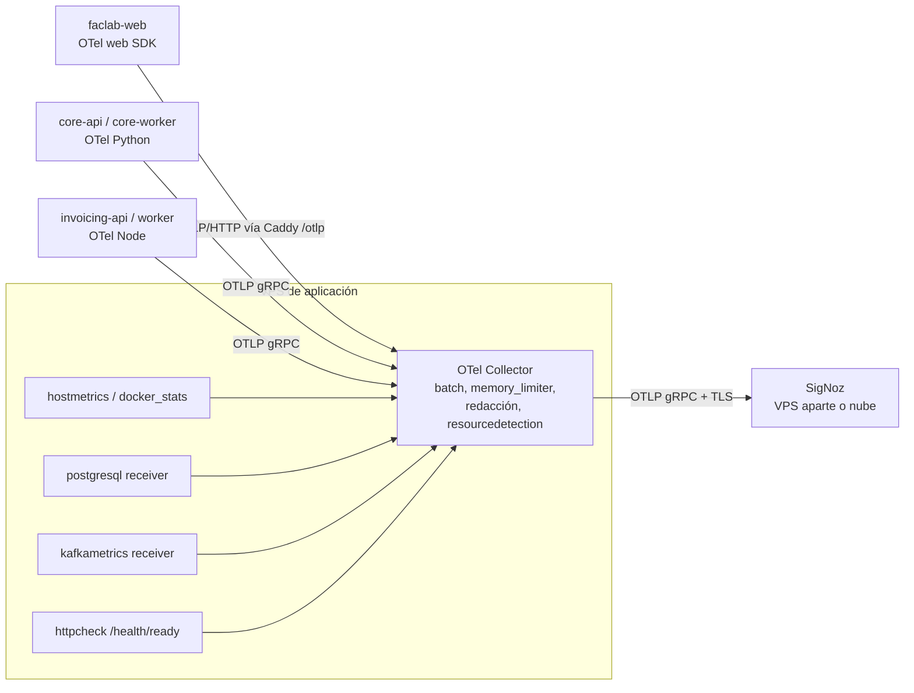

# Observabilidad: estándar y plan

> Decisión base: [ADR-0010](ADR/0010-observabilidad-con-otel-collector-y-signoz.md). Estado actual
> detallado en [CURRENT_STATE.md §6](CURRENT_STATE.md#6-observabilidad) y brechas G-61 a G-71 en
> [GAP_ANALYSIS.md](GAP_ANALYSIS.md).

## 1. Estado actual

Actualizado tras S1.5 (2026-10-15), que corrigió G-61 a G-67 y G-71.

| Aspecto | faclab-core | faclab-invoicing | faclab-web |
|---|---|---|---|
| SDK | OTel Python 1.32 (trazas, métricas y logs por OTLP gRPC) | OTel sdk-node 0.214 | Ninguno |
| Auto-instrumentación | FastAPI (middleware por fuera del de errores, convenciones HTTP estables) y SQLAlchemy del engine de los requests | HTTP, AWS SDK, pino, Fastify | — |
| Spans manuales | `command.*`, `query.*`, `event.publish.*`, `event.handle.*`, `send <tópico>`, `process <tópico>` | `send <tópico>`, `process <tópico>` (también la DLQ), SOAP | — |
| Logs | structlog (JSON fuera de local) + OTLP | pino + OTLP | `console.error` |
| Correlación de logs | `trace_id`, `span_id`, `http.request.id` y `event.name` en cada log | `trace_id` y `span_id` por instrumentación de pino | — |
| Métricas propias | `handler.*` (con `error.kind`), `events.*`, `kafka.*` | `kafka.consumer.*`, `dlq.message.count`, `soap.call.duration` | — |
| Recurso | `service.name`, `service.namespace`, `service.version`, `deployment.environment.name` | Ídem | — |
| Redacción | Lista bloqueada de §4.6 (structlog) | Lista bloqueada de §4.6 (pino) | — |
| Dashboards y alertas | No existen | No existen | — |

Lo que se conserva:

- Las métricas actuales ya evitan etiquetas de alta cardinalidad.
- El `traceparent` viaja por Kafka en ambas direcciones.
- Los spans de handlers y eventos son una buena base.

## 2. Arquitectura

- Los servicios exportan al Collector local por la red interna de Docker; nunca directo a SigNoz.
- El Collector aplica `memory_limiter`, `batch` y el procesador de atributos que borra claves sensibles.
  Después reenvía con TLS.
- El navegador envía OTLP/HTTP a una ruta pública (`/otlp`) que Caddy limita por tamaño y frecuencia.
  Solo se aceptan trazas y logs de la propia aplicación.

## 3. Atributos de recurso (todos los servicios)

| Atributo | Valor | Origen |
|---|---|---|
| `service.name` | `faclab-core-api`, `faclab-core-worker`, `faclab-invoicing-api`, `faclab-invoicing-worker`, `faclab-web` | Variable `OTEL_SERVICE_NAME` |
| `service.namespace` | `faclab` | Fijo |
| `service.version` | Tag semántico o SHA del commit | Variable de build (`SERVICE_VERSION`) |
| `deployment.environment.name` | `local`, `staging`, `production` | Variable de entorno |
| `service.instance.id` | Id del contenedor | `resourcedetection` |

## 4. Logs

### 4.1 Esquema

Logs en JSON fuera de `local`, un objeto por línea. Se usan los nombres de las convenciones de
OpenTelemetry cuando existen y el prefijo `faclab.` para los propios. No se duplican atributos
equivalentes.

| Campo | Obligatorio | Descripción |
|---|---|---|
| `timestamp` | Sí | ISO 8601 en UTC |
| `severity` | Sí | `DEBUG`, `INFO`, `WARN`, `ERROR`, `FATAL` |
| `message` | Sí | Frase legible: qué pasó y, si aplica, qué hacer |
| `event.name` | Sí | Identificador estable `<dominio>.<acción>[.<resultado>]`, por ejemplo `sale.confirmed`, `outbox.publish.failed`, `sri.authorization.rejected`. En el core sale del evento de structlog (`outbox_publish_failed` → `outbox.publish.failed`); un log de otra librería toma el nombre de su logger |
| `service.name`, `service.version`, `deployment.environment.name` | Sí | Del recurso (los agrega el SDK o el Collector) |
| `trace_id`, `span_id` | Si hay span activo | Correlación con trazas |
| `http.request.id` | En HTTP | Id de solicitud (`X-Request-Id`), validado como UUID o generado |
| `faclab.tenant.id` | Si hay contexto | UUID de la empresa (no es dato personal) |
| `faclab.branch.id` | Si aplica | Id de sucursal: el `X-Branch-Id` validado de la solicitud (S2.5), en logs y en el span del request |
| `user.id` | Solo en eventos de seguridad y auditoría | Id interno, nunca usuario ni email |
| `faclab.operation` | En operaciones de negocio | Nombre del comando o consulta, por ejemplo `ConfirmSaleCommand` |
| `duration_ms` | En operaciones medidas | Número |
| `error.type` | En errores | Clase de la excepción |
| `error.code` | En errores de dominio | `error_code` existente (`INSUFFICIENT_STOCK`, `SRI_UNAVAILABLE`…) |
| `exception.message`, `exception.stacktrace` | Solo en ERROR inesperado | Redactados |
| `messaging.system`, `messaging.destination.name`, `messaging.kafka.message.key`, `messaging.message.id` | En mensajería | `kafka`, tópico, clave (empresa), `event_id` |
| `faclab.retry.attempt` | En reintentos | Número de intento |

### 4.2 Niveles

| Nivel | Cuándo |
|---|---|
| `DEBUG` | Detalle de desarrollo. Desactivado en producción |
| `INFO` | Hechos de negocio y del ciclo de vida: venta confirmada, factura autorizada, turno cerrado, servicio iniciado |
| `WARN` | Situación esperada que requiere atención o que se reintentará: error de dominio 4xx, SRI no disponible, reintento de outbox, certificado por vencer |
| `ERROR` | Fallo inesperado o que agotó reintentos: 5xx, mensaje enviado a fallidos, factura rechazada por error de datos |
| `FATAL` | El proceso no puede continuar (configuración inválida al arrancar) |

Regla: un error de dominio (`DomainError` con 4xx) es **WARN**, no ERROR, y no marca el span como
error. Hoy ambos se marcan (G-65).

### 4.3 Mensajes

- Deben responder qué pasó, en qué operación y sobre qué recurso, y qué puede hacer el operador.
  Ejemplo (`outbox_message_failed`, S3.4): `"Could not publish SaleConfirmed to sales.confirmed after 10 attempts; it is failed. Retry it with python -m src.background.cli outbox-retry 42"`. La consola de plataforma (S8.5) lo hará por HTTP.
- Prohibidos: `"Something went wrong"`, `"Error processing request"`, mensajes sin `event.name`.

### 4.4 HTTP

- Una línea por solicitud al terminar, `event.name=http.request.completed`, con:
  - `http.request.method` y `http.route` (plantilla, no URL con ids).
  - `http.response.status_code`, `duration_ms`, `http.request.id`, `faclab.tenant.id`.
- 2xx y 3xx van como INFO, 4xx como WARN y 5xx como ERROR.
- Se excluyen `/health/*` y `/otlp`.
- No se registran cuerpos de solicitud ni de respuesta. Los errores de validación registran solo
  `loc` y `type` de cada error, **nunca `input`** (G-46).
- Se devuelve `X-Request-Id` en la respuesta.

### 4.5 Operaciones asíncronas y Kafka

- Productor: `messaging.publish.succeeded|failed` con tópico, `messaging.message.id` y empresa.
- Consumidor: `messaging.process.succeeded|failed|retried|dead_lettered` con `faclab.retry.attempt`.
- Las tareas periódicas registran inicio y fin por ciclo solo si hicieron trabajo, o en DEBUG.
- Nunca se registra el payload completo de un mensaje (hoy `invoice_message_invalid` lo hace). Solo se
  registran `event_id`, `event_type`, tópico y los errores de validación.

### 4.6 Redacción

Hay tres capas: la aplicación (procesador de structlog o `redact` de pino), el Collector (procesador
`attributes` o `redaction`) y la revisión de código.

Nunca se registran:

- Contraseñas.
- Tokens (`Authorization`, access, refresh, secretos de webhooks y de clientes de integración).
- Claves privadas, `.p12`, contraseñas de certificados o la clave de cifrado.
- Números completos de tarjeta.
- XML firmados o autorizados.
- Cuerpos SOAP.

Datos personales:

- Cédula o RUC de una persona natural: se enmascara (`17******01`). El RUC del emisor puede
  registrarse.
- Email, teléfono y dirección de clientes no se registran.

Lista de claves bloqueadas (insensible a mayúsculas): `password`, `new_password`, `token`,
`refresh_token`, `authorization`, `secret`, `client_secret`, `p12`, `certificate`, `private_key`,
`xml`, `signature`.

### 4.7 Volumen, retención y costos

- Producción con INFO. Se estima una línea por solicitud más eventos de negocio y de error.
- Retención inicial propuesta (D-7): logs 15 días, trazas 7 días, métricas 90 días. Se ajusta con el
  volumen real medido en el piloto.
- Muestreo de logs DEBUG: nunca en producción. Ráfagas de errores repetidos: el Collector puede
  agruparlos, pero no se descartan errores.

## 5. Trazas

### 5.1 Propagación

- W3C Trace Context (`traceparent`, `tracestate`) en HTTP y Kafka. Ya existe en Kafka.
- Navegador → API: la instrumentación de `fetch`/XHR del SDK web inyecta `traceparent` solo hacia los
  dominios propios (`propagateTraceHeaderCorsUrls`). CORS debe permitir el encabezado.
- Kafka:
  - El productor crea un span `send <tópico>` (kind PRODUCER) e **inyecta ese span**; hoy invoicing
    inyecta el contexto activo (G-67).
  - El consumidor crea `process <tópico>` (kind CONSUMER) como hijo del contexto extraído.
  - Cuando procesa en lote, usa *links* en vez de padre.
- Outbox: el relay crea `send <tópico>` como **hijo** del contexto guardado con el mensaje e inyecta su
  propio contexto. Así la venta queda en una sola traza: request → `send sales.confirmed` →
  `process sales.confirmed` → `process invoice` → `send invoices` → `process invoices`.
- Cola de facturación (S4.2): el consumidor de invoicing guarda el contexto del mensaje con la factura
  (`trace_context`) y cada trabajo del worker abre `process invoice` (kind CONSUMER) como **hijo** de
  ese contexto, con las llamadas al SRI dentro; `send invoices` es hijo del trabajo. Un link en vez de padre la partiría
  en dos (decidido en S1.5). Los links quedan para lotes y mensajes fallidos.
- Reintentos y mensajes fallidos: cada intento es un span nuevo con `faclab.retry.attempt`. El envío a
  fallidos crea un span `dead_letter <tópico>` con link al original.

### 5.2 Convenciones de spans

| Operación | Nombre del span | Atributos (además de los estándar) |
|---|---|---|
| Comando | `command <Nombre>` | `faclab.operation`, `faclab.tenant.id`, `faclab.branch.id` |
| Consulta | `query <Nombre>` | Ídem |
| Evento de dominio | `event.publish <Tipo>`, `event.handle <Handler>` | `faclab.event.type` |
| Kafka | `send <tópico>`, `process <tópico>` | `messaging.system=kafka`, `messaging.destination.name`, `messaging.kafka.message.key`, `messaging.message.id` |
| SRI | `sri.recepcion`, `sri.autorizacion` | `faclab.sri.environment` (pruebas o producción), `faclab.sri.status` (RECIBIDA, DEVUELTA, AUTORIZADO, NO AUTORIZADO, EN PROCESO), `error.type` |
| Firma | `invoice.sign` | `faclab.document.type` (factura, nota de crédito) |
| Webhook | `webhook.deliver` | `http.response.status_code`, `faclab.retry.attempt` |
| Base de datos | Automático (SQLAlchemy, pg) | `db.system`, `db.operation.name`; sin parámetros |

Prohibido en atributos de span: datos personales de clientes, montos detallados de un cliente
identificado, XML y claves de acceso completas. El id de venta y el id de factura **sí** pueden ir en
el span (`faclab.sale.id`, `faclab.invoice.id`): sirven para investigar y no son etiquetas de métrica.

### 5.3 Muestreo

- `ParentBased(TraceIdRatioBased(r))` en todos los servicios; `r = 1.0` mientras el volumen lo permita.
- En el core, la raíz no inicia trazas para spans CLIENT sin padre (`SkipBackgroundQueries`): son las
  consultas del relay del outbox y del readiness, cada pocos segundos. Una consulta dentro de un request
  o de un mensaje sigue la decisión de su padre.
- Cuando se necesite reducir costo, se aplica `tail_sampling` en el Collector: 100 % de las trazas con
  error, 100 % de las que superan 1 s y un porcentaje del resto.

## 6. Métricas

### 6.1 Técnicas

| Métrica | Tipo y unidad | Atributos | Origen | Estado |
|---|---|---|---|---|
| `http.server.request.duration` | Histograma, s | `http.request.method`, `http.route`, `http.response.status_code` | Auto (activar `OTEL_SEMCONV_STABILITY_OPT_IN=http`, PV según versión) | Existe con la convención anterior |
| `handler.duration`, `handler.invocations`, `handler.errors` | Histograma ms, contadores | `handler.type`, `handler.name` | Core | Existe; `handler.errors` debe excluir errores de dominio o separarlos con `error.kind=domain|unexpected` |
| `db.client.connection.count` | Gauge | `state` | Pool de SQLAlchemy / pg | Falta |
| `kafka.messages_sent`, `kafka.send_errors`, `kafka.messages_consumed`, `kafka.consume_errors` | Contadores | `messaging.destination.name` | Core | Existe; renombrar a convenciones `messaging.*` |
| `faclab.outbox.pending` | Gauge | `messaging.destination.name` | Core worker | Falta |
| `faclab.outbox.oldest_age` | Gauge, s | `messaging.destination.name` | Core worker | Falta |
| `faclab.outbox.failed` | Gauge | `messaging.destination.name` | Core worker | Falta |
| `faclab.dead_letters.pending` | Gauge | `messaging.destination.name`, `service.name` | Ambos | Falta (invoicing tiene `dlq.message.count` como contador) |
| `kafka.consumer_group.lag` | Gauge | `group`, `topic` | Collector (`kafkametrics`) | Falta |
| `faclab.sri.request.duration` | Histograma, s | `faclab.sri.operation`, `faclab.sri.outcome` | Invoicing | Existe como `soap.call.duration` |
| `faclab.webhooks.deliveries` | Contador | `result` (`success`, `retry`, `failed`) | Core worker | Falta (Etapa 6) |
| `faclab.auth.login.attempts` | Contador | `result` (`success`, `invalid`, `locked`) | Core | Falta |
| Host, contenedores, PostgreSQL | Varias | Estándar de cada receptor | Collector | Falta |

### 6.2 Negocio

| Métrica | Tipo | Atributos (acotados) | Para qué |
|---|---|---|---|
| `faclab.sales.confirmed` | Contador | `faclab.sale.source` (`pos`, `admin`, `api`) | Tráfico de negocio; caída anormal = problema |
| `faclab.sales.failed` | Contador | `error.code` | Ventas que no se pudieron confirmar (stock, pago, validación) |
| `faclab.sales.cancelled`, `faclab.refunds.completed` | Contadores | `faclab.sale.source` | Devoluciones y anulaciones |
| `faclab.inventory.movements` | Contador | `faclab.movement.type`, `faclab.movement.source` | Volumen de inventario |
| `faclab.inventory.stock_rejections` | Contador | `faclab.movement.source` | Intentos de vender sin stock |
| `faclab.invoices.transitions` | Contador | `from`, `to` (estados) | Flujo de facturación |
| `faclab.invoices.pending` | Gauge | `status`, `faclab.issue.type` | Comprobantes sin estado final |
| `faclab.invoices.time_to_final` | Histograma, s | `result` (`authorized`, `rejected`) | Tiempo desde la venta hasta el resultado del SRI |
| `faclab.invoices.rejections` | Contador | `faclab.sri.message.code` (código SRI, acotado) | Rechazos tributarios |
| `faclab.certificates.expiring` | Gauge | `window` (`30d`, `7d`, `expired`) | Cuántos certificados vencen pronto; el detalle por empresa va en un log diario `certificate.expiring` |
| `faclab.reconciliation.discrepancies` | Gauge | `kind` (`confirmed_without_result`, `authorized_on_cancelled`…) | Operaciones que requieren conciliación |

**Prohibido como etiqueta de métrica:** ids de venta, factura, usuario, cliente, producto o empresa.
Excepción evaluada y rechazada: certificados por empresa (se resuelve con conteos por ventana más un
log con el detalle).

## 7. Dashboards

> Se implementan en S7.5 como JSON en `faclab-infra/observability/signoz/dashboards/`. Antes de
> construirlos se verifica qué paneles, variables y tipos de consulta soporta la versión de SigNoz
> desplegada. El compose del clon local referencia v0.118.0; está pendiente de validar al desplegar.
> SigNoz ya genera métricas RED (solicitudes, errores y duración) por servicio a partir de los spans;
> los dashboards se enfocan en lo que esa vista no muestra.

| # | Dashboard | Propósito y decisión que habilita | Paneles principales | Filtros | Umbrales visuales | Acción recomendada |
|---|---|---|---|---|---|---|
| 1 | **Ecosistema** | ¿Está sano el sistema ahora? | Disponibilidad por servicio (httpcheck); tasa de 5xx; p95 por servicio; outbox más antiguo; facturas pendientes; mensajes fallidos | Entorno | Rojo si un servicio no responde, 5xx > 5 %, outbox > 15 min | Abrir el dashboard específico |
| 2 | **API Core** | ¿Qué endpoint o dependencia degrada la experiencia? | Solicitudes por ruta; p50/p95/p99 por ruta; 4xx vs 5xx por ruta; `handler.duration` por comando; duración de consultas SQL; conexiones del pool | Entorno, ruta, método | p95 de rutas POS > 1,5 s | Ver trazas lentas de esa ruta |
| 3 | **Kafka y mensajería** | ¿Fluyen los mensajes entre servicios? | Producidos y consumidos por tópico; lag por grupo; outbox pendiente y edad; reintentos; mensajes fallidos por tópico | Tópico, grupo | Lag creciente 10 min; edad > 5 min | Revisar consumidor, mensajes fallidos y reprocesar |
| 4 | **Facturación electrónica** | ¿Se están autorizando los comprobantes a tiempo? | Transiciones por estado; pendientes por estado y causa (`issue`); tiempo a resultado p50/p95; rechazos por código SRI; latencia y errores del SRI por operación; certificados por vencer | Entorno, ambiente SRI | Pendientes > 30 min; rechazos > 5 % | Ver issues; contactar al emisor; revisar estado del SRI |
| 5 | **Base de datos e infraestructura** | ¿Hay saturación de recursos? | CPU, memoria y disco del host; contenedores; conexiones de PostgreSQL, bloqueos y duración de transacciones; tamaño de las bases; memoria de Kafka | Host, contenedor | Disco > 80 %; conexiones > 80 % del máximo | Ampliar recursos, revisar consultas |
| 6 | **Calidad de operaciones** | ¿Qué operaciones de negocio necesitan intervención? | Ventas fallidas por código; rechazos de stock; discrepancias de conciliación; devoluciones y anulaciones; entregas de webhooks fallidas; intentos de login bloqueados | Entorno | Discrepancias > 0 | Usar el listado de conciliación y reprocesar |

Cada panel documenta en su descripción: consulta, unidad, umbral y acción.

## 8. Alertas

Los umbrales son **iniciales y provisionales**: hay que fijar una línea base con el tráfico del piloto
(S9.2) y ajustarlos. Cada alerta enlaza a un runbook en `faclab-infra/observability/runbooks/`.

| Alerta | Condición inicial | Severidad | Acción |
|---|---|---|---|
| Servicio no disponible | `/health/ready` falla 2 min seguidos | Crítica | Revisar contenedor, logs de arranque y dependencias |
| Errores 5xx sostenidos | > 2 % durante 10 min con al menos 20 solicitudes | Advertencia (> 5 %: crítica) | Trazas con error del servicio |
| Latencia del POS | p95 de rutas `/api/pos/sales*` > 1,5 s durante 10 min | Advertencia | Dashboard 2 y consultas lentas |
| Outbox atascado | Mensaje pendiente más antiguo > 5 min (crítica > 15 min) | Advertencia | Revisar worker y Kafka; mensajes `failed` |
| Consumidor detenido | Lag sin bajar durante 10 min con mensajes nuevos | Crítica | Revisar worker del consumidor |
| Mensajes fallidos nuevos | Más de 0 en 15 min | Advertencia | Inspeccionar y reprocesar |
| Facturas atascadas | Comprobantes no finales con más de 30 min | Advertencia | Ver causa (`issue`), estado del SRI y del emisor |
| SRI no disponible | > 50 % de llamadas fallidas durante 10 min | Advertencia | Confirmar caída del SRI; los reintentos son automáticos |
| Aumento de rechazos | > 3 rechazos en 1 h o > 5 % | Advertencia | Revisar códigos de rechazo y datos de la empresa |
| Certificado por vencer | `faclab.certificates.expiring{window=30d}` > 0 (diaria); `7d` crítica | Advertencia o crítica | Avisar a la empresa |
| Conciliación | Discrepancias > 0 durante 30 min | Advertencia | Listado de conciliación |
| Disco | > 80 % (crítica > 90 %) | Advertencia | Liberar o ampliar; revisar retención |
| Conexiones PostgreSQL | > 80 % de `max_connections` | Advertencia | Revisar pool y fugas |
| Ausencia de telemetría | Sin spans de un servicio durante 10 min en horario comercial | Advertencia | Revisar Collector y exportador |
| Fuerza bruta | > 50 logins fallidos en 5 min | Advertencia | Revisar IPs; ajustar bloqueo |

Canales: correo y un canal de mensajería (por definir). Las críticas despiertan a alguien. Las
advertencias se revisan en horario laboral.

## 9. Estándar por tecnología

### 9.1 Python (faclab-core)

Implementado en S1.5 (`src/shared/infra/adapters/telemetry.py`, `logging.py`, `middlewares.py`):
`OpenTelemetry.setup()` antes del engine y de la app, `instrument_app()` después de los middlewares,
`OTEL_SEMCONV_STABILITY_OPT_IN=http` por defecto y `RequestIdMiddleware`. En JSON, cada línea lleva
además `service.name`, `service.version` y `deployment.environment.name`, y la traza de las excepciones.

- Paquetes `opentelemetry-*` alineados en una sola versión.
- Inicialización:
  - Configurar los proveedores **antes** de crear el engine y la app.
  - Instrumentar el engine concreto: `SQLAlchemyInstrumentor().instrument(engine=engine)`.
  - Instrumentar FastAPI de modo que el middleware de OTel quede **por fuera** del middleware de
    errores, para que este vea el span activo y la respuesta final tenga código HTTP.
- structlog:
  1. `merge_contextvars`.
  2. Procesador que lee el span activo con `trace.get_current_span()` y agrega `trace_id` y `span_id`.
     No depende de `_record`.
  3. Procesador de redacción.
  4. `JSONRenderer` fuera de local.
- Contexto: `bind_contextvars(tenant_id=..., branch_id=..., request_id=...)` al entrar en cada solicitud,
  mensaje o tarea, y limpieza al salir.
- Exportador con TLS configurable (`OTEL_EXPORTER_OTLP_INSECURE`: verdadero por defecto solo en local).
- `shutdown()` en el lifespan, como ya existe.

### 9.2 Node (faclab-invoicing)

Implementado en S1.5. La redacción usa `formatters.log` de pino en vez de `redact`: compara las claves sin
distinguir mayúsculas y a cualquier profundidad, igual que el core, y corre antes de serializar, así que
también cubre lo que la instrumentación de pino envía por OTLP. `sdk.shutdown()` espera como máximo 5 s.

- `@opentelemetry/sdk-node` con `service.version` del build, no fijo.
- pino con `redact` para las claves de la lista bloqueada.
- `sdk.shutdown()` antes de `process.exit`.
- Spans de Kafka con kind PRODUCER y CONSUMER e inyección del span del productor.
- Recurso y nombres de atributos idénticos a los de Python.

### 9.3 Navegador (faclab-web)

- `@opentelemetry/sdk-trace-web` con instrumentación de `fetch`/XHR y carga de documento.
- Exportador OTLP/HTTP al endpoint público `/otlp`.
- Reporte de errores no controlados desde el `ErrorBoundary`, como log o span de error, sin datos del
  formulario.
- Web vitals (LCP, INP, CLS) como métricas agregadas por ruta.
- Mostrar el `requestId` en los mensajes de error para facilitar el soporte (ya se recibe en `ApiError`).

## 10. Observabilidad en pruebas y entrega

- **Pruebas:**
  - Exportador en memoria en las pruebas de integración de flujos críticos: venta POS, publicación al
    outbox, consumo de `invoices`, firma y envío al SRI simulado.
  - Las pruebas verifican que existen los spans esperados, con sus atributos y la correlación padre e
    hijo, y que los logs llevan `trace_id` y `event.name`.
- **Redacción:** prueba que envía una contraseña inválida y verifica que no aparece en la salida del
  log.
- **CI:** se verifica que la configuración de producción tenga `service.version` y endpoint del
  Collector.
- **Definición de terminado** (plantilla de PR):
  - Logs con `event.name`.
  - Métricas de las operaciones nuevas.
  - Spans de las rutas críticas.
  - Dashboard o alerta si el cambio introduce un modo de fallo nuevo.

### 10.1 SigNoz local

`faclab-infra/scripts/signoz.sh up` levanta SigNoz (v0.118.0) y une su collector a `faclab_network`. Los
contenedores exportan a `http://signoz-otel-collector:4317` y los procesos del host a
`http://localhost:4317`. La primera vez hay que crear la cuenta de administrador en
`http://localhost:8080`: hasta entonces SigNoz no le entrega configuración al collector y nada escucha
en 4317.

## 11. Implementación por sesiones

| Sesión | Alcance |
|---|---|
| S1.5 | Corregir correlación, middleware, SQL, recurso, sampler, niveles, redacción, spans de Kafka, apagado de invoicing; SigNoz local conectado a `faclab_network` (terminada 2026-10-15) |
| S7.1 | Métricas técnicas y de negocio del core (outbox, fallidos, ventas, inventario, login) |
| S7.2 | Métricas y trazas de facturación (SRI, transiciones, tiempo a resultado, certificados) |
| S7.3 | SDK web, errores de interfaz y web vitals |
| S7.4 | Collector con receptores de host, Docker, PostgreSQL, Kafka y httpcheck |
| S7.5 | Dashboards y alertas como código, con runbooks |
| S7.6 | Pruebas de observabilidad y definición de terminado |
| S8.6 | Despliegue y operación de SigNoz (versión fijada, accesos, retención, respaldos) |
