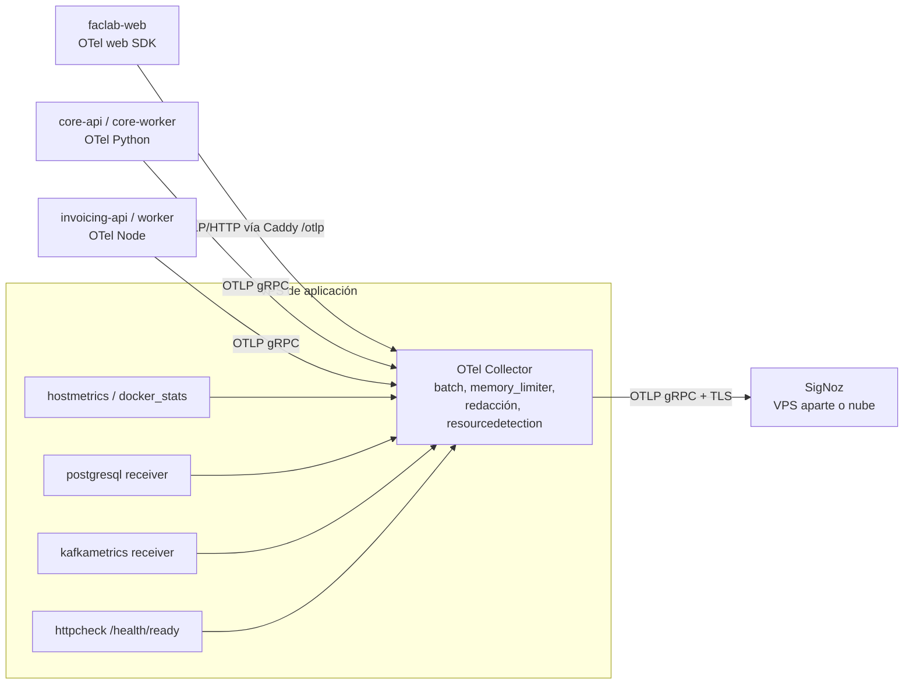

# Observabilidad: estándar y plan

> Decisión base: [ADR-0010](ADR/0010-observabilidad-con-otel-collector-y-signoz.md). Estado actual
> detallado en [CURRENT_STATE.md §6](CURRENT_STATE.md#6-observabilidad) y brechas G-61 a G-71 en
> [GAP_ANALYSIS.md](GAP_ANALYSIS.md).

## 1. Estado actual

Actualizado tras S1.5 (2026-10-15), que corrigió G-61 a G-67 y G-71; S7.1 (2026-11-21), que agregó
las métricas del core (G-68); S7.2 (2026-11-21), que agregó las de facturación (G-68) y el aviso de
certificados por vencer (G-23), y S7.3 (2026-11-21), que agregó la telemetría del navegador (G-69).

| Aspecto | faclab-core | faclab-invoicing | faclab-web |
|---|---|---|---|
| SDK | OTel Python 1.32 (trazas, métricas y logs por OTLP gRPC) | OTel sdk-node 0.214 | OTel web 2.12 (trazas y métricas por OTLP/HTTP a `/otlp`), en un chunk que solo se carga con `otelEnabled`; apagado por defecto (§9.3) |
| Auto-instrumentación | FastAPI (middleware por fuera del de errores, convenciones HTTP estables) y SQLAlchemy del engine de los requests | HTTP, AWS SDK, pino, Fastify | Carga del documento, XHR (axios) y fetch, con `traceparent` solo hacia el core y la facturación |
| Spans manuales | `command.*`, `query.*`, `event.publish.*`, `event.handle.*`, `send <tópico>`, `process <tópico>` | `send <tópico>`, `process <tópico>`, `process invoice`, `deliver invoice`, `sri.recepcion`, `sri.autorizacion`, `invoice.sign` | `ui.error` |
| Logs | structlog (JSON fuera de local) + OTLP | pino + OTLP | `console.error`; los errores de interfaz van como spans `ui.error` |
| Correlación de logs | `trace_id`, `span_id`, `http.request.id` y `event.name` en cada log | `trace_id` y `span_id` por instrumentación de pino | La traza de cada llamada continúa en el core y la facturación; los avisos de error muestran el `requestId` |
| Métricas propias | `handler.*` (con `error.kind`), `events.*`, `messaging.*`, colas (`faclab.outbox.*`, `faclab.dead_letters.pending`), pool, login, ventas, inventario, conciliación y webhooks (§6) | `messaging.*`, `faclab.dead_letters.pending`, SRI, comprobantes (transiciones, pendientes, tiempo a resultado, rechazos, pasos, cola), entregas y certificados (§6) | `faclab.web_vitals.lcp`, `.inp` y `.cls` por ruta (§6.3) |
| Recurso | `service.name`, `service.namespace`, `service.version`, `deployment.environment.name` | Ídem | Ídem, sin `service.instance.id` |
| Redacción | Lista bloqueada de §4.6 (structlog) | Lista bloqueada de §4.6 (pino) | Valores del query string de cada URL; de un `ApiError`, el mensaje del servidor (§9.3) |
| Dashboards y alertas | No existen | No existen | — |

Lo que se conserva:

- Las métricas actuales ya evitan etiquetas de alta cardinalidad.
- El `traceparent` viaja por Kafka en ambas direcciones.
- Los spans de handlers y eventos son una buena base.

## 2. Arquitectura

- Los servicios exportan al Collector local por la red interna de Docker; nunca directo a SigNoz.
- El Collector aplica `memory_limiter`, `batch` y el procesador de atributos que borra claves sensibles.
  Después reenvía con TLS.
- El navegador envía OTLP/HTTP a una ruta pública (`/otlp`) que Caddy limita por tamaño y frecuencia.
  Solo se aceptan trazas y logs de la propia aplicación.
  - `/otlp` es del mismo origen que la aplicación, así que el Collector no necesita CORS.
  - En local lo sirve el servidor de Vite, que lo reenvía al OTLP/HTTP de SigNoz (S7.3, §10.1).
  - En producción la ruta y sus límites quedan para S8.1 (Caddy) y S7.4 (receptor del Collector).

## 3. Atributos de recurso (todos los servicios)

| Atributo | Valor | Origen |
|---|---|---|
| `service.name` | `faclab-core-api`, `faclab-core-worker`, `faclab-invoicing-api`, `faclab-invoicing-worker`, `faclab-web` | Variable `OTEL_SERVICE_NAME` |
| `service.namespace` | `faclab` | Fijo |
| `service.version` | Tag semántico o SHA del commit | Variable de build (`SERVICE_VERSION`) |
| `deployment.environment.name` | `local`, `staging`, `production` | Variable de entorno |
| `service.instance.id` | Id del contenedor | `resourcedetection` |

## 4. Logs

### 4.1 Esquema

Logs en JSON fuera de `local`, un objeto por línea. Se usan los nombres de las convenciones de
OpenTelemetry cuando existen y el prefijo `faclab.` para los propios. No se duplican atributos
equivalentes.

| Campo | Obligatorio | Descripción |
|---|---|---|
| `timestamp` | Sí | ISO 8601 en UTC |
| `severity` | Sí | `DEBUG`, `INFO`, `WARN`, `ERROR`, `FATAL` |
| `message` | Sí | Frase legible: qué pasó y, si aplica, qué hacer |
| `event.name` | Sí | Identificador estable `<dominio>.<acción>[.<resultado>]`, por ejemplo `sale.confirmed`, `outbox.publish.failed`, `sri.authorization.rejected`. En el core sale del evento de structlog (`outbox_publish_failed` → `outbox.publish.failed`); un log de otra librería toma el nombre de su logger |
| `service.name`, `service.version`, `deployment.environment.name` | Sí | Del recurso (los agrega el SDK o el Collector) |
| `trace_id`, `span_id` | Si hay span activo | Correlación con trazas |
| `http.request.id` | En HTTP | Id de solicitud (`X-Request-Id`), validado como UUID o generado |
| `faclab.tenant.id` | Si hay contexto | UUID de la empresa (no es dato personal) |
| `faclab.branch.id` | Si aplica | Id de sucursal: el `X-Branch-Id` validado de la solicitud (S2.5), en logs y en el span del request |
| `user.id` | Solo en eventos de seguridad y auditoría | Id interno, nunca usuario ni email |
| `faclab.operation` | En operaciones de negocio | Nombre del comando o consulta, por ejemplo `ConfirmSaleCommand` |
| `duration_ms` | En operaciones medidas | Número |
| `error.type` | En errores | Clase de la excepción |
| `error.code` | En errores de dominio | `error_code` existente (`INSUFFICIENT_STOCK`, `SRI_UNAVAILABLE`…) |
| `exception.message`, `exception.stacktrace` | Solo en ERROR inesperado | Redactados |
| `messaging.system`, `messaging.destination.name`, `messaging.kafka.message.key`, `messaging.message.id` | En mensajería | `kafka`, tópico, clave (empresa), `event_id` |
| `faclab.retry.attempt` | En reintentos | Número de intento |

### 4.2 Niveles

| Nivel | Cuándo |
|---|---|
| `DEBUG` | Detalle de desarrollo. Desactivado en producción |
| `INFO` | Hechos de negocio y del ciclo de vida: venta confirmada, factura autorizada, turno cerrado, servicio iniciado |
| `WARN` | Situación esperada que requiere atención o que se reintentará: error de dominio 4xx, SRI no disponible, reintento de outbox, certificado por vencer |
| `ERROR` | Fallo inesperado o que agotó reintentos: 5xx, mensaje enviado a fallidos, factura rechazada por error de datos |
| `FATAL` | El proceso no puede continuar (configuración inválida al arrancar) |

Regla: un error de dominio (`DomainError` con 4xx) es **WARN**, no ERROR, y no marca el span como
error. Hoy ambos se marcan (G-65).

### 4.3 Mensajes

- Deben responder qué pasó, en qué operación y sobre qué recurso, y qué puede hacer el operador.
  Ejemplo (`outbox_message_failed`, S3.4): `"Could not publish SaleConfirmed to sales.confirmed after 10 attempts; it is failed. Retry it with python -m src.background.cli outbox-retry 42"`. La consola de plataforma (S8.5) lo hará por HTTP.
- Prohibidos: `"Something went wrong"`, `"Error processing request"`, mensajes sin `event.name`.

### 4.4 HTTP

- Una línea por solicitud al terminar, `event.name=http.request.completed`, con:
  - `http.request.method` y `http.route` (plantilla, no URL con ids).
  - `http.response.status_code`, `duration_ms`, `http.request.id`, `faclab.tenant.id`.
- 2xx y 3xx van como INFO, 4xx como WARN y 5xx como ERROR.
- Se excluyen `/health/*` y `/otlp`.
- No se registran cuerpos de solicitud ni de respuesta. Los errores de validación registran solo
  `loc` y `type` de cada error, **nunca `input`** (G-46).
- Se devuelve `X-Request-Id` en la respuesta.

### 4.5 Operaciones asíncronas y Kafka

- Productor: `messaging.publish.succeeded|failed` con tópico, `messaging.message.id` y empresa.
- Consumidor: `messaging.process.succeeded|failed|retried|dead_lettered` con `faclab.retry.attempt`.
- Las tareas periódicas registran inicio y fin por ciclo solo si hicieron trabajo, o en DEBUG.
- Nunca se registra el payload completo de un mensaje (hoy `invoice_message_invalid` lo hace). Solo se
  registran `event_id`, `event_type`, tópico y los errores de validación.

### 4.6 Redacción

Hay tres capas: la aplicación (procesador de structlog o `redact` de pino), el Collector (procesador
`attributes` o `redaction`) y la revisión de código.

Nunca se registran:

- Contraseñas.
- Tokens (`Authorization`, access, refresh, secretos de webhooks y de clientes de integración).
- Claves privadas, `.p12`, contraseñas de certificados o la clave de cifrado.
- Números completos de tarjeta.
- XML firmados o autorizados.
- Cuerpos SOAP.

Datos personales:

- Cédula o RUC de una persona natural: se enmascara (`17******01`). El RUC del emisor puede
  registrarse.
- Email, teléfono y dirección de clientes no se registran.

Lista de claves bloqueadas (insensible a mayúsculas): `password`, `new_password`, `token`,
`refresh_token`, `authorization`, `secret`, `client_secret`, `p12`, `certificate`, `private_key`,
`xml`, `signature`.

### 4.7 Volumen, retención y costos

- Producción con INFO. Se estima una línea por solicitud más eventos de negocio y de error.
- Retención inicial propuesta (D-7): logs 15 días, trazas 7 días, métricas 90 días. Se ajusta con el
  volumen real medido en el piloto.
- Muestreo de logs DEBUG: nunca en producción. Ráfagas de errores repetidos: el Collector puede
  agruparlos, pero no se descartan errores.

## 5. Trazas

### 5.1 Propagación

- W3C Trace Context (`traceparent`, `tracestate`) en HTTP y Kafka. Ya existe en Kafka.
- Navegador → API (S7.3):
  - La instrumentación de `fetch`/XHR del SDK web inyecta `traceparent` y `tracestate` solo hacia los
    orígenes de `apiBaseUrl` e `invoicingApiUrl` (`propagateTraceHeaderCorsUrls`).
  - Core e invoicing los aceptan en CORS. Ambos devuelven en el preflight los encabezados que pide el
    navegador: `allow_headers=["*"]` en el core, `@fastify/cors` sin `allowedHeaders` en invoicing.
    `test_http_observability.py` y `test/http/cors.test.ts` lo fijan.
  - Los dos continúan la traza: el span XHR del navegador es la raíz y `POST /api/pos/sales/quick` su
    hijo, con el resto de la venta debajo.
  - Con `ParentBased`, la decisión de muestreo del navegador manda en las solicitudes que él inicia.
- Kafka:
  - El productor crea un span `send <tópico>` (kind PRODUCER) e **inyecta ese span**; hoy invoicing
    inyecta el contexto activo (G-67).
  - El consumidor crea `process <tópico>` (kind CONSUMER) como hijo del contexto extraído.
  - Cuando procesa en lote, usa *links* en vez de padre.
- Outbox: el relay crea `send <tópico>` como **hijo** del contexto guardado con el mensaje e inyecta su
  propio contexto. Así la venta queda en una sola traza: request → `send sales.confirmed` →
  `process sales.confirmed` → `process invoice` → `send invoices` → `process invoices`.
- Cola de facturación (S4.2): el consumidor de invoicing guarda el contexto del mensaje con la factura
  (`trace_context`) y cada trabajo del worker abre `process invoice` (kind CONSUMER) como **hijo** de
  ese contexto, con las llamadas al SRI dentro; `send invoices` es hijo del trabajo. Un link en vez de padre la partiría
  en dos (decidido en S1.5). Los links quedan para lotes y mensajes fallidos.
- Reintentos y mensajes fallidos: cada intento es un span nuevo con `faclab.retry.attempt`. El envío a
  fallidos crea un span `dead_letter <tópico>` con link al original.

### 5.2 Convenciones de spans

| Operación | Nombre del span | Atributos (además de los estándar) |
|---|---|---|
| Comando | `command <Nombre>` | `faclab.operation`, `faclab.tenant.id`, `faclab.branch.id` |
| Consulta | `query <Nombre>` | Ídem |
| Evento de dominio | `event.publish <Tipo>`, `event.handle <Handler>` | `faclab.event.type` |
| Kafka | `send <tópico>`, `process <tópico>` | `messaging.system=kafka`, `messaging.destination.name`, `messaging.kafka.message.key`, `messaging.message.id` |
| SRI | `sri.recepcion`, `sri.autorizacion` (kind CLIENT, S7.2) | `faclab.sri.environment` (`pruebas`, `produccion`), `faclab.sri.status` (RECIBIDA, DEVUELTA, AUTORIZADO, NO AUTORIZADO, EN PROCESO; sin autorización todavía = EN PROCESO), `error.type` (`timeout` o la clase del error cuando no hubo respuesta); además `rpc.system=soap`, `rpc.method`, `server.address`. El cliente SOAP ya no abre su propio span |
| Firma | `invoice.sign` (S7.2) | `faclab.document.type` (`invoice`, `credit_note`), `error.type` (el código del error tipado, por ejemplo `CERTIFICATE_EXPIRED`) |
| Webhook | `webhook.deliver` | `http.response.status_code`, `faclab.retry.attempt` |
| Navegador: carga | `documentLoad`, `documentFetch` y `resourceFetch` (instrumentación de carga, S7.3) | `faclab.ui.route`, `url.full` |
| Navegador: llamada | El método (`POST`), kind CLIENT, con un hijo `CORS Preflight` cuando hubo preflight (XHR y fetch, S7.3) | `faclab.ui.route`, `url.full`, `http.response.status_code` |
| Error de interfaz | `ui.error` (S7.3), con estado ERROR y evento `exception` | `faclab.ui.route`, `faclab.error.source` (`boundary`, `window`, `unhandledrejection`), `error.type`, `faclab.react.component_stack`; de un `ApiError`: `faclab.error.code`, `http.response.status_code` y `http.request.id`, sin el mensaje |
| Base de datos | Automático (SQLAlchemy, pg) | `db.system`, `db.operation.name`; sin parámetros |

`faclab.ui.route` es el patrón de la ruta (`/sales/:id`), nunca la URL, y las URLs del navegador van sin
los valores de su query string (`?search=REDACTED`).

Prohibido en atributos de span: datos personales de clientes, montos detallados de un cliente
identificado, XML y claves de acceso completas. El id de venta y el id de factura **sí** pueden ir en
el span (`faclab.sale.id`, `faclab.invoice.id`): sirven para investigar y no son etiquetas de métrica.

### 5.3 Muestreo

- `ParentBased(TraceIdRatioBased(r))` en todos los servicios; `r = 1.0` mientras el volumen lo permita.
- En el core, la raíz no inicia trazas para spans CLIENT sin padre (`SkipBackgroundQueries`): son las
  consultas del relay del outbox y del readiness, cada pocos segundos. Una consulta dentro de un request
  o de un mensaje sigue la decisión de su padre.
- Cuando se necesite reducir costo, se aplica `tail_sampling` en el Collector: 100 % de las trazas con
  error, 100 % de las que superan 1 s y un porcentaje del resto.

## 6. Métricas

### 6.1 Técnicas

| Métrica | Tipo y unidad | Atributos | Origen | Estado |
|---|---|---|---|---|
| `http.server.request.duration` | Histograma, s | `http.request.method`, `http.route`, `http.response.status_code` | Auto (`OTEL_SEMCONV_STABILITY_OPT_IN=http`, que fija S1.5) | Existe con la convención estable; una prueba lo fija (S7.1) |
| `handler.duration`, `handler.invocations`, `handler.errors` | Histograma ms, contadores | `handler.type`, `handler.name`; `handler.errors` además `error.kind` (`domain`, `unexpected`) | Core | Existe (la separación por `error.kind` la hizo S1.5) |
| `db.client.connection.count` | Up-down counter observable, `{connection}` | `db.client.connection.pool.name` (`request`: el motor de las unidades de trabajo, los requests del API y los scopes de las tareas del worker; `app`; `worker`), `db.client.connection.state` (`idle`, `used`) | Core, cada pool de SQLAlchemy (los de SQLite no cuentan conexiones) | Existe (S7.1). Reemplaza el `db.client.connections.usage` obsoleto de la instrumentación, que nombraba el pool por la URL de la base |
| `messaging.client.sent.messages` | Contador, `{message}` | `messaging.system`, `messaging.operation.name`, `messaging.destination.name`; `error.type` en un envío fallido | Core (relay) e invoicing (productor de `invoices` y `credit_notes.results`) | Existe (S7.1 en el core; S7.2 en invoicing); reemplaza `kafka.messages_sent` y `kafka.send_errors` |
| `messaging.process.duration` | Histograma, s | `messaging.system`, `messaging.operation.name`, `messaging.destination.name`, `messaging.consumer.group.name`; `error.type` si el handler falló | Core e invoicing (consumidores), por intento | Existe (S7.1 en el core; S7.2 en invoicing, que reemplaza `kafka.consumer.message.*` y `kafka.consumer.retry.count`); reemplaza `kafka.messages_consumed` y `kafka.consume_errors` |
| `faclab.outbox.pending` | Gauge observable, `{message}` | `messaging.destination.name` | Core worker (`queue_metrics`) | Existe (S7.1) |
| `faclab.outbox.oldest_age` | Gauge observable, s | `messaging.destination.name` | Core worker (`queue_metrics`) | Existe (S7.1); 0 sin pendientes |
| `faclab.outbox.failed` | Gauge observable, `{message}` | `messaging.destination.name` | Core worker (`queue_metrics`) | Existe (S7.1) |
| `faclab.dead_letters.pending` | Gauge observable, `{message}` | `messaging.destination.name` (`service.name` va en el recurso) | Ambos | Existe en el core (S7.1, `queue_metrics`) y en invoicing (S7.2, el muestreo del worker sobre su tabla `dead_letters`; reemplaza el contador `dlq.message.count`) |
| `kafka.consumer_group.lag` | Gauge | `group`, `topic` | Collector (`kafkametrics`) | Falta |
| `faclab.sri.request.duration` | Histograma, s | `faclab.sri.operation` (`recepcion`, `autorizacion`), `faclab.sri.outcome` (`ok`, `timeout`, `error`), `faclab.sri.environment` (`pruebas`, `produccion`) | Invoicing (adaptadores SRI) | Existe (S7.2); reemplaza `soap.call.duration`. `faclab.sri.environment` se agregó para el filtro del dashboard 4. `error` es una llamada sin respuesta: un DEVUELTA es `ok` y se cuenta en `faclab.invoices.rejections` |
| `faclab.invoices.step.duration` | Histograma, s | `faclab.invoice.step` (`prepare`, `sign`, `send`, `authorize`), `faclab.step.outcome` (`advanced`, `blocked`, `invalid`, `retry`, `conflict`), `faclab.document.type` | Invoicing (decorador de los pasos) | Existe (S7.2, lo que S4.2 dejó pendiente). El resultado es la clase del issue que deja el paso |
| `faclab.invoices.due` | Gauge observable, `{document}` | — | Invoicing worker (muestreo) | Existe (S7.2): filas de la cola vencidas que nadie tiene; un valor que crece indica pocos workers |
| `faclab.invoices.expired_leases` | Gauge observable, `{document}` | — | Invoicing worker (muestreo) | Existe (S7.2): retenidas por un worker cuyo lease venció (un worker que murió) |
| `faclab.invoices.deliveries` | Contador, `{delivery}` | `result` (`sent`, `bounced`, `retry`, `failed`, `no_recipient`, `disabled`) | Invoicing (worker de entregas) | Existe (S7.2, lo que S4.4 dejó pendiente) |
| `faclab.invoices.pending_deliveries` | Gauge observable, `{delivery}` | — | Invoicing worker (muestreo) | Existe (S7.2) |
| `faclab.webhooks.deliveries` | Contador, `{delivery}` | `result` (`delivered`, `retry`, `failed`) | Core worker | Existe (S6.4) |
| `faclab.auth.login.attempts` | Contador, `{attempt}` | `result` (`success`, `invalid`, `locked`, `no_tenant`) | Core (ruta de login) | Existe (S7.1). `no_tenant`: contraseña correcta, pero sin ninguna empresa activa (ni éxito ni fuerza bruta) |
| Host, contenedores, PostgreSQL | Varias | Estándar de cada receptor | Collector | Falta |

### 6.2 Negocio

| Métrica | Tipo | Atributos (acotados) | Para qué |
|---|---|---|---|
| `faclab.sales.confirmed` | Contador | `faclab.sale.source` (`pos`, `api`; toda venta se hace en el POS o en la API pública desde S5.5) | Tráfico de negocio; caída anormal = problema. Existe (S7.1): cuenta al confirmarse la transacción |
| `faclab.sales.failed` | Contador | `error.code`, `faclab.sale.source` | Ventas que no se pudieron confirmar (stock, pago, validación). Existe (S7.1): venta rápida, confirmar y venta de la API; un error inesperado va como `INTERNAL_ERROR`. `faclab.sale.source` se agregó porque los fallos de integradores y de cajeros son poblaciones distintas |
| `faclab.sales.cancelled`, `faclab.refunds.completed` | Contadores | `faclab.sale.source` | Devoluciones y anulaciones. Existen (S7.1); `cancelled` solo cuenta ventas confirmadas que se anulan (descartar un borrador no es una anulación) |
| `faclab.inventory.movements` | Contador | `faclab.movement.type` (`in`, `out`), `faclab.movement.source` | Volumen de inventario. Existe (S7.1): se cuenta en el repositorio de movimientos, por donde escriben los documentos y `TerminalStock` |
| `faclab.inventory.stock_rejections` | Contador | `faclab.movement.source` | Intentos de vender sin stock. Existe (S7.1): ventas (`sale`), reserva de una transferencia (`transfer`) y la salida de cualquier otro documento en el handler de movimientos |
| `faclab.invoices.transitions` | Contador | `from`, `to` (estados), `faclab.document.type` | Flujo de facturación. Existe (S7.2): cuenta cada cambio de estado que un paso guardó, en el worker y en el reintento manual |
| `faclab.invoices.pending` | Gauge observable | `status`, `faclab.issue.type` (el código del issue, `none` o `other`), `faclab.document.type` | Comprobantes sin estado final. Existe (S7.2): el worker lo muestrea cada `WORKER_METRICS_INTERVAL_MS` (60 s) en todas las empresas; cada estado de cada tipo reporta, en 0 si no hay |
| `faclab.invoices.oldest_age` | Gauge observable, s | `status` | Edad del comprobante sin estado final más antiguo (desde que llegó); 0 sin pendientes. Existe (S7.2), para la alerta de facturas atascadas |
| `faclab.invoices.time_to_final` | Histograma, s | `result` (`authorized`, `rejected`), `faclab.document.type` | Tiempo desde la venta hasta el resultado del SRI. Existe (S7.2): desde el `occurred_at` del mensaje (`requested_at`: la confirmación o un reenvío) hasta el estado final; los anteriores a S4.1, desde que llegaron |
| `faclab.invoices.rejections` | Contador | `faclab.sri.message.code` (identificador SRI de 1 a 4 dígitos, `other` o `none`), `faclab.sri.operation` | Rechazos tributarios. Existe (S7.2): DEVUELTA (salvo los 43 y 70 de una clave que el SRI ya tiene) y NO AUTORIZADO, con el código del primer error. Los rechazos antes del SRI (consumidor final sobre el límite, nota de crédito sin factura) solo se ven en `faclab.invoices.transitions` desde `pending` |
| `faclab.certificates.expiring` | Gauge observable | `window` (`30d`, `7d`, `expired`) | Cuántos certificados vencen pronto; el detalle por empresa va en un log diario `certificate.expiring`. Existe (S7.2): solo el certificado que cada emisor seleccionó; ventanas exclusivas (`7d`: hasta 7 días; `30d`: de 8 a 30); se muestrea con las demás para que una renovación se vea enseguida, y el log (WARN `certificate.expiring`, ERROR `certificate.expired`, sin el sujeto del certificado) sale al arrancar el worker y cada 24 h |
| `faclab.reconciliation.discrepancies` | Gauge observable | `kind` (`confirmed_without_result`, `authorized_on_cancelled`) | Operaciones que requieren conciliación. Existe (S4.3; observable desde S7.1, antes se exportaba una sola vez por pasada): la tarea `invoice_reconciliation` del worker la fija después de cada pasada con las abiertas de todas las empresas por tipo (las revisadas no cuentan). Sus logs: `invoice_discrepancy_detected` (WARN, una por discrepancia nueva, con la venta y el tipo), `invoice_reconciliation_done` (INFO si abrió o cerró alguna, DEBUG si no) e `invoice_reconciliation_failed` (ERROR, la empresa que falló) |

`faclab.movement.source` es el `reference_type` del movimiento (`sale`, `refund`, `purchase_order`,
`supplier_return`, `adjustment`, `transfer`), `manual` sin referencia y `other` para cualquier tipo nuevo
que no esté en esa lista, así que sigue acotado.

`faclab.document.type` (`invoice`, `credit_note`) en las métricas de comprobantes es una desviación
del estándar (S7.2): facturas y notas de crédito pasan por la misma cola y conviene separarlas.

**Prohibido como etiqueta de métrica:** ids de venta, factura, usuario, cliente, producto o empresa.
`tests/unit/shared/test_metric_attributes.py` emite cada métrica de S7.1 por su camino real y falla si
un atributo no es uno de los permitidos, si su clave termina en `id` o si su valor parece un id. En
facturación hace lo mismo `test/shared/metric-attributes.test.ts` (S7.2), con el catálogo de sus 15
métricas.
Excepción evaluada y rechazada: certificados por empresa (se resuelve con conteos por ventana más un
log con el detalle).

### 6.3 Navegador

| Métrica | Tipo y unidad | Atributos | Para qué |
|---|---|---|---|
| `faclab.web_vitals.lcp` | Histograma, ms | `faclab.ui.route`, `faclab.web_vitals.rating` (`good`, `needs-improvement`, `poor`) | Largest Contentful Paint de la carga de la aplicación. Existe (S7.3) |
| `faclab.web_vitals.inp` | Histograma, ms | Ídem | Interaction to Next Paint: la interacción más lenta de la visita. Existe (S7.3) |
| `faclab.web_vitals.cls` | Histograma, sin unidad | Ídem | Cumulative Layout Shift: la peor ventana de desplazamientos. Existe (S7.3) |

- **Medición:** la librería `web-vitals`, que mide como Chrome.
- **Buckets:** rodean los umbrales de Google: LCP 2,5 y 4 s; INP 200 y 500 ms; CLS 0,1 y 0,25.
- **Ruta de cada vital:**
  - LCP lleva la ruta de carga.
  - INP y CLS se informan al ocultar la página, cuando ya puede haber otra ruta abierta. Por eso llevan la
    ruta donde ocurrió la interacción o el mayor desplazamiento, según el `startTime` de sus entradas y
    el historial de rutas (`routes.ts`).
- **Temporalidad DELTA:** cada navegador es una serie sin id de instancia, y con la acumulativa dos
  navegadores se pisarían.
- **Exportación:** cada 60 s, y además al ocultar la página.

## 7. Dashboards

> Se implementan en S7.5 como JSON en `faclab-infra/observability/signoz/dashboards/`. Antes de
> construirlos se verifica qué paneles, variables y tipos de consulta soporta la versión de SigNoz
> desplegada. El compose del clon local referencia v0.118.0; está pendiente de validar al desplegar.
> SigNoz ya genera métricas RED (solicitudes, errores y duración) por servicio a partir de los spans;
> los dashboards se enfocan en lo que esa vista no muestra.

| # | Dashboard | Propósito y decisión que habilita | Paneles principales | Filtros | Umbrales visuales | Acción recomendada |
|---|---|---|---|---|---|---|
| 1 | **Ecosistema** | ¿Está sano el sistema ahora? | Disponibilidad por servicio (httpcheck); tasa de 5xx; p95 por servicio; outbox más antiguo; facturas pendientes; mensajes fallidos | Entorno | Rojo si un servicio no responde, 5xx > 5 %, outbox > 15 min | Abrir el dashboard específico |
| 2 | **API Core** | ¿Qué endpoint o dependencia degrada la experiencia? | Solicitudes por ruta; p50/p95/p99 por ruta; 4xx vs 5xx por ruta; `handler.duration` por comando; duración de consultas SQL; conexiones del pool | Entorno, ruta, método | p95 de rutas POS > 1,5 s | Ver trazas lentas de esa ruta |
| 3 | **Kafka y mensajería** | ¿Fluyen los mensajes entre servicios? | Producidos y consumidos por tópico; lag por grupo; outbox pendiente y edad; reintentos; mensajes fallidos por tópico | Tópico, grupo | Lag creciente 10 min; edad > 5 min | Revisar consumidor, mensajes fallidos y reprocesar |
| 4 | **Facturación electrónica** | ¿Se están autorizando los comprobantes a tiempo? | Transiciones por estado; pendientes por estado y causa (`issue`); tiempo a resultado p50/p95; rechazos por código SRI; latencia y errores del SRI por operación; certificados por vencer | Entorno, ambiente SRI | Pendientes > 30 min; rechazos > 5 % | Ver issues; contactar al emisor; revisar estado del SRI |
| 5 | **Base de datos e infraestructura** | ¿Hay saturación de recursos? | CPU, memoria y disco del host; contenedores; conexiones de PostgreSQL, bloqueos y duración de transacciones; tamaño de las bases; memoria de Kafka | Host, contenedor | Disco > 80 %; conexiones > 80 % del máximo | Ampliar recursos, revisar consultas |
| 6 | **Calidad de operaciones** | ¿Qué operaciones de negocio necesitan intervención? | Ventas fallidas por código; rechazos de stock; discrepancias de conciliación; devoluciones y anulaciones; entregas de webhooks fallidas; intentos de login bloqueados | Entorno | Discrepancias > 0 | Usar el listado de conciliación y reprocesar |

Cada panel documenta en su descripción: consulta, unidad, umbral y acción.

## 8. Alertas

Los umbrales son **iniciales y provisionales**: hay que fijar una línea base con el tráfico del piloto
(S9.2) y ajustarlos. Cada alerta enlaza a un runbook en `faclab-infra/observability/runbooks/`.

| Alerta | Condición inicial | Severidad | Acción |
|---|---|---|---|
| Servicio no disponible | `/health/ready` falla 2 min seguidos | Crítica | Revisar contenedor, logs de arranque y dependencias |
| Errores 5xx sostenidos | > 2 % durante 10 min con al menos 20 solicitudes | Advertencia (> 5 %: crítica) | Trazas con error del servicio |
| Latencia del POS | p95 de rutas `/api/pos/sales*` > 1,5 s durante 10 min | Advertencia | Dashboard 2 y consultas lentas |
| Outbox atascado | Mensaje pendiente más antiguo > 5 min (crítica > 15 min) | Advertencia | Revisar worker y Kafka; mensajes `failed` |
| Consumidor detenido | Lag sin bajar durante 10 min con mensajes nuevos | Crítica | Revisar worker del consumidor |
| Mensajes fallidos nuevos | Más de 0 en 15 min | Advertencia | Inspeccionar y reprocesar |
| Facturas atascadas | Comprobantes no finales con más de 30 min | Advertencia | Ver causa (`issue`), estado del SRI y del emisor |
| SRI no disponible | > 50 % de llamadas fallidas durante 10 min | Advertencia | Confirmar caída del SRI; los reintentos son automáticos |
| Aumento de rechazos | > 3 rechazos en 1 h o > 5 % | Advertencia | Revisar códigos de rechazo y datos de la empresa |
| Certificado por vencer | `faclab.certificates.expiring{window=30d}` > 0 (diaria); `7d` crítica | Advertencia o crítica | Avisar a la empresa |
| Conciliación | Discrepancias > 0 durante 30 min | Advertencia | Listado de conciliación |
| Disco | > 80 % (crítica > 90 %) | Advertencia | Liberar o ampliar; revisar retención |
| Conexiones PostgreSQL | > 80 % de `max_connections` | Advertencia | Revisar pool y fugas |
| Ausencia de telemetría | Sin spans de un servicio durante 10 min en horario comercial | Advertencia | Revisar Collector y exportador |
| Fuerza bruta | > 50 logins fallidos en 5 min | Advertencia | Revisar IPs; ajustar bloqueo |

Canales: correo y un canal de mensajería (por definir). Las críticas despiertan a alguien. Las
advertencias se revisan en horario laboral.

## 9. Estándar por tecnología

### 9.1 Python (faclab-core)

Implementado en S1.5 (`src/shared/infra/adapters/telemetry.py`, `logging.py`, `middlewares.py`):
`OpenTelemetry.setup()` antes del engine y de la app, `instrument_app()` después de los middlewares,
`OTEL_SEMCONV_STABILITY_OPT_IN=http` por defecto y `RequestIdMiddleware`. En JSON, cada línea lleva
además `service.name`, `service.version` y `deployment.environment.name`, y la traza de las excepciones.

- Paquetes `opentelemetry-*` alineados en una sola versión.
- Inicialización:
  - Configurar los proveedores **antes** de crear el engine y la app.
  - Instrumentar el engine concreto: `SQLAlchemyInstrumentor().instrument(engine=engine)`.
  - Instrumentar FastAPI de modo que el middleware de OTel quede **por fuera** del middleware de
    errores, para que este vea el span activo y la respuesta final tenga código HTTP.
- structlog:
  1. `merge_contextvars`.
  2. Procesador que lee el span activo con `trace.get_current_span()` y agrega `trace_id` y `span_id`.
     No depende de `_record`.
  3. Procesador de redacción.
  4. `JSONRenderer` fuera de local.
- Contexto: `bind_contextvars(tenant_id=..., branch_id=..., request_id=...)` al entrar en cada solicitud,
  mensaje o tarea, y limpieza al salir.
- Exportador con TLS configurable (`OTEL_EXPORTER_OTLP_INSECURE`: verdadero por defecto solo en local).
- `shutdown()` en el lifespan, como ya existe.

Métricas (S7.1): el catálogo completo está en `src/shared/infra/telemetry_instruments.py`.

- **Contar lo que se confirmó.** Lo que pasó (venta confirmada, anulada, devuelta, movimiento escrito)
  se cuenta con `add_on_commit` (`src/shared/infra/metrics.py`): queda en la sesión y se registra en su
  `after_commit`, y una transacción que termina sin confirmar lo descarta. Así, un request que falla
  después de publicar `SaleConfirmed` no cuenta la venta.
- **Contar lo que falló.** Se cuenta en el momento, en infraestructura:
  - `sale_attempt` en las rutas que confirman ventas;
  - `login_attempt` en el login;
  - `stock_attempt` en la reserva de una transferencia;
  - el handler de `MovementCreated`, que ahora lleva `reference_type`.
- **Gauges de la base.** Son observables: la tarea `queue_metrics` del worker consulta la base cada
  `WORKER_METRICS_INTERVAL_SECONDS` (60), como faclab_worker, y cada exportación (15 s) lee la última
  muestra (`ObservedValues`). La muestra caduca a los tres intervalos, así que la serie se corta en vez de
  quedarse congelada si la tarea deja de correr. Un gauge síncrono del SDK 1.32 se exporta una sola vez
  después de cada `set()`.
- **Pool.** Cada `create_session_maker` registra su pool con un nombre fijo; la instrumentación de
  SQLAlchemy ya no emite su métrica de conexiones.

### 9.2 Node (faclab-invoicing)

Implementado en S1.5. La redacción usa `formatters.log` de pino en vez de `redact`: compara las claves sin
distinguir mayúsculas y a cualquier profundidad, igual que el core, y corre antes de serializar, así que
también cubre lo que la instrumentación de pino envía por OTLP. `sdk.shutdown()` espera como máximo 5 s.

- `@opentelemetry/sdk-node` con `service.version` del build, no fijo.
- pino con `redact` para las claves de la lista bloqueada.
- `sdk.shutdown()` antes de `process.exit`.
- Spans de Kafka con kind PRODUCER y CONSUMER e inyección del span del productor.
- Recurso y nombres de atributos idénticos a los de Python.

Métricas (S7.2): el catálogo está en `src/shared/telemetry/metrics.ts`.

- **Instrumentos perezosos.** El API de OpenTelemetry para JS no tiene meter proxy: un instrumento creado
  al importar el módulo, antes de que el SDK registre su proveedor, quedaría no-op. Cada uno se crea en
  su primer uso con el proveedor vigente.
- **Pasos medidos por un decorador.** `measureSteps` envuelve el mapa de comandos: lo usan el worker y
  el reintento manual, y solo cuenta lo que un paso guardó (transiciones, duración, tiempo a
  resultado). La capa de aplicación no importa OpenTelemetry.
- **Gauges de la base, observables.** Igual que en el core (`ObservedGauge` porta `ObservedValues`): el
  worker muestrea cola, entregas, mensajes fallidos y certificados cada `WORKER_METRICS_INTERVAL_MS`
  (60 s) y la muestra caduca a los tres intervalos. Cada worker reporta la suya: los paneles agregan
  con `max`.

### 9.3 Navegador (faclab-web)

Implementado en S7.3, en `src/shared/lib/telemetry/`.

- **Configuración.** Va en `appConfig.telemetry`, que lee `/config.js` (`window.__FACLAB_CONFIG__`) y si
  no, los `VITE_*`:

  | Clave de `/config.js` | Variable `VITE_*` | Variable de la imagen | Por defecto |
  |---|---|---|---|
  | `otelEnabled` | `VITE_OTEL_ENABLED` | `OTEL_ENABLED` | `false` |
  | `otlpUrl` | `VITE_OTLP_URL` | `OTLP_URL` | `/otlp` |
  | `otelSamplingRate` | `VITE_OTEL_SAMPLING_RATE` | `OTEL_SAMPLING_RATE` | `1` |
  | `environment` | `VITE_ENVIRONMENT` | `ENVIRONMENT` | `local` (la imagen, `production`) |

  - Apagarla es el rollback.
  - El e2e la fija apagada.
  - `service.version` es `__APP_VERSION__`: el `SERVICE_VERSION` del build (`--build-arg` de la imagen) o,
    sin él, la versión de `package.json`.
- **Carga diferida.**
  - `index.ts`, que va en el bundle principal (unos 0,8 KB gzip), escucha `error` y `unhandledrejection`
    de `window` desde antes del render. Con la telemetría encendida importa `sdk.ts`, un chunk aparte de
    unos 44 KB gzip.
  - Los errores que llegan mientras carga esperan en una cola de 20.
  - Las llamadas anteriores a la carga del SDK no se trazan; el `/me` inicial es una de ellas.
- **Trazas.**
  - `WebTracerProvider` con `ParentBased(TraceIdRatioBased(otelSamplingRate))` y `BatchSpanProcessor`
    acotado (cola de 512, lotes de 64), exportando a `<otlpUrl>/v1/traces`.
  - Instrumentaciones de carga del documento, XHR (axios) y fetch.
  - `traceparent` solo va hacia los orígenes del core y la facturación.
  - El propio `/otlp` se ignora: el exportador envía con fetch y, sin eso, cada envío se trazaría.
- **Redacción.**
  - `RedactUrlProcessor` (`onEnding`) deja `url.full` y `http.url` sin los valores del query string ni el
    fragmento. Así las búsquedas por nombre, RUC o código de barras no salen del navegador.
  - Nunca se leen el DOM, los formularios, el usuario ni la empresa.
- **Errores.**
  - Los informan el `ErrorBoundary` (con el stack de componentes) y los oyentes de `window`. Los
    errores no capturados de React 19 llegan por ahí.
  - Cada error es un span `ui.error` (§5.2) con la ruta, y aparece en la vista de excepciones de SigNoz.
  - Mensajes y stacks van recortados.
  - De un `ApiError` va el código en lugar del mensaje, también en la primera línea del stack.
- **Ruta.**
  - `RouteTracker`, dentro de `AppViews` para que la tabla de rutas no entre al bundle inicial, guarda
    el patrón (`routePattern`, `matchRoutes` sobre las rutas de la app) con el instante de cada cambio.
  - Una URL ajena es `unmatched`.
  - Lo anterior a que cargue `AppViews` lleva `unknown`; por ejemplo, la carga del documento y las
    primeras llamadas como `/me`. Su `url.full` dice la página.
- **`resourceFetch` en desarrollo:** Vite sirve cada módulo por separado, así que cada carga produce
  cientos de estos spans. Con el build son unos pocos.
- **Web vitals:** §6.3.
- **requestId.**
  - `notifyError` y `ErrorState` muestran «Id de solicitud» con el `meta.requestId` del error, completo
    y seleccionable.
  - Con id, el aviso dura 8 s y se puede cerrar.
- **Imagen.** `docker/entrypoint.sh` valida las variables de telemetría y las escribe en `/config.js`.

## 10. Observabilidad en pruebas y entrega

- **Pruebas:**
  - Exportador en memoria en las pruebas de integración de flujos críticos: venta POS, publicación al
    outbox, consumo de `invoices`, firma y envío al SRI simulado.
  - Las pruebas verifican que existen los spans esperados, con sus atributos y la correlación padre e
    hijo, y que los logs llevan `trace_id` y `event.name`.
- **Redacción:** prueba que envía una contraseña inválida y verifica que no aparece en la salida del
  log.
- **CI:** se verifica que la configuración de producción tenga `service.version` y endpoint del
  Collector.
- **Definición de terminado** (plantilla de PR):
  - Logs con `event.name`.
  - Métricas de las operaciones nuevas.
  - Spans de las rutas críticas.
  - Dashboard o alerta si el cambio introduce un modo de fallo nuevo.

### 10.1 SigNoz local

`faclab-infra/scripts/signoz.sh up` levanta SigNoz (v0.118.0) y une su collector a `faclab_network`. Los
contenedores exportan a `http://signoz-otel-collector:4317` y los procesos del host a
`http://localhost:4317`.

faclab-web en desarrollo (`VITE_OTEL_ENABLED=true`) envía a `/otlp` de su propio origen, y el servidor de
Vite lo reenvía al OTLP/HTTP de SigNoz en `http://localhost:4318` (`OTLP_PROXY_TARGET` lo cambia). La primera vez hay que crear la cuenta de administrador en
`http://localhost:8080`: hasta entonces SigNoz no le entrega configuración al collector y nada escucha
en 4317.

## 11. Implementación por sesiones

| Sesión | Alcance |
|---|---|
| S1.5 | Corregir correlación, middleware, SQL, recurso, sampler, niveles, redacción, spans de Kafka, apagado de invoicing; SigNoz local conectado a `faclab_network` (terminada 2026-10-15) |
| S4.3 | `faclab.reconciliation.discrepancies` y los logs de la conciliación (terminada 2026-10-30) |
| S7.1 | Métricas técnicas y de negocio del core (outbox, fallidos, pool, ventas, inventario, login; `kafka.*` renombradas a `messaging.*`) (terminada 2026-11-21) |
| S7.2 | Métricas y trazas de facturación (SRI, transiciones, tiempo a resultado, rechazos, cola, entregas, certificados; `kafka.*` y `dlq.message.count` renombradas a `messaging.*` y `faclab.dead_letters.pending`) (terminada 2026-11-21) |
| S7.3 | SDK web con trazas que continúan en el core y la facturación, errores de interfaz (`ui.error`), web vitals por ruta y el `requestId` en los avisos de error; `/otlp` local por el proxy de Vite (terminada 2026-11-21) |
| S7.4 | Collector con receptores de host, Docker, PostgreSQL, Kafka y httpcheck |
| S7.5 | Dashboards y alertas como código, con runbooks |
| S7.6 | Pruebas de observabilidad y definición de terminado |
| S8.6 | Despliegue y operación de SigNoz (versión fijada, accesos, retención, respaldos) |
