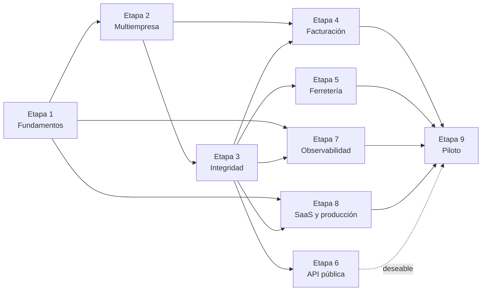
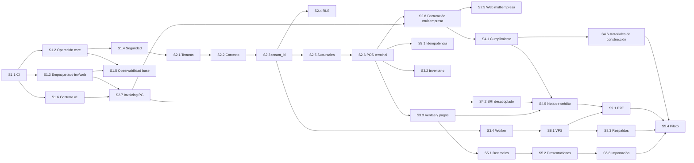

# Roadmap de evolución

> 9 etapas y 57 sesiones. Cada sesión cabe en una conversación nueva de Claude Code, siempre que sus
> dependencias estén terminadas. El detalle (15 campos y prompt listo para usar) está en
> [`sessions/`](sessions/README.md). Las brechas (`G-xx`, `F-xx`) están en [GAP_ANALYSIS.md](GAP_ANALYSIS.md).
>
> Tamaño relativo: **S** (cambio acotado), **M** (varios módulos de un repo), **L** (transversal o
> varios repos).

## 1. Etapas

| Etapa | Objetivo | Resultado verificable |
|---|---|---|
| 0. Auditoría | Diagnóstico, arquitectura objetivo y plan | Esta carpeta (terminada el 2026-10-14) |
| 1. Fundamentos | Poder cambiar con seguridad: CI, imágenes, configuración, seguridad base, observabilidad base y contrato de eventos | CI en verde en los cuatro repos; imagen de producción segura; contrato v1 probado en ambos servicios |
| 2. Multiempresa y multisucursal | Aislamiento por empresa, sucursales, puntos de emisión, terminales y facturación por emisor | Suite de aislamiento en verde; dos empresas facturan con secuenciales propios |
| 3. Integridad transaccional | Reintentos seguros, inventario y caja correctos, mensajería que no se bloquea, auditoría | Pruebas de concurrencia e idempotencia; ningún mensaje bloquea la cola |
| 4. Facturación robusta | Cumplimiento, desacople del SRI, conciliación, RIDE y nota de crédito | Flujo venta → factura → nota de crédito autorizado en el ambiente de pruebas del SRI |
| 5. Operación de ferretería | Decimales, presentaciones, precios, cotizaciones, crédito, costo, importación, cierre de caja | Escenarios de ferretería cubiertos por pruebas |
| 6. API pública | Credenciales de integración, `/api/v1`, webhooks, portal y sandbox | Un integrador externo sincroniza catálogo y crea ventas solo con la documentación |
| 7. Observabilidad completa | Métricas de negocio, frontend, infraestructura, dashboards y alertas | Alertas que se disparan en pruebas de fallo controladas |
| 8. SaaS y producción | VPS, CI/CD, respaldos, planes, onboarding, SigNoz, protección de datos | Despliegue reproducible y restauración probada |
| 9. Piloto | Pruebas integrales, carga, seguridad y puesta en marcha con un cliente | Cliente piloto facturando en producción |

### Ajustes al orden propuesto en el encargo

- **El contrato de eventos v1 (S1.6) se adelanta a la Etapa 1.** El cambio multiempresa modifica el
  mensaje `sales.confirmed`; sin pruebas de contrato se rompería la facturación en silencio, como ya
  ocurrió (G-08).
- **La persistencia de facturación en PostgreSQL (S2.7) va en la Etapa 2.** Es requisito para
  secuenciales por establecimiento y para correr en el VPS. Por eso **no** se corrige la carrera del
  secuencial en DynamoDB (G-09): esa persistencia se reemplaza. *S2.7 (terminada):* el contador es una
  fila de PostgreSQL, arranca en 1 y guardar la configuración ya no lo reescribe. *S2.8 (terminada):*
  un contador por empresa, establecimiento y punto de emisión, que no retrocede, y `UNIQUE` sobre el
  número emitido.
- **La Etapa 8 puede empezar en paralelo** desde la Etapa 3 (S8.1 a S8.3) para tener staging pronto.
  El orden de la tabla es el lógico, no el único posible.
- **Ferretería (Etapa 5) va después de multiempresa e integridad** para no construir módulos nuevos
  sobre un esquema que va a cambiar. Las capacidades imprescindibles (F-01 a F-05) son requisito del
  piloto.

### Pendientes detectados al ejecutar las sesiones

- **Login con email y descartar el nombre de usuario** (detectado en S2.1; diferido a S8.5 por
  decisión del usuario en S2.9). Con identidad global, el
  `username` es único en toda la plataforma. Dos empresas no pueden usar el mismo nombre (`caja1`) y
  el 409 revela que el nombre ya existe en otra. Pasar al login con email y descartar `username`
  mitiga esos choques. S2.9 mantuvo el login por nombre de usuario; se decide con el onboarding
  (S8.5).
- ~~**Empresa en los mensajes de `invoices`**~~ (detectado en S2.2; mitigado en S2.3; resuelto en S2.8:
  faclab-invoicing envía `faclab-tenant-id` y la empresa como clave, y el core ya no busca la empresa
  por la venta: descarta un mensaje sin ella). El consumidor del
  core abre el contexto con el header `faclab-tenant-id` o el `tenant_id` del sobre, pero
  faclab-invoicing todavía no envía ninguno. Desde S2.3, un mensaje sin empresa corre en la de su venta
  (`_tenant_of_sale` en `src/invoicing/infra/invoice_messages.py`, búsqueda por el id global de la
  venta), así que ya no se reintenta sin fin. Falta que faclab-invoicing copie a sus mensajes el header
  del `sales.confirmed` que factura (S2.8, que cambia el contrato completo); entonces se quita el
  respaldo. Desde S2.4 esa búsqueda corre fuera de toda empresa con el rol `faclab_worker`.
- ~~**Tablas leídas entre empresas y RLS**~~ (detectado en S2.3; resuelto en S2.4). `memberships` y
  `auth_sessions` quedan sin RLS, como las demás tablas de plataforma, y las protege el filtro explícito
  de auth (decisión del usuario). En `outbox_messages`, `faclab_app` solo inserta y el relay usa
  `faclab_worker`.
- **Invitar a un usuario que ya existe a otra empresa** (detectado en S2.4). `POST /api/admin/users`
  siempre crea una identidad nueva: si el usuario o el email ya existen en otra empresa responde 409, y
  el admin tendría que crearle otra cuenta. Hoy solo la provisión (`make provision-tenant`) agrega un
  usuario existente, y solo como administrador. Falta un flujo de invitación (el admin invita por email,
  el usuario acepta con su sesión y se crea la membresía), a decidir junto con el login por email; quedó
  para S8.5 (decisión del usuario en S2.9).
- **Roles de base en despliegue y respaldos** (detectado en S2.4). Antes del primer despliegue hay que
  crear los roles con `python -m src.shared.infra.db_roles` y un superusuario (S8.1); otorgar `BYPASSRLS`
  exige superusuario, así que en un PostgreSQL administrado el worker necesitaría una política permisiva
  propia. Con `FORCE`, `pg_dump` como dueño falla: los respaldos usan un superusuario o un rol con
  `BYPASSRLS` (S8.3).
- **Índices que empiezan por `tenant_id`** (detectado en S2.4). Cada tabla de negocio tiene un índice
  simple en `tenant_id` y las únicas por empresa lo incluyen; los listados grandes pueden necesitar
  índices compuestos `(tenant_id, …)`. Medir en S9.2 (carga y línea base).
- ~~**Bodegas sin sucursal en faclab-web**~~ (detectado en S2.5; resuelto en S2.9: el formulario elige
  la sucursal al crear, entre las de la sesión). `POST /api/admin/warehouses` exige
  `branchId` (decisión del usuario) y el formulario de bodegas de faclab-web todavía no lo envía: crear
  una bodega desde la web responde 422 hasta S2.9, que agrega la sucursal al formulario. Editarlas sigue
  funcionando (la sucursal no cambia por PUT).
- **Listados por sucursales permitidas** (detectado en S2.5; resuelto en el POS en S2.6). Un usuario
  limitado a algunas sucursales no puede usar `X-Branch-Id` de otra. Desde S2.6 los historiales y
  reportes del POS (turnos, devoluciones, X, Z, diario y por medio de pago) se limitan a sus sucursales.
  Falta en la administración: stock, bodegas, ventas (`/api/admin/sales`) y los reportes de
  inventario todavía muestran toda la empresa (MULTI_TENANCY §7). Desde S2.9 la web envía `X-Branch-Id`
  en todas las llamadas de administración, pero el backend todavía no filtra esos listados: queda para
  los reportes por sucursal.
- **Códigos SRI de la sucursal con comprobantes emitidos** (detectado en S2.5; la dirección se resolvió
  en S2.8). Hoy se pueden cambiar el código de establecimiento y el de punto de emisión con un PUT.
  Desde S2.8 facturación numera por esos códigos, que llegan en cada `sales.confirmed`: cambiar uno
  con facturas emitidas abre otra numeración en el SRI. Conviene bloquear el cambio cuando el
  establecimiento o el punto ya emitieron (por ejemplo, en S3.x o con el onboarding, S8.5). La
  dirección de la sucursal (`address`) es la `dirEstablecimiento` del comprobante; sin ella, la
  factura sale sin ese campo.
- ~~**POS de faclab-web sin encabezados de sucursal y terminal**~~ (detectado en S2.6; resuelto en
  S2.9: la web vincula cada navegador a una caja, envía `X-Branch-Id` y `X-Terminal-Id`, y se retiró
  `POS_TERMINAL_FALLBACK` con su rechazo en `config/deployed.py`). Las rutas del POS
  exigen `X-Branch-Id` y `X-Terminal-Id`, y la web no los envía todavía. Hasta S2.9 corre con
  `POS_TERMINAL_FALLBACK` (verdadero solo en `local`): sin encabezados usa la primera terminal activa
  de la matriz. En staging y producción el POS de la web no funciona hasta S2.9, que vincula la
  terminal con `GET /api/pos/terminals`, envía los encabezados y quita el respaldo (el ajuste y su
  rechazo en `config/deployed.py`).
- ~~**Número, establecimiento y punto de emisión en `sales.confirmed`**~~ (detectado en S2.6; resuelto
  en S2.8 con `sales.confirmed` v2). La venta
  del POS ya guarda `branch_id`, `emission_point_id`, `terminal_id` y `number`, pero el mensaje a
  faclab-invoicing no los lleva: lo cambia S2.8 junto con el contrato (ADR-0006, ADR-0012).
- ~~**Ventas del seed sin sucursal ni número**~~ (detectado en S2.6; resuelto en S2.8: el seed las crea
  en la terminal de la matriz y una venta sin punto de emisión responde
  `SALE_WITHOUT_EMISSION_POINT`). La API de administración solo lee
  ventas (las crea el POS), pero `make seed` siembra ventas confirmadas sin sucursal, terminal ni
  número, como las anteriores a S2.6: un usuario limitado a algunas sucursales no las ve en los
  historiales del POS y S2.8 no podría facturarlas. Conviene que el seed las cree en una terminal
  (S2.8 o S2.9).
- **Idempotencia fuera de las operaciones que mueven dinero** (detectado en S3.1). El POS exige
  `Idempotency-Key` en crear venta, venta rápida, confirmar, pagos, crear y procesar devoluciones y
  movimientos de caja. No la piden la edición del borrador (ítems, descuento, precio, aparcar y
  reanudar), abrir y cerrar turno ni las anulaciones: las protege el estado o un índice único, pero un
  reintento de "agregar ítem" al retener una venta desde la web puede duplicar una línea del borrador.
  Tampoco la piden las rutas de administración; la API v1 (S6.3) la exige en todos sus POST de
  creación. La purga de claves vencidas la corre el worker cada hora desde S3.4;
  `make purge-idempotency-keys` queda para correrla a mano.
- **Más documentos con `document_sequences`** (detectado en S2.6). Hoy numera ventas y devoluciones
  del POS por sucursal (`V-001-000123`) y, desde S3.3, las órdenes de compra con el contador de la
  empresa (`branch_id` nulo, `PO-2026-0001`, continuo). Faltan el formato configurable por empresa
  (ADR-0012) y pasar a la misma tabla los ajustes, las transferencias, las cotizaciones (S5.4) y el
  cierre de caja (S5.9).
- **Turno en una terminal desactivada** (detectado en S2.6). Desactivar una terminal con un turno
  abierto hace que `GET /api/pos/shifts/active` responda `POS_TERMINAL_INACTIVE`; el turno se sigue
  cerrando por id (`POST /api/pos/shifts/{id}/close`). Conviene impedir desactivar una terminal con
  turno abierto, junto con el cierre de caja (S5.9).
- ~~**Disponibilidad en el POS**~~ (resuelto en S3.2: el POS valida contra `available_quantity` y la
  suma de las líneas de cada producto). El POS valida contra `quantity` de la ubicación, no
  contra `available_quantity`: puede vender stock reservado por una transferencia.
- ~~**`movements.reference_id` sin FK**~~ (detectado en S2.4; resuelto en S3.2: `POST /movements` ya
  no acepta `referenceType` ni `referenceId`, que solo llenan los documentos que mueven stock; un
  movimiento manual no tiene documento). Es un entero libre que `POST /movements`
  acepta del body: puede nombrar una venta u orden de otra empresa. No expone datos (nada se lee por
  ese número), pero conviene validarlo o quitarlo del body cuando se revisen los movimientos (S3.2).
- **Movimientos manuales de faclab-web sin ubicación** (detectado en S3.2). El formulario de
  movimientos envía `productId`, `quantity`, `type`, `reason` y `date`, nunca `locationId`: todo
  movimiento manual cae en el stock "sin ubicación", que el POS no vende. Desde S3.2 un OUT que esa
  fila no cubre responde `INSUFFICIENT_STOCK` (antes dejaba stock negativo). Falta un selector de
  bodega y ubicación en el formulario.
- **Ítems de ajuste repetidos** (detectado en S3.2). Un ajuste acepta dos ítems del mismo producto y
  ubicación; al confirmar, cada uno lleva el stock a su conteo, así que gana el último. Conviene
  rechazar el segundo (o sumar los conteos) al agregarlo.
- ~~**El secuencial de facturación puede retroceder**~~ (detectado en S2.7; resuelto en S2.8: el
  secuencial ya no es parte de la configuración, que ignora `invoiceSequence`, y su valor inicial se
  fija aparte sin poder retroceder). Guardar la configuración sin
  `invoiceSequence` ya no toca el contador. Pero con el campo lo fija tal cual, aunque sea menor que el
  último emitido, y el formulario de faclab-web siempre lo reenvía con el valor que leyó. Si se emiten
  facturas mientras el formulario está abierto, guardarlo retrocede el contador. S2.8 lo cierra:
  valor inicial que no retrocede y `UNIQUE` sobre el número emitido. Conviene que la web solo envíe el
  campo si el usuario lo cambió.
- **Roles y RLS en la base de facturación** (detectado en S2.7; decidido en S2.8). `faclab_invoicing`
  es dueño de la base y la usa la aplicación. En S2.8 el aislamiento entre empresas es un filtro
  obligatorio de la aplicación (decisión del usuario), probado por repositorio y por API. Falta
  separar dueño, aplicación y un rol con `BYPASSRLS` para el consumidor y la recuperación, y activar
  RLS por `tenant_id` como en el core (S2.4); toca faclab-infra (script de roles). Encaja antes de
  producción (S8.1); no entró en S3.4.
- **Historiales y reportes del POS por sucursal y caja en faclab-web** (detectado en S2.9). El backend
  acepta `branchId` y `terminalId` en turnos, devoluciones y reportes (S2.6), pero las pantallas de
  administración del POS todavía no ofrecen esos filtros ni muestran la caja de cada turno.
- **Devolución por número de venta** (detectado en S2.9). El recibo y las listas muestran el número de
  la sucursal (`V-001-000123`), pero el diálogo de devolución del POS busca la venta por su id interno:
  falta buscarla por número en el core y en la web (encaja con S4.5; S3.3 no lo tocó).
- **Publicadores sin la sesión de la petición** (detectado en S3.3). Un handler de eventos corre en
  la transacción de la petición solo si quien publica pasa `session=self.session`; si no, abre su
  propio scope y confirma aparte. Desde S3.3 lo pasan todos los publicadores de eventos con
  suscriptores que escriben (movimientos, recepciones, confirmación y venta rápida del POS, reenvío a
  facturación). Antes, el mensaje `sales.confirmed` de las ventas del POS se guardaba en otra
  transacción. Para que no se repita con un suscriptor nuevo, conviene que `EventBusPublisher` tome la
  sesión de la petición por defecto (scoped) en lugar de depender de cada publicador.
- **Pagos de devolución por encima del total** (detectado en S3.3). `ProcessRefundCommandHandler`
  solo exige que los pagos cubran la devolución: lo que la supera se guarda como pagado y cuenta en
  `cashRefunds`. Conviene aplicarles la misma regla que a los pagos de venta (sin vuelto, o con él
  aparte); encaja con S4.5 o S5.9.
- **Ventas confirmadas antes de S3.3 sin cobertura** (detectado en S3.3). Al reenviarlas a facturación
  responden `INSUFFICIENT_PAYMENT`: hay que registrar el pago que falta antes del reenvío. En la base
  de desarrollo hay 3 (datos del seed). Su `invoice_status` es nulo, así que también se pueden cancelar
  aunque se hayan enviado a facturación.
- **Sesión con sucursales viejas** (detectado en S2.9). Un cambio de accesos rige desde el próximo
  refresh y `/me` se relee cada 5 minutos: entre tanto la web puede ofrecer una sucursal que el token
  ya no acepta (`BRANCH_ACCESS_DENIED`, que reintenta una vez con un token nuevo). Conviene releer `/me`
  tras cada refresh o devolver las sucursales en el par de tokens (S8.5).
- **Filtro por fecha en la lista de facturas de faclab-web** (detectado en S2.7). `GET /api/invoices`
  acepta `fromDate` y `toDate`, pero la pantalla solo filtra por estado y por "requieren atención".
- ~~**Configuración de facturación de faclab-web**~~ (detectado en S2.8; resuelto en S2.9: perfil fiscal
  sin campos de sucursal ni `invoiceSequence`, con RIMPE y el RUC de la empresa; pantalla de
  secuenciales; orden perfil, certificado, selección). La API ya no tiene
  `branchCode`, `salePointCode`, `branchAddress` ni `invoiceSequence` en el perfil: los ignora si
  llegan y el `GET` no los devuelve, así que hasta S2.9 el formulario los muestra vacíos y pide
  llenarlos para guardar (decisión del usuario). S2.9 los quita, agrega el régimen RIMPE, una pantalla
  de secuenciales por establecimiento y punto de emisión (`GET`/`PUT /api/sequences`) y el orden del
  primer arranque: perfil, certificado, selección (subir un certificado sin perfil responde
  `ISSUER_NOT_CONFIGURED`).
- **RUC del certificado según la entidad certificadora** (detectado en S2.8). facturación busca el RUC
  o la cédula en el sujeto (`serialNumber`, `UID`, `organizationIdentifier`) y en las extensiones
  privadas de la entidad (`1.3.6.1.4.1.*`), sin una lista fija de OIDs, y rechaza un certificado sin
  ninguno (`CERTIFICATE_RUC_UNKNOWN`, decisión del usuario). Falta probarlo con certificados reales
  de las entidades del país (BCE, Security Data, ANF, Uanataca, etc.), por ejemplo en la puesta en
  marcha del piloto (S9.x) o con S4.1.
- **Base local de facturación** (detectado en S2.8). La migración `1792581513940_multi-company` vuelve
  a crear las tablas vacías: tras `npm run migrate up` hay que volver a guardar el perfil fiscal de
  cada empresa y subir su certificado. Los mensajes `sales.confirmed` v1 que queden en el topic local
  solo se facturan con `SALES_V1_TENANT_ID`.
- **Clave de partición en Kafka** (hecho en S2.8 y S3.4). El relay del core y faclab-invoicing usan el
  `tenant_id` como clave, y `faclab-infra/scripts/create-topics.sh` crea los tópicos con 6 particiones
  (S3.4). El stack de producción (S8.1) tiene que correr ese script antes de arrancar los servicios.
- **Mensajería, lo que quedó de S3.4** (detectado en S3.4):
  - El reproceso de mensajes `failed` y `dead_letters` es un CLI (`make outbox-retry`,
    `make reprocess-dead-letter`) que deja el autor en la fila y en el log. Los endpoints HTTP y su
    registro en la bitácora de auditoría llegan con el rol de plataforma (S8.5): S3.5 lo dejó fuera
    porque cruzan empresas y una dead letter puede no tener empresa.
  - ~~faclab-web no muestra todavía `invoiceStatus`, `invoiceId` ni `invoiceRejectionReason` de la
    venta~~: hecho en S4.3 (columna, filtro, insignia y la vista "Requieren atención").
  - El worker revisa el outbox cada segundo, porque el `wake()` tras el commit solo llega al relay del
    mismo proceso. Si llega a pesar, cambiar a LISTEN/NOTIFY.
  - Las dead letters reprocesadas no se purgan.
  - El stack de producción (S8.1) tiene que levantar el servicio `worker` con su healthcheck y
    `RUN_BACKGROUND=false` en el API.
- **Bitácora de auditoría, lo que quedó de S3.5** (detectado en S3.5):
  - Quedan fuera del catálogo: el reproceso por CLI (S8.5), la configuración fiscal y los
    certificados (viven en faclab-invoicing; auditarlos allá, con S4.x), los datos del tenant (sin
    rutas hasta S8.5), las órdenes de compra, el reenvío a facturación y el resultado del SRI por
    Kafka, y los borradores de ajustes y transferencias.
  - `POST /api/pos/sales/{id}/items` acepta cualquier `unitPrice` sin motivo ni entrada en la
    bitácora (la venta rápida y `PUT .../price` sí la dejan). Cerrarlo con las listas de precios (S5.3)
    o antes: exigir motivo cuando difiere del precio del producto.
  - `Permission.SALE_CANCEL` no se usa: la anulación del POS pide `pos:operate`, así que cualquier
    cajero anula una venta confirmada (queda en la bitácora). Revisar con el cierre de caja (S5.9).
  - No hay retención ni purga de la bitácora: se decide con la protección de datos (S8.7).
- **Facturación, lo que quedó de S4.1** (2026-10-29):
  - Códigos de materiales de construcción en `codigoAuxiliar` (Anexo 23 de la ficha técnica, G-79):
    sesión nueva [S4.6](sessions/S4.6-materiales-de-construccion.md), necesaria para el piloto con
    una ferretería.
  - Leyenda "Gran Contribuyente" con su resolución (Anexo 24, G-80): un campo más del perfil fiscal y
    un `campoAdicional`. Sin sesión: hacerlo cuando un cliente lo sea.
  - Fijar `INVOICING_PROVIDER_RUC` en producción (Anexo 26, G-81) y leer la Res.
    NAC-DGERCGC26-00000027 para confirmar a qué proveedores aplica (la ficha cita la "resolución
    2718"). Con el despliegue (S8.1).
  - Bloquear en el core la venta a consumidor final que supera el límite (hoy invoicing la rechaza
    antes de numerarla y el core la ve `REJECTED` con el motivo): al confirmar en el admin y en el
    POS, con el mismo valor que `FINAL_CONSUMER_MAX_TOTAL`. Encaja con S5.9 o antes del piloto.
  - D-4 sigue abierta con el contador: qué fecha llevan las facturas que esperaron
    (`INVOICE_EMISSION_DATE`, `sale` por defecto) y si RIMPE Negocio Popular tiene otro límite de
    consumidor final (fuentes secundarias citan USD 200).
  - Probar la leyenda `CONTRIBUYENTE NEGOCIO POPULAR - RÉGIMEN RIMPE` con un emisor de ese régimen en
    el SRI de pruebas: el XSD publicado no la tiene y se agregó desde la ficha.
  - Número y fecha de autorización hacia el core: `InvoiceAuthorized` (invoices v1) solo lleva el id
    de la factura. S4.3 no los necesitó (la web los lee de facturación); con S4.4 si hacen falta.
  - Servicio compatible con S3 del VPS (S8.1) y copia de los XML autorizados fuera del servidor, con
    su retención (S8.3).
  - `npm audit` de faclab-invoicing reporta vulnerabilidades en dependencias que ya estaban (zod,
    `@scalar/*` y otras), ninguna de las agregadas en S4.1. Revisarlas en una sesión de dependencias.
- **Facturación, lo que quedó de S4.2** (2026-10-29):
  - Métricas de la cola de facturas (vencidas, edad de la más antigua, leases vencidos, duración de
    cada paso): S7.2.
  - Servicio `invoicing-worker` en el stack de producción: la API con `RUN_BACKGROUND=false`, el
    worker con el mismo `HEALTHCHECK` y un `stop_grace_period` mayor que `SRI_TIMEOUT_MS` (S8.1). Si
    se mata antes, sus facturas esperan a que venza el lease (2 minutos por defecto).
  - La cola atiende por `next_attempt_at`, sin reparto entre empresas: una con muchas facturas
    vencidas retrasa a las demás. Repartir por empresa si el volumen lo pide.
  - Resincronizar `contracts/` en faclab-invoicing (`npm run contracts:sync`) después del
    squash-merge del core: cambió el README de `invoices` v1, no su esquema.
  - Volver a la versión anterior de faclab-invoicing: antes, dejar que el worker publique los
    resultados pendientes (`status IN ('authorized', 'rejected') AND result_published_at IS NULL`),
    porque la versión anterior no los publica; su migración `down` quita las columnas de la cola.
  - La API con `RUN_BACKGROUND=false` no se conecta a Kafka, pero la configuración de producción
    todavía exige `KAFKA_BROKERS`. Relajarlo con S8.1 si estorba.
- **Conciliación y mensajes fallidos, lo que quedó de S4.3** (2026-10-30):
  - Diferencias de totales entre la venta y su factura (decisión del usuario: fuera de S4.3). Hoy el
    `importeTotal` de la factura es el `total` que manda el core, así que compararlos no aporta. Si
    faclab-invoicing llega a calcular su propio total, sumar `total` opcional a `InvoiceAuthorized`
    (invoices v1) y una discrepancia `total_mismatch`.
  - Quitar el tópico `dlq` de `faclab-infra/scripts/create-topics.sh` (y del stack de S8.1) después
    de desplegar faclab-invoicing: ya nadie lo escribe. Lo que quede en él se puede ignorar: era un
    tópico sin lector.
  - Las dead letters reprocesadas de faclab-invoicing no se purgan (igual que las del core).
  - El reproceso de dead letters de facturación es un CLI sobre el código compilado (`npm run build`
    y `npm run cli`, o la imagen). Los endpoints de plataforma y su entrada en la bitácora llegan con
    S8.5, como los del core.
  - La alerta sobre `faclab.reconciliation.discrepancies` (discrepancias abiertas durante 30 minutos)
    es de S7.5; la cifra de discrepancias en el resumen de inicio, si se quiere, con S7.x. El
    `uninvoicedSales` del dashboard sigue contando todas las ventas `CONFIRMED`.
  - Una venta confirmada sin resultado se marca a los 30 minutos aunque facturación la esté
    reintentando sola (SRI caído). La vista muestra el estado en facturación para decidir; si el
    ruido molesta, subir `INVOICE_RECONCILIATION_PENDING_MINUTES` o distinguir con datos de
    facturación (consulta con token de servicio, descartada por ahora).
  - Resincronizar `contracts/` en faclab-invoicing (`npm run contracts:sync`) después del
    squash-merge del core: cambió el README de los contratos (la versión desconocida va a
    `dead_letters`), no un esquema.

## 2. Dependencias

Camino crítico hasta el piloto:

## 3. Sesiones

| ID | Título | Objetivo | Depende de | Repos | Brechas | Tamaño |
|---|---|---|---|---|---|---|
| [S1.1](sessions/S1.1-ci-minima.md) | CI mínima | Lint, tipos, pruebas y build en cada PR de los cuatro repos | — | core, invoicing, web, infra | G-53, G-56, G-60, G-78 | M |
| [S1.2](sessions/S1.2-operacion-del-core.md) | Operación del core | Imagen de producción segura, salud, configuración por entorno, PostgreSQL 17 | S1.1 | core | G-38, G-40, G-41, G-51, G-54, G-55, G-58 | M |
| [S1.3](sessions/S1.3-empaquetado-invoicing-y-web.md) | Empaquetado de invoicing y web | Dockerfiles y configuración por entorno sin valores fijos | S1.1 | invoicing, web | G-07, G-56 | M |
| [S1.4](sessions/S1.4-seguridad-del-api.md) | Seguridad del API | Actor desde el token, sesión segura, bloqueo de login, errores y logs sin secretos | S1.2 | core, web | G-39, G-42, G-43, G-44, G-45, G-46, G-47 | M |
| [S1.5](sessions/S1.5-observabilidad-base.md) | Observabilidad base | Correlación de logs y trazas, recurso, sampler, redacción, spans de Kafka | S1.2, S1.3 | core, invoicing, infra | G-61 a G-67, G-71 | M |
| [S1.6](sessions/S1.6-contrato-de-eventos-v1.md) | Contrato de eventos v1 | JSON Schema versionado y pruebas de contrato; corrige los nulos | S1.1 | core, invoicing | G-08, G-76 | M |
| [S2.1](sessions/S2.1-tenants-y-membresias.md) | Tenants y membresías | Empresas, membresías, token con `tid`, alta por comando | S1.4 | core | G-01 | L |
| [S2.2](sessions/S2.2-contexto-de-tenant.md) | Contexto de tenant | `TenantContext` en requests, mensajes y tareas; repositorio base que filtra y asigna | S2.1 | core | G-01 | M |
| [S2.3](sessions/S2.3-tenant-id-en-modulos.md) | `tenant_id` en todos los módulos | Columnas, restricciones compuestas y nueva línea base de migraciones | S2.2 | core | G-01, G-06 | L |
| [S2.4](sessions/S2.4-rls-y-aislamiento.md) | RLS y aislamiento | Políticas RLS, roles de base y pruebas negativas por ruta | S2.3 | core | G-01 | M |
| [S2.5](sessions/S2.5-sucursales-y-puntos-de-emision.md) | Sucursales y puntos de emisión | Sucursales, puntos de emisión, terminales, bodegas por sucursal, acceso por sucursal | S2.3 | core | G-02 | L |
| [S2.6](sessions/S2.6-pos-por-terminal.md) | POS por terminal | Turno por terminal, cajero del token, stock por ubicación, numeración de ventas | S2.5 | core | G-03, G-04 | L |
| [S2.7](sessions/S2.7-invoicing-en-postgresql.md) | Invoicing en PostgreSQL | Reemplazar DynamoDB con el mismo comportamiento | S1.3, S1.6 | invoicing, infra | G-18, G-74 | L |
| [S2.8](sessions/S2.8-facturacion-multiempresa.md) | Facturación multiempresa | Perfil fiscal, certificados y secuenciales por empresa y punto de emisión | S2.6, S2.7 | invoicing, core | G-05, G-09, G-23 | L |
| [S2.9](sessions/S2.9-frontend-multiempresa.md) | Frontend multiempresa | Selección de empresa y sucursal, terminal POS, administración de sucursales | S2.5, S2.6, S2.8 | web, core | G-02, G-03 | L |
| [S3.1](sessions/S3.1-idempotencia.md) | Idempotencia | `Idempotency-Key` en POS y pagos | S2.6 | core, web | G-26 | M |
| [S3.2](sessions/S3.2-reglas-de-inventario.md) | Reglas de inventario | Sin stock negativo, disponibilidad real, ajustes correctos | S2.6 | core | G-27, G-28, G-29, G-32, G-36 | M |
| [S3.3](sessions/S3.3-ventas-pagos-y-precision.md) | Ventas, pagos y precisión | Pagos válidos, vuelto, anulación con factura en curso, dinero sin tope bajo | S2.6 | core, web | G-16, G-20, G-30, G-31, G-33 | M |
| [S3.4](sessions/S3.4-worker-y-mensajeria-resiliente.md) | Worker y mensajería resiliente | Worker separado, límites, mensajes fallidos, estado de facturación en la venta | S2.3 | core, infra, invoicing | G-21, G-24, G-25, G-35 | M |
| [S3.5](sessions/S3.5-bitacora-de-auditoria.md) | Bitácora de auditoría | Registro inmutable de operaciones sensibles | S2.3, S1.4 | core, web | G-50, F-16 | M |
| [S4.1](sessions/S4.1-cumplimiento-de-la-factura.md) | Cumplimiento de la factura | Ambiente por emisor, autorización guardada, XSD, campos tributarios | S2.8 | invoicing, core | G-10, G-15, G-16, G-17, G-19, G-22 | L |
| [S4.2](sessions/S4.2-sri-desacoplado.md) | SRI desacoplado | Cola en PostgreSQL y worker para firmar y enviar | S2.7 | invoicing | G-13, G-14 | M |
| [S4.3](sessions/S4.3-conciliacion-y-reproceso.md) | Conciliación y reproceso | Detección de discrepancias y herramientas de reproceso | S3.4, S4.2 | core, invoicing, web | G-21 | M |
| [S4.4](sessions/S4.4-ride-y-correo.md) | RIDE y correo | PDF del comprobante y envío al cliente | S4.1 | invoicing, web | G-12 | M |
| [S4.5](sessions/S4.5-nota-de-credito.md) | Nota de crédito | Emisión desde devoluciones y anulaciones | S4.1, S4.2, S3.3 | invoicing, core, web | G-11, G-20, G-22, F-04 | L |
| [S4.6](sessions/S4.6-materiales-de-construccion.md) | Materiales de construcción | Código de subcategoría del Anexo 23 en `codigoAuxiliar` | S4.1 | core, invoicing, web | G-79 | M |
| [S5.1](sessions/S5.1-cantidades-decimales.md) | Cantidades decimales | Cantidades con precisión configurable en todo el flujo | S3.3 | core, web, invoicing | F-01 | L |
| [S5.2](sessions/S5.2-unidades-y-presentaciones.md) | Unidades y presentaciones | Conversiones, presentaciones y códigos de barras | S5.1 | core, web | F-02, F-03 | L |
| [S5.3](sessions/S5.3-listas-de-precios.md) | Listas de precios | Minorista, mayorista, por volumen y por sucursal | S5.2 | core, web | F-06 | M |
| [S5.4](sessions/S5.4-cotizaciones.md) | Cotizaciones | Proformas con vigencia y conversión a venta | S5.3 | core, web | F-07 | M |
| [S5.5](sessions/S5.5-credito-y-cuentas-por-cobrar.md) | Crédito y cuentas por cobrar | Venta a crédito, abonos, estado de cuenta | S5.3, S3.3 | core, web | F-08, G-34 | L |
| [S5.6](sessions/S5.6-costo-promedio-y-kardex.md) | Costo promedio y kárdex | Costo ponderado por bodega y kárdex valorizado | S5.1, S3.2 | core, web | F-09 | M |
| [S5.7](sessions/S5.7-compras-devoluciones-e-iva.md) | Compras: devoluciones e IVA | Devoluciones a proveedor, IVA en compras, cuentas por pagar básicas | S5.6 | core, web | F-11, F-12, G-37 | M |
| [S5.8](sessions/S5.8-importacion-masiva.md) | Importación masiva | Productos, clientes, proveedores y saldos iniciales desde CSV | S5.2, S5.3 | core, web | F-05 | M |
| [S5.9](sessions/S5.9-cierre-de-caja.md) | Cierre de caja | Cierre Z numerado e inmutable con arqueo | S2.6, S3.5 | core, web | F-10 | M |
| [S6.1](sessions/S6.1-jwt-asimetrico-y-jwks.md) | JWT asimétrico y JWKS | Firma asimétrica, rotación y validación por JWKS | S2.1 | core, invoicing | G-48 | M |
| [S6.2](sessions/S6.2-credenciales-de-integracion.md) | Credenciales de integración | OAuth 2.0 *client credentials*, scopes y alcance por sucursal | S6.1, S2.5, S3.5 | core | G-72 | M |
| [S6.3](sessions/S6.3-api-v1.md) | API v1 | Fachada `/api/v1`, convenciones y límites de solicitudes | S6.2, S3.1 | core, invoicing | G-72, G-73, G-42 | L |
| [S6.4](sessions/S6.4-webhooks.md) | Webhooks | Suscripciones, firma, entregas y reintentos | S6.2, S3.4 | core | G-72 | M |
| [S6.5](sessions/S6.5-portal-documentacion-y-sandbox.md) | Portal, documentación y sandbox | Gestión de integraciones y guía para integradores | S6.3, S6.4 | web, core | G-72 | M |
| [S7.1](sessions/S7.1-metricas-del-core.md) | Métricas del core | Métricas técnicas y de negocio | S1.5, S3.4 | core | G-68 | M |
| [S7.2](sessions/S7.2-metricas-de-facturacion.md) | Métricas de facturación | SRI, transiciones, tiempos, certificados | S1.5, S4.2 | invoicing | G-68, G-23 | M |
| [S7.3](sessions/S7.3-observabilidad-del-frontend.md) | Observabilidad del frontend | Trazas desde el navegador, errores y web vitals | S1.5 | web, core | G-69 | M |
| [S7.4](sessions/S7.4-collector-e-infraestructura.md) | Collector e infraestructura | Collector con métricas de host, Docker, PostgreSQL y Kafka | S1.5 | infra | G-68 | M |
| [S7.5](sessions/S7.5-dashboards-y-alertas.md) | Dashboards y alertas | Seis dashboards, alertas y runbooks como código | S7.1, S7.2, S7.3, S7.4 | infra | G-70 | M |
| [S7.6](sessions/S7.6-observabilidad-en-pruebas.md) | Observabilidad en pruebas | Pruebas de spans y logs; definición de terminado | S7.1, S7.2 | core, invoicing | — | S |
| [S8.1](sessions/S8.1-stack-de-produccion-en-vps.md) | Stack de producción | Compose de producción en el VPS con Caddy y secretos | S1.2, S1.3, S2.7, S3.4 | infra | G-49, G-59 | L |
| [S8.2](sessions/S8.2-entrega-continua.md) | Entrega continua | Imágenes versionadas, despliegue y reversión | S8.1, S1.1 | todos | G-57 | M |
| [S8.3](sessions/S8.3-respaldos-y-recuperacion.md) | Respaldos y recuperación | PITR, archivo de comprobantes y simulacro de restauración | S8.1 | infra | G-59 | M |
| [S8.4](sessions/S8.4-planes-y-limites.md) | Planes y límites | Planes, suscripciones y límites de uso | S2.5 | core, web | — | M |
| [S8.5](sessions/S8.5-onboarding-y-consola.md) | Onboarding y consola | Alta guiada de empresas y consola de plataforma | S8.4, S2.8, S5.8 | core, web, invoicing | — | L |
| [S8.6](sessions/S8.6-signoz-en-operacion.md) | SigNoz en operación | Despliegue, acceso, retención y respaldo de SigNoz | S7.5, S8.1 | infra | G-52, G-70 | M |
| [S8.7](sessions/S8.7-proteccion-de-datos.md) | Protección de datos | Exportación y eliminación de datos por empresa, políticas | S8.3 | core, invoicing | — | M |
| [S9.1](sessions/S9.1-e2e-flujo-completo.md) | E2E del flujo completo | Venta → factura → nota de crédito con servicios reales | S4.5, S8.1 | todos | G-77 | M |
| [S9.2](sessions/S9.2-carga-y-linea-base.md) | Carga y línea base | Capacidad del POS y umbrales de alertas | S8.1, S7.5 | core | G-77 | M |
| [S9.3](sessions/S9.3-revision-de-seguridad.md) | Revisión de seguridad | Revisión de seguridad, dependencias y aislamiento | S6.3, S8.1 | todos | — | M |
| [S9.4](sessions/S9.4-puesta-en-marcha-del-piloto.md) | Puesta en marcha del piloto | Primer cliente en producción | S9.1, S9.2, S9.3, S8.3, S8.5 | todos | — | L |
| [S9.5](sessions/S9.5-cierre-del-piloto.md) | Cierre del piloto | Lecciones, ajustes y backlog siguiente | S9.4 | docs | — | S |

## 4. Primera sesión recomendada

**S1.1 — CI mínima.** Es barata y no toca el dominio. Hoy ningún repositorio la tiene (G-53), y es la
red de seguridad indispensable para el cambio multiempresa, que toca las 34 tablas del core.

## 5. Cómo usar este roadmap

1. Elegir la siguiente sesión cuyas dependencias estén terminadas (columna *Estado* del archivo de la
   sesión).
2. Abrir una conversación nueva de Claude Code en el repositorio principal de la sesión y pegar el
   bloque **Prompt** del archivo.
3. Al terminar, la sesión actualiza su propio archivo (*Estado: terminada*, fecha y PR), esta tabla si
   cambió algo, el ADR correspondiente (*aceptado*) y las brechas resueltas en GAP_ANALYSIS.
4. Si una sesión descubre que el plan no se ajusta a la realidad, documenta el ajuste aquí antes de
   seguir.
