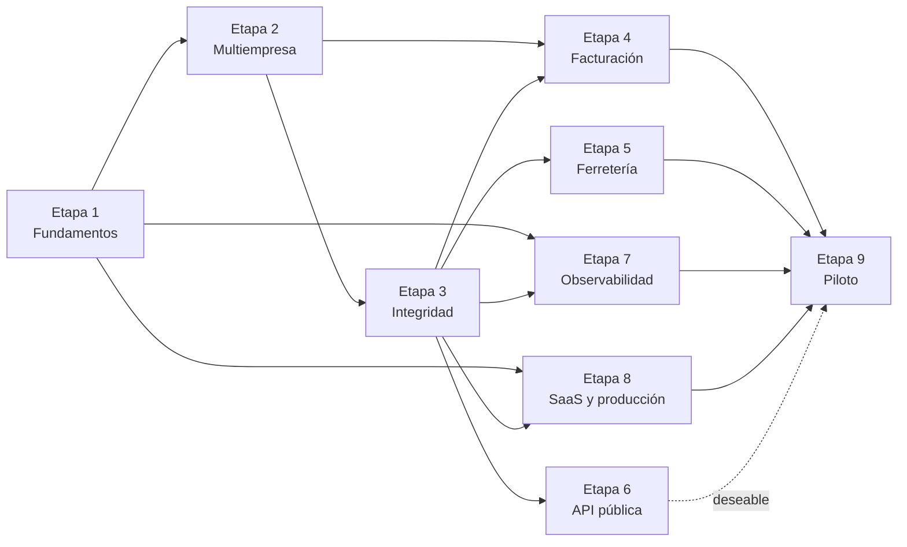
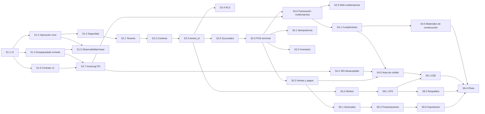

# Roadmap de evolución

> 9 etapas y 57 sesiones. Cada sesión cabe en una conversación nueva de Claude Code, siempre que sus
> dependencias estén terminadas. El detalle (15 campos y prompt listo para usar) está en
> [`sessions/`](sessions/README.md). Las brechas (`G-xx`, `F-xx`) están en [GAP_ANALYSIS.md](GAP_ANALYSIS.md).
>
> Tamaño relativo: **S** (cambio acotado), **M** (varios módulos de un repo), **L** (transversal o
> varios repos).

## 1. Etapas

| Etapa | Objetivo | Resultado verificable |
|---|---|---|
| 0. Auditoría | Diagnóstico, arquitectura objetivo y plan | Esta carpeta (terminada el 2026-10-14) |
| 1. Fundamentos | Poder cambiar con seguridad: CI, imágenes, configuración, seguridad base, observabilidad base y contrato de eventos | CI en verde en los cuatro repos; imagen de producción segura; contrato v1 probado en ambos servicios |
| 2. Multiempresa y multisucursal | Aislamiento por empresa, sucursales, puntos de emisión, terminales y facturación por emisor | Suite de aislamiento en verde; dos empresas facturan con secuenciales propios |
| 3. Integridad transaccional | Reintentos seguros, inventario y caja correctos, mensajería que no se bloquea, auditoría | Pruebas de concurrencia e idempotencia; ningún mensaje bloquea la cola |
| 4. Facturación robusta | Cumplimiento, desacople del SRI, conciliación, RIDE y nota de crédito | Flujo venta → factura → nota de crédito autorizado en el ambiente de pruebas del SRI |
| 5. Operación de ferretería | Decimales, presentaciones, precios, cotizaciones, crédito, costo, importación, cierre de caja | Escenarios de ferretería cubiertos por pruebas |
| 6. API pública | Credenciales de integración, `/api/v1`, webhooks, portal y sandbox | Un integrador externo sincroniza catálogo y crea ventas solo con la documentación |
| 7. Observabilidad completa | Métricas de negocio, frontend, infraestructura, dashboards y alertas | Alertas que se disparan en pruebas de fallo controladas |
| 8. SaaS y producción | VPS, CI/CD, respaldos, planes, onboarding, SigNoz, protección de datos | Despliegue reproducible y restauración probada |
| 9. Piloto | Pruebas integrales, carga, seguridad y puesta en marcha con un cliente | Cliente piloto facturando en producción |

### Ajustes al orden propuesto en el encargo

- **El contrato de eventos v1 (S1.6) se adelanta a la Etapa 1.** El cambio multiempresa modifica el
  mensaje `sales.confirmed`; sin pruebas de contrato se rompería la facturación en silencio, como ya
  ocurrió (G-08).
- **La persistencia de facturación en PostgreSQL (S2.7) va en la Etapa 2.** Es requisito para
  secuenciales por establecimiento y para correr en el VPS. Por eso **no** se corrige la carrera del
  secuencial en DynamoDB (G-09): esa persistencia se reemplaza. *S2.7 (terminada):* el contador es una
  fila de PostgreSQL, arranca en 1 y guardar la configuración ya no lo reescribe. *S2.8 (terminada):*
  un contador por empresa, establecimiento y punto de emisión, que no retrocede, y `UNIQUE` sobre el
  número emitido.
- **La Etapa 8 puede empezar en paralelo** desde la Etapa 3 (S8.1 a S8.3) para tener staging pronto.
  El orden de la tabla es el lógico, no el único posible.
- **Ferretería (Etapa 5) va después de multiempresa e integridad** para no construir módulos nuevos
  sobre un esquema que va a cambiar. Las capacidades imprescindibles (F-01 a F-05) son requisito del
  piloto.

### Pendientes detectados al ejecutar las sesiones

- **Lo que S9.1 dejó fuera** (pruebas de punta a punta, 2026-11-26):
  - **Verla pasar en CI** (workflow `E2E` de faclab-infra), también con `inject_regression`: exige publicar las ramas.
  - **`celcer`**: el modo está implementado (`--sri celcer`) y sin probar; falta un certificado de pruebas y, en CI, los
    secretos `SRI_E2E_P12_BASE64`, `SRI_E2E_P12_PASSWORD` y `SRI_E2E_RUC`.
  - **Versión de web con el arreglo del selector de presentación**: v0.1.0 lo tiene roto; sale con el próximo release.
  - **Más escenarios**: venta a crédito y abono, cotización cobrada, devolución parcial, factura rechazada por el SRI y
    reenvío, varias sucursales y un cajero con acceso limitado. Hoy solo se recorre el camino feliz.
  - **La semilla de core trae ventas `CONFIRMED` nunca enviadas a facturar** y la conciliación las lista; la suite las
    descarta. Decidir si la semilla debe marcarlas de otra forma.
  - **El simulador no verifica la firma XAdES ni el XSD** del SRI: eso solo lo comprueba `celcer`.
- **Lo que S8.7 dejó fuera** (protección de datos personales, 2026-11-25; los puntos de las otras
  viñetas que dicen «S8.7» siguen pendientes salvo que digan lo contrario aquí):
  - **La prueba en staging** del criterio de aceptación: la VM `faclab-staging` está apagada y probarla
    exige publicar las ramas y un prerelease. Hecho en su lugar: las pruebas con PostgreSQL real
    (roles `faclab_app`, `faclab_worker` y `faclab_owner`, RLS forzada, funciones de dueño) de core y la
    base de invoicing, con dos empresas.
  - **Validar con el contador y un abogado** los plazos y las bases legales de `docs/data-protection.md`
    §8 y el registro de tratamientos (borrador): el plazo de 7 años y desde cuándo cuenta (hoy, desde la
    última venta), cuáles registros más hay que conservar, el rol de Faclab (responsable o encargado) y
    la notificación de vulneraciones. **Antes de crear el bucket de producción** (Object Lock).
  - **Collector** (faclab-infra): `url.query` y `url.full` en `transform/redact` (OBSERVABILITY §4.6).
  - **Retención y purga de la bitácora** (`audit_log`, `issuer_audit`): hoy se conserva (con actores
    anonimizados al dar de baja) y solo se borra con la empresa; la política de 7 años es una propuesta.
  - **La exportación en la interfaz** (faclab-web): botón y estado de `data-exports`; la etiqueta
    `AUDIT_ACTION_LABELS` de `data_export.requested`, `tenant.offboarding_started`,
    `tenant.offboarding_cancelled` y `tenant.anonymized` (`check:contract`).
  - **Anonimizar a un titular concreto** con la empresa activa (supresión u oposición de un cliente):
    hoy solo se anonimiza una empresa entera al darla de baja.
  - **Automatizar la baja entre servicios** con un evento de Kafka (ADR-0014): hoy el operador corre la
    CLI de cada uno con el mismo RUC.
  - **El XML y el RIDE conservan** nombre, dirección y correo del comprador tal como se firmaron; solo
    se pueden eliminar al vencer la conservación.
  - **Los mensajes de la cola `invoices`** pendientes de una empresa bloquean la anonimización; no hay
    todavía un comando que los reprocese por empresa.
  - **Retención de datos en respaldos:** una baja tarda ~5 semanas en salir de los respaldos de
    PostgreSQL; ver `docs/data-protection.md` §6.
- **Lo que S8.6 dejó fuera** (SigNoz en operación, 2026-11-25; la sesión quedó **en curso**, no terminada;
  los puntos de las otras viñetas que dicen «S8.6» siguen pendientes salvo que digan lo contrario aquí):
  - **Desplegar SigNoz** (VPS aparte o SigNoz Cloud) y encender la telemetría de producción con TLS,
    vista en los seis dashboards: D-1 sigue abierta por decisión del usuario (no se compra host hasta
    tener un par de clientes). Hecho en su lugar: el Collector arranca con la telemetría apagada
    (`TELEMETRY_EXPORTER=nop`) y se enciende con variables; el exporter con TLS y token está probado
    contra un receptor local; `scripts/signoz.sh retention` aplica D-7.
  - Sus usuarios nominales y canales reales (SMTP, bot de Telegram, `ALERT_EMAIL_TO`,
    `SIGNOZ_EXTERNAL_URL`) y una alerta de prueba que llegue a ellos.
  - El simulacro de restauración del metastore de SigNoz (el procedimiento está documentado y el
    volcado se probó en el SigNoz local) y las métricas propias del Collector.
  - **Latidos y sondeos** (`heartbeats.sh`, un timer por comprobación): probados con un receptor local;
    falta crear las cuentas (servicio de latidos y de sondeos), poner `HEARTBEAT_BASE_URL` y probarlos
    en un servidor. No cubren facturas atascadas ni certificados de firma por vencer (leen tablas de
    negocio y `faclab_monitor` no las ve), ni errores 5xx, latencia o trazas: vuelven con SigNoz.
  - Leer los términos de uso comercial del plan gratuito del servicio de latidos y del de sondeos.

- **Lo que S8.5 dejó fuera** (consola de plataforma y asistente, 2026-11-25; los puntos de las otras
  viñetas que dicen «S8.5» siguen pendientes salvo que digan lo contrario aquí):
  - La consola no tiene los endpoints HTTP del reproceso de mensajes `failed` y `dead_letters` (siguen
    en la CLI), ni la edición de planes (CRUD por la CLI `make plans`), ni el umbral de justificación
    del cierre Z por empresa, ni el login por email ni la invitación de usuarios existentes.
  - La consola no ve el readiness fino de facturación (perfil, certificado) de una empresa: core no
    llama a faclab-invoicing y este no tiene rutas entre empresas. Mostrarlo pide un token de servicio
    por empresa o una ruta de plataforma en faclab-invoicing (decisión de seguridad aparte).
  - El paso a producción queda auditado en `issuer_audit` de faclab-invoicing y no se muestra en la
    bitácora de la empresa en core (un mensaje nuevo sería un contrato nuevo); falta una ruta para
    leerlo y mostrarlo.
  - Los pasos de configuración del asistente (perfil, certificado, sucursales, cajas, usuarios,
    importación, secuenciales) llevan a su pantalla y el estado vuelve solo al asistente; no se
    incrustaron los formularios en el asistente.
  - El operador entra solo con usuario y contraseña (sin segunda verificación) y el token no se renueva.
  - La factura de prueba usa el primer punto de emisión (`001-001`) o el que se le pase por la API;
    el asistente no deja elegirlo.

- **Login con email y descartar el nombre de usuario** (detectado en S2.1; diferido a S8.5 por
  decisión del usuario en S2.9). Con identidad global, el
  `username` es único en toda la plataforma. Dos empresas no pueden usar el mismo nombre (`caja1`) y
  el 409 revela que el nombre ya existe en otra. Pasar al login con email y descartar `username`
  mitiga esos choques. S2.9 mantuvo el login por nombre de usuario; se decide con el onboarding
  (S8.5).
- ~~**Empresa en los mensajes de `invoices`**~~ (detectado en S2.2; mitigado en S2.3; resuelto en S2.8:
  faclab-invoicing envía `faclab-tenant-id` y la empresa como clave, y el core ya no busca la empresa
  por la venta: descarta un mensaje sin ella). El consumidor del
  core abre el contexto con el header `faclab-tenant-id` o el `tenant_id` del sobre, pero
  faclab-invoicing todavía no envía ninguno. Desde S2.3, un mensaje sin empresa corre en la de su venta
  (`_tenant_of_sale` en `src/invoicing/infra/invoice_messages.py`, búsqueda por el id global de la
  venta), así que ya no se reintenta sin fin. Falta que faclab-invoicing copie a sus mensajes el header
  del `sales.confirmed` que factura (S2.8, que cambia el contrato completo); entonces se quita el
  respaldo. Desde S2.4 esa búsqueda corre fuera de toda empresa con el rol `faclab_worker`.
- ~~**Tablas leídas entre empresas y RLS**~~ (detectado en S2.3; resuelto en S2.4). `memberships` y
  `auth_sessions` quedan sin RLS, como las demás tablas de plataforma, y las protege el filtro explícito
  de auth (decisión del usuario). En `outbox_messages`, `faclab_app` solo inserta y el relay usa
  `faclab_worker`.
- **Invitar a un usuario que ya existe a otra empresa** (detectado en S2.4). `POST /api/admin/users`
  siempre crea una identidad nueva: si el usuario o el email ya existen en otra empresa responde 409, y
  el admin tendría que crearle otra cuenta. Hoy solo la provisión (`make provision-tenant`) agrega un
  usuario existente, y solo como administrador. Falta un flujo de invitación (el admin invita por email,
  el usuario acepta con su sesión y se crea la membresía), a decidir junto con el login por email; quedó
  para S8.5 (decisión del usuario en S2.9).
- **Roles de base en despliegue y respaldos** (detectado en S2.4). Antes del primer despliegue hay que
  crear los roles con `python -m src.shared.infra.db_roles` y un superusuario (S8.1); otorgar `BYPASSRLS`
  exige superusuario, así que en un PostgreSQL administrado el worker necesitaría una política permisiva
  propia. Con `FORCE`, `pg_dump` como dueño falla: el respaldo previo a cada despliegue (S8.2) usa el
  superusuario, y los de S8.3 son físicos (pgBackRest copia los archivos), así que la RLS no los
  alcanza.
- **Índices que empiezan por `tenant_id`** (detectado en S2.4). Cada tabla de negocio tiene un índice
  simple en `tenant_id` y las únicas por empresa lo incluyen; los listados grandes pueden necesitar
  índices compuestos `(tenant_id, …)`. Medir en S9.2 (carga y línea base).
- ~~**Bodegas sin sucursal en faclab-web**~~ (detectado en S2.5; resuelto en S2.9: el formulario elige
  la sucursal al crear, entre las de la sesión). `POST /api/admin/warehouses` exige
  `branchId` (decisión del usuario) y el formulario de bodegas de faclab-web todavía no lo envía: crear
  una bodega desde la web responde 422 hasta S2.9, que agrega la sucursal al formulario. Editarlas sigue
  funcionando (la sucursal no cambia por PUT).
- **Listados por sucursales permitidas** (detectado en S2.5; resuelto en el POS en S2.6). Un usuario
  limitado a algunas sucursales no puede usar `X-Branch-Id` de otra. Desde S2.6 los historiales y
  reportes del POS (turnos, devoluciones, X, Z, diario y por medio de pago) se limitan a sus sucursales.
  Falta en la administración: stock, bodegas, ventas (`/api/admin/sales`) y los reportes de
  inventario todavía muestran toda la empresa (MULTI_TENANCY §7). Desde S2.9 la web envía `X-Branch-Id`
  en todas las llamadas de administración, pero el backend todavía no filtra esos listados: queda para
  los reportes por sucursal.
- **Códigos SRI de la sucursal con comprobantes emitidos** (detectado en S2.5; la dirección se resolvió
  en S2.8). Hoy se pueden cambiar el código de establecimiento y el de punto de emisión con un PUT.
  Desde S2.8 facturación numera por esos códigos, que llegan en cada `sales.confirmed`: cambiar uno
  con facturas emitidas abre otra numeración en el SRI. Conviene bloquear el cambio cuando el
  establecimiento o el punto ya emitieron (por ejemplo, en S3.x o con el onboarding, S8.5). La
  dirección de la sucursal (`address`) es la `dirEstablecimiento` del comprobante; sin ella, la
  factura sale sin ese campo.
- ~~**POS de faclab-web sin encabezados de sucursal y terminal**~~ (detectado en S2.6; resuelto en
  S2.9: la web vincula cada navegador a una caja, envía `X-Branch-Id` y `X-Terminal-Id`, y se retiró
  `POS_TERMINAL_FALLBACK` con su rechazo en `config/deployed.py`). Las rutas del POS
  exigen `X-Branch-Id` y `X-Terminal-Id`, y la web no los envía todavía. Hasta S2.9 corre con
  `POS_TERMINAL_FALLBACK` (verdadero solo en `local`): sin encabezados usa la primera terminal activa
  de la matriz. En staging y producción el POS de la web no funciona hasta S2.9, que vincula la
  terminal con `GET /api/pos/terminals`, envía los encabezados y quita el respaldo (el ajuste y su
  rechazo en `config/deployed.py`).
- ~~**Número, establecimiento y punto de emisión en `sales.confirmed`**~~ (detectado en S2.6; resuelto
  en S2.8 con `sales.confirmed` v2). La venta
  del POS ya guarda `branch_id`, `emission_point_id`, `terminal_id` y `number`, pero el mensaje a
  faclab-invoicing no los lleva: lo cambia S2.8 junto con el contrato (ADR-0006, ADR-0012).
- ~~**Ventas del seed sin sucursal ni número**~~ (detectado en S2.6; resuelto en S2.8: el seed las crea
  en la terminal de la matriz y una venta sin punto de emisión responde
  `SALE_WITHOUT_EMISSION_POINT`). La API de administración solo lee
  ventas (las crea el POS), pero `make seed` siembra ventas confirmadas sin sucursal, terminal ni
  número, como las anteriores a S2.6: un usuario limitado a algunas sucursales no las ve en los
  historiales del POS y S2.8 no podría facturarlas. Conviene que el seed las cree en una terminal
  (S2.8 o S2.9).
- **Idempotencia fuera de las operaciones que mueven dinero** (detectado en S3.1). El POS exige
  `Idempotency-Key` en crear venta, venta rápida, confirmar, pagos, crear y procesar devoluciones y
  movimientos de caja. No la piden la edición del borrador (ítems, descuento, precio, aparcar y
  reanudar), abrir y cerrar turno ni las anulaciones: las protege el estado o un índice único, pero un
  reintento de "agregar ítem" al retener una venta desde la web puede duplicar una línea del borrador.
  Tampoco la piden las rutas de administración; la API v1 (S6.3) la exige en todos sus POST. La purga de claves vencidas la corre el worker cada hora desde S3.4;
  `make purge-idempotency-keys` queda para correrla a mano.
- **Más documentos con `document_sequences`** (detectado en S2.6). Hoy numera ventas y devoluciones
  del POS por sucursal (`V-001-000123`), desde S3.3 las órdenes de compra con el contador de la
  empresa (`branch_id` nulo, `PO-2026-0001`, continuo) y desde S5.4 las cotizaciones por sucursal
  (`COT-001-000012`). Faltan el formato configurable por empresa (ADR-0012) y pasar a la misma tabla
  los ajustes y las transferencias. El cierre Z (S5.9) no la usa: su correlativo es por terminal y lo
  da la propia tabla `pos_shift_closings` (máximo + 1, con los cierres de una terminal en fila porque
  el turno queda bloqueado y la restricción única como última barrera).
- **Turno en una terminal desactivada** (detectado en S2.6). Desactivar una terminal con un turno
  abierto hace que `GET /api/pos/shifts/active` responda `POS_TERMINAL_INACTIVE`; el turno se sigue
  cerrando por id (`POST /api/pos/shifts/{id}/close`). Conviene impedir desactivar una terminal con
  turno abierto (S5.9 no lo tocó: no estaba en su ficha).
- ~~**Disponibilidad en el POS**~~ (resuelto en S3.2: el POS valida contra `available_quantity` y la
  suma de las líneas de cada producto). El POS valida contra `quantity` de la ubicación, no
  contra `available_quantity`: puede vender stock reservado por una transferencia.
- ~~**`movements.reference_id` sin FK**~~ (detectado en S2.4; resuelto en S3.2: `POST /movements` ya
  no acepta `referenceType` ni `referenceId`, que solo llenan los documentos que mueven stock; un
  movimiento manual no tiene documento). Es un entero libre que `POST /movements`
  acepta del body: puede nombrar una venta u orden de otra empresa. No expone datos (nada se lee por
  ese número), pero conviene validarlo o quitarlo del body cuando se revisen los movimientos (S3.2).
- **Movimientos manuales de faclab-web sin ubicación** (detectado en S3.2). El formulario de
  movimientos envía `productId`, `quantity`, `type`, `reason` y `date`, nunca `locationId`: todo
  movimiento manual cae en el stock "sin ubicación", que el POS no vende. Desde S3.2 un OUT que esa
  fila no cubre responde `INSUFFICIENT_STOCK` (antes dejaba stock negativo). Falta un selector de
  bodega y ubicación en el formulario.
- **Ítems de ajuste repetidos** (detectado en S3.2). Un ajuste acepta dos ítems del mismo producto y
  ubicación; al confirmar, cada uno lleva el stock a su conteo, así que gana el último. Conviene
  rechazar el segundo (o sumar los conteos) al agregarlo.
- ~~**El secuencial de facturación puede retroceder**~~ (detectado en S2.7; resuelto en S2.8: el
  secuencial ya no es parte de la configuración, que ignora `invoiceSequence`, y su valor inicial se
  fija aparte sin poder retroceder). Guardar la configuración sin
  `invoiceSequence` ya no toca el contador. Pero con el campo lo fija tal cual, aunque sea menor que el
  último emitido, y el formulario de faclab-web siempre lo reenvía con el valor que leyó. Si se emiten
  facturas mientras el formulario está abierto, guardarlo retrocede el contador. S2.8 lo cierra:
  valor inicial que no retrocede y `UNIQUE` sobre el número emitido. Conviene que la web solo envíe el
  campo si el usuario lo cambió.
- **Roles y RLS en la base de facturación** (detectado en S2.7; decidido en S2.8). `faclab_invoicing`
  es dueño de la base y la usa la aplicación. En S2.8 el aislamiento entre empresas es un filtro
  obligatorio de la aplicación (decisión del usuario), probado por repositorio y por API. Falta
  separar dueño, aplicación y un rol con `BYPASSRLS` para el consumidor y la recuperación, y activar
  RLS por `tenant_id` como en el core (S2.4); toca faclab-infra (script de roles). Encaja antes de
  producción; no entró en S3.4 ni en S8.1, cuyo stack usa el rol único `faclab_invoicing`. Sigue
  pendiente antes del piloto.
- **Historiales y reportes del POS por sucursal y caja en faclab-web** (detectado en S2.9). El backend
  acepta `branchId` y `terminalId` en turnos, devoluciones y reportes (S2.6), pero las pantallas de
  administración del POS todavía no ofrecen esos filtros ni muestran la caja de cada turno.
- **Devolución por número de venta** (detectado en S2.9). El recibo y las listas muestran el número de
  la sucursal (`V-001-000123`), pero el diálogo de devolución del POS busca la venta por su id interno:
  falta buscarla por número en el core y en la web (S3.3 y S4.5 no lo tocaron).
- **Publicadores sin la sesión de la petición** (detectado en S3.3). Un handler de eventos corre en
  la transacción de la petición solo si quien publica pasa `session=self.session`; si no, abre su
  propio scope y confirma aparte. Desde S3.3 lo pasan todos los publicadores de eventos con
  suscriptores que escriben (movimientos, recepciones, confirmación y venta rápida del POS, reenvío a
  facturación). Antes, el mensaje `sales.confirmed` de las ventas del POS se guardaba en otra
  transacción. Para que no se repita con un suscriptor nuevo, conviene que `EventBusPublisher` tome la
  sesión de la petición por defecto (scoped) en lugar de depender de cada publicador.
- **Salud del consumidor de faclab-invoicing** (detectado en S4.5). Tras una suspensión de la máquina el
  grupo quedó sin miembros activos con el proceso vivo y `/health` en 200: conviene cubrirlo en la salud
  del worker y alertar por lag (S7.x). No se identificó la causa.
- **Pagos de devolución por encima del total** (detectado en S3.3). `ProcessRefundCommandHandler`
  solo exige que los pagos cubran la devolución: lo que la supera se guarda como pagado y cuenta en
  `cashRefunds`. Conviene aplicarles la misma regla que a los pagos de venta (sin vuelto, o con él
  aparte). Ni S4.5 ni S5.9 lo tocaron.
- **Ventas confirmadas antes de S3.3 sin cobertura** (detectado en S3.3). Al reenviarlas a facturación
  responden `INSUFFICIENT_PAYMENT`: hay que registrar el pago que falta antes del reenvío. En la base
  de desarrollo hay 3 (datos del seed). Su `invoice_status` es nulo, así que también se pueden cancelar
  aunque se hayan enviado a facturación.
- **Sesión con sucursales viejas** (detectado en S2.9). Un cambio de accesos rige desde el próximo
  refresh y `/me` se relee cada 5 minutos: entre tanto la web puede ofrecer una sucursal que el token
  ya no acepta (`BRANCH_ACCESS_DENIED`, que reintenta una vez con un token nuevo). Conviene releer `/me`
  tras cada refresh o devolver las sucursales en el par de tokens (S8.5).
- **Filtro por fecha en la lista de facturas de faclab-web** (detectado en S2.7). `GET /api/invoices`
  acepta `fromDate` y `toDate`, pero la pantalla solo filtra por estado y por "requieren atención".
- ~~**Configuración de facturación de faclab-web**~~ (detectado en S2.8; resuelto en S2.9: perfil fiscal
  sin campos de sucursal ni `invoiceSequence`, con RIMPE y el RUC de la empresa; pantalla de
  secuenciales; orden perfil, certificado, selección). La API ya no tiene
  `branchCode`, `salePointCode`, `branchAddress` ni `invoiceSequence` en el perfil: los ignora si
  llegan y el `GET` no los devuelve, así que hasta S2.9 el formulario los muestra vacíos y pide
  llenarlos para guardar (decisión del usuario). S2.9 los quita, agrega el régimen RIMPE, una pantalla
  de secuenciales por establecimiento y punto de emisión (`GET`/`PUT /api/sequences`) y el orden del
  primer arranque: perfil, certificado, selección (subir un certificado sin perfil responde
  `ISSUER_NOT_CONFIGURED`).
- **RUC del certificado según la entidad certificadora** (detectado en S2.8). facturación busca el RUC
  o la cédula en el sujeto (`serialNumber`, `UID`, `organizationIdentifier`) y en las extensiones
  privadas de la entidad (`1.3.6.1.4.1.*`), sin una lista fija de OIDs, y rechaza un certificado sin
  ninguno (`CERTIFICATE_RUC_UNKNOWN`, decisión del usuario). Falta probarlo con certificados reales
  de las entidades del país (BCE, Security Data, ANF, Uanataca, etc.), por ejemplo en la puesta en
  marcha del piloto (S9.x) o con S4.1.
- **Base local de facturación** (detectado en S2.8). La migración `1792581513940_multi-company` vuelve
  a crear las tablas vacías: tras `npm run migrate up` hay que volver a guardar el perfil fiscal de
  cada empresa y subir su certificado. Los mensajes `sales.confirmed` v1 que queden en el topic local
  solo se facturan con `SALES_V1_TENANT_ID`.
- **Clave de partición en Kafka** (hecho en S2.8 y S3.4). El relay del core y faclab-invoicing usan el
  `tenant_id` como clave, y `faclab-infra/scripts/create-topics.sh` crea los tópicos con 6 particiones
  (S3.4). Hecho en S8.1: el servicio `kafka-topics` del stack de producción lo corre antes de los
  workers.
- **Mensajería, lo que quedó de S3.4** (detectado en S3.4):
  - El reproceso de mensajes `failed` y `dead_letters` es un CLI (`make outbox-retry`,
    `make reprocess-dead-letter`) que deja el autor en la fila y en el log. Los endpoints HTTP y su
    registro en la bitácora de auditoría llegan con el rol de plataforma (S8.5): S3.5 lo dejó fuera
    porque cruzan empresas y una dead letter puede no tener empresa.
  - ~~faclab-web no muestra todavía `invoiceStatus`, `invoiceId` ni `invoiceRejectionReason` de la
    venta~~: hecho en S4.3 (columna, filtro, insignia y la vista "Requieren atención").
  - El worker revisa el outbox cada segundo, porque el `wake()` tras el commit solo llega al relay del
    mismo proceso. Si llega a pesar, cambiar a LISTEN/NOTIFY.
  - Las dead letters reprocesadas no se purgan.
  - ~~El stack de producción (S8.1) tiene que levantar el servicio `worker` con su healthcheck y
    `RUN_BACKGROUND=false` en el API~~: hecho en S8.1 (`core-worker`).
- **Bitácora de auditoría, lo que quedó de S3.5** (detectado en S3.5):
  - Quedan fuera del catálogo: el reproceso por CLI (S8.5), la configuración fiscal y los
    certificados (viven en faclab-invoicing; auditarlos allá, con S4.x), los datos del tenant (sin
    rutas hasta S8.5), las órdenes de compra, el reenvío a facturación y el resultado del SRI por
    Kafka, y los borradores de ajustes y transferencias.
  - ~~`POST /api/pos/sales/{id}/items` acepta cualquier `unitPrice` sin motivo ni entrada en la
    bitácora~~ (resuelto en S5.3: sin `unitPrice` toma el de su lista; uno distinto exige
    `overrideReason` y queda en la bitácora como en la venta rápida).
  - `Permission.SALE_CANCEL` no se usa: la anulación del POS pide `pos:operate`, así que cualquier
    cajero anula una venta confirmada (queda en la bitácora). S5.9 no lo cambió; ver abajo la
    anulación de ventas de un turno cerrado.
  - No hay retención ni purga de la bitácora: se decide con la protección de datos (S8.7).
- **Cierre de caja, lo que quedó de S5.9** (2026-11-16):
  - Anular una venta confirmada de un turno ya cerrado sigue permitido: su cierre Z no cambia, pero el
    dinero que se devuelve no entra en el arqueo de ningún turno. Evaluar exigir una devolución (que
    va al turno abierto) en vez de la anulación, junto con `Permission.SALE_CANCEL`.
  - Una devolución pendiente creada en un turno que se cerró ya no se procesa (`NO_OPEN_SHIFT`): se
    anula y se crea de nuevo en el turno abierto. Evaluar moverla al turno abierto al procesarla.
  - El umbral de justificación es de la instalación (`SHIFT_CLOSING_JUSTIFICATION_THRESHOLD`):
    pasarlo a la empresa o a la sucursal con la consola de plataforma (S8.5).
  - Sin impresión ni PDF del cierre Z (la pantalla del turno lo muestra). Los turnos cerrados antes
    de S5.9 no tienen cierre: su Z se sigue calculando.
- **Importación masiva, lo que quedó de S5.8** (2026-11-16):
  - No se importan saldos iniciales de cuentas por cobrar ni por pagar: no hay un comando que abra una
    cuenta sin su venta o su recepción. Hace falta uno propio (con su documento de origen y su
    bitácora) antes de una plantilla.
  - Los saldos iniciales no cargan lotes ni series: se registran después desde sus pantallas.
  - No se importan productos de proveedor (código y precio del proveedor) ni contactos de clientes y
    proveedores.
  - Una importación detenida (`FAILED`) no se reanuda desde la pantalla: se vuelve a subir el archivo
    corregido, y lo ya importado queda sin cambios. Tampoco se cancela una importación en curso.
  - Al actualizar, una celda vacía conserva el valor: la importación no borra un valor (un correo, la
    lista de precios de un cliente). Se borra desde la pantalla del registro.
  - Las altas y cambios de clientes y proveedores no tienen acción propia en la bitácora, igual que
    fuera de la importación: los cubre `import.confirmed` y el `recordId` de cada fila.
  - El reporte de errores repite las celdas del archivo tal como venían: un valor que empieza con `=`
    se abre como fórmula en Excel (es el archivo del mismo usuario).
  - La importación corre de una en una por worker (la más antigua primero): una empresa con un archivo
    grande demora la de otra. Con más volumen, un turno por empresa o más workers.
- **Compras, devoluciones y cuentas por pagar, lo que quedó de S5.7** (2026-11-12):
  - La devolución a proveedor no toca lotes ni series: el OUT no descuenta el lote ni marca las series
    devueltas. Hacerlo pide elegir el lote (o las series) en cada línea, como al recibir.
  - Una devolución confirmada y un pago a proveedor no se anulan: uno equivocado se compensa a mano.
    Anularlos (con permiso propio, bitácora y su efecto en el stock y las cuentas) queda pendiente.
  - No hay saldo a favor del proveedor: lo que una devolución no acredita (porque ya se le pagó) queda
    como `refundDue`, y el reembolso se registra fuera del sistema. Tampoco se cruza con la próxima
    compra.
  - Las recepciones anteriores a S5.7 no tienen cuenta por pagar (la migración solo recalculó sus
    totales). Cargar los saldos de proveedores no entró en la importación (S5.8): ver lo que quedó de
    S5.8.
  - Cuentas por pagar sin antigüedad de saldos ni estado de cuenta del proveedor (los tiene la cartera,
    S5.5), sin retenciones en la fuente (Anexo y comprobante de retención) y sin enlazar la factura
    electrónica del proveedor (se escribe su número a mano en la recepción).
  - `PaymentMethod` no tiene cheque: un pago con cheque va como `OTHER` con su número en `reference`.
  - El IVA de una línea sale del producto al agregarla y no se cambia en la orden: una compra con otra
    tarifa (un proveedor RISE, un bien exento solo para ese proveedor) necesita cambiar el producto.
  - La web de órdenes de compra sigue sin `useCan` en sus acciones de siempre (enviar, recibir,
    cancelar); las nuevas (devolver, confirmar, pagar) sí lo usan.

- **Costo promedio y kárdex, lo que quedó de S5.6** (2026-11-12):
  - El costo promedio es por ubicación (decisión de S5.6, en `docs/modules.md`): en una bodega con
    varias ubicaciones, una venta sale al promedio de la suya y el de la bodega se deriva (valor /
    cantidad). Llevarlo por bodega pide una tabla propia y reordenar los bloqueos de stock del POS,
    ajustes, transferencias y compras.
  - No hay costo de ventas ni margen en los reportes del POS ni del dashboard: el dato queda en los OUT
    de cada venta (`unit_cost`).
  - Corregir el costo de una compra ya recibida no recalcula los movimientos posteriores ni el
    promedio: no hay recosteo retroactivo. Tampoco costo propio por lote.
  - Un movimiento manual con fecha pasada entra al kárdex en su fecha, pero recalculó el promedio al
    registrarse: el saldo cuadra, el costo de las salidas de en medio no se rehace.
  - El kárdex no se pagina ni se exporta (PDF o Excel); se consulta por producto y rango de fechas.
  - ~~El IVA de compras queda fuera del costo y la devolución a proveedor saldrá al promedio (S5.7)~~
    (hecho en S5.7: el IVA nunca entra al costo y la devolución sale al promedio de su ubicación). Los
    saldos iniciales de la importación (S5.8) envían `unitCost` en los ítems del ajuste (hecho en
    S5.8: ajustes `initial_balance` confirmados, uno por bodega y por lote).
  - El movimiento manual de la web no elige ubicación: va al stock sin ubicación (ya era así) y queda
    fuera del kárdex de una bodega. Agregar el selector de ubicación al formulario.
- **Crédito y cuentas por cobrar, lo que quedó de S5.5** (2026-11-11):
  - Un abono no se anula ni se corrige: uno equivocado se compensa con una devolución o se deja
    anotado. Anularlo (con permiso propio, bitácora y su efecto en la caja del turno) queda pendiente.
  - No hay saldo a favor: un abono no puede pasar de lo que el cliente debe, y una devolución de una
    venta a crédito ya pagada se devuelve en dinero.
  - El cupo no considera lo vencido: un cliente con saldo vencido sigue comprando a crédito mientras le
    alcance el cupo. Bloquearlo (o pedir autorización) queda para una regla configurable.
  - La antigüedad es siempre a hoy, sobre los saldos actuales; no hay antigüedad a una fecha pasada.
  - Los reportes diario y por medio de pago del POS no muestran los abonos; X y Z sí
    (`customerPaymentsByMethod`) y el arqueo cuenta los abonos en efectivo (`customerPayments`).
  - No hay recibo imprimible del abono ni envío por correo del estado de cuenta.
  - Las ventas de administración siguen de solo lectura (G-34): una venta a crédito sin pasar por la
    caja (despacho a obra desde la bodega) necesita una terminal o la guía de remisión (F-14).
  - La anulación de una venta a crédito sigue pidiendo `pos:operate` (ver `Permission.SALE_CANCEL`
    arriba).
- **Cotizaciones, lo que quedó de S5.4** (2026-11-11):
  - No reservan stock (fuera de alcance por la ficha): la venta lo descuenta al cobrarse y puede
    faltar. El POS muestra el disponible de la terminal antes de cobrar.
  - Solo se cobran completas y con sus mismos ítems: no hay conversión parcial ni con ítems cambiados
    (el cliente que compra una parte se vende sin la cotización).
  - No hay estado de rechazada o anulada: una que el cliente no acepta vence sola.
  - No llevan descuento global ni precios a mano: el precio sale de las listas y el descuento es por
    línea. Un precio negociado necesita su lista o el override en el POS.
  - Si se anula la venta que la cobró, la cotización queda `CONVERTED`: no se vuelve a cobrar.
  - El correo se envía dentro de la solicitud, sin bitácora de envíos ni reintentos (los tiene la
    factura en faclab-invoicing). El PDF no lleva el logo de la empresa, que vive en faclab-invoicing.
  - Las empresas de producción necesitan `EMAIL_ENABLED`, `EMAIL_FROM` y `SMTP_*` en el core, además de
    los de faclab-invoicing. S8.1 los pasa en el stack (`env/` y `secrets.env`); el proveedor se elige
    con el primer VPS.
  - ~~Cotizar a crédito llega con S5.5~~ (resuelto en S5.5: la venta rápida que cobra la cotización
    acepta un pago `CREDIT` como cualquier otra).
- **Listas de precios, lo que quedó de S5.3** (2026-11-10):
  - El cajero no elige una lista a mano para una venta (un maestro sin ficha de cliente): la lista sale
    del cliente o de la sucursal. Elegirla sería un descuento disfrazado: si hace falta, con permiso
    propio y en la bitácora.
  - No hay listas definidas como porcentaje sobre el precio general (mayorista = 10% menos): cada
    precio se carga por producto y presentación. ~~La carga masiva de ítems llega con la importación
    (S5.8)~~ (hecho en S5.8: plantilla de precios por lista).
  - La grilla de productos del POS y el selector de presentaciones muestran el precio general; el
    carrito muestra el de la lista una vez que la resuelve.
  - La línea de venta no guarda qué lista le dio el precio: solo su precio y, si se cambió, el motivo.
  - La escala se compara con la cantidad de cada línea, no con la suma del producto en la venta (el
    carrito junta las líneas de un mismo producto y presentación).
  - `PUT /api/pos/sales/{id}/items/{itemId}/price` sigue registrando como precio anterior el de la línea,
    no el de su lista, y marca override aunque el precio nuevo sea el de la lista.
  - Las empresas que se den de alta por SQL, como las de las pruebas, no tienen lista general hasta el
    próximo alta: sin ella la venta toma el precio del producto, sin escalas generales.
- **Presentaciones, lo que quedó de S5.2** (2026-11-10):
  - La factura y la nota de crédito nombran la presentación en la descripción de la línea, pero no
    llevan `unidadMedida` (opcional en el XSD): necesita un campo nuevo en `sales.confirmed` y
    `credit_notes.requested` y el cambio en faclab-invoicing. La copia de los contratos en
    faclab-invoicing solo difiere en la descripción de `product_name`: resincronizarla cuando convenga.
  - Los productos de proveedor (`supplier_products`) siguen con precio y mínimo de pedido por unidad
    base: no tienen presentación.
  - ~~Las listas de precios por presentación quedan para S5.3~~ (resuelto en S5.3: un ítem de lista es
    de una presentación, y una sin ítem toma el de la unidad base de la lista × su factor).
  - Ajustes, transferencias y movimientos manuales siguen solo en unidades base, y ninguna regla
    relaciona la cantidad de números de serie con la cantidad base recibida.
  - Una presentación que alguna línea usa no se borra (409) y su factor puede cambiar: las líneas
    guardan el suyo. Bajar los decimales de la unidad no valida otra vez los factores existentes.
- **Cantidades decimales, lo que quedó de S5.1** (2026-11-07):
  - La factura no lleva `unidadMedida` en el detalle (es opcional en el XSD). S5.2 nombra la
    presentación en la descripción de la línea; `unidadMedida` sigue pendiente (ver S5.2).
  - Ninguna regla relaciona la cantidad de números de serie con la cantidad recibida, y con
    cantidades fraccionarias la regla sería más difícil de definir. Revisarlo si un cliente usa series.
  - Bajar los decimales de una unidad con stock fraccionario se permite: el stock y los documentos
    anteriores se conservan y las cantidades nuevas respetan la unidad.
  - Después del squash-merge del core, volver a sincronizar los contratos de faclab-invoicing con el
    commit de `master` antes de integrar su PR.
- **Materiales de construcción, lo que quedó de S4.6** (2026-11-05):
  - Antes de facturar en el piloto, la ferretería tiene que editar sus materiales y ponerles código e
    IVA 5%: los productos existentes no se reclasifican.
  - Confirmar con el contador que la nota de crédito lleve el código en `codigoAdicional`.
  - Si la ley cambia la tarifa de los materiales: agregar el código de IVA nuevo donde corresponda,
    cambiar `CONSTRUCTION_MATERIAL_TAX_CODE` (core y web) y migrar los productos con código.
- **Facturación, lo que quedó de S4.1** (2026-10-29):
  - Leyenda "Gran Contribuyente" con su resolución (Anexo 24, G-80): un campo más del perfil fiscal y
    un `campoAdicional`. Sin sesión: hacerlo cuando un cliente lo sea.
  - Fijar `INVOICING_PROVIDER_RUC` en producción (Anexo 26, G-81) y leer la Res.
    NAC-DGERCGC26-00000027 para confirmar a qué proveedores aplica (la ficha cita la "resolución
    2718"). S8.1 pasa la variable en el stack (`env/production.env`); el valor y la lectura de la
    resolución quedan para el primer VPS.
  - Bloquear en el core la venta a consumidor final que supera el límite (hoy invoicing la rechaza
    antes de numerarla y el core la ve `REJECTED` con el motivo): al confirmar en el admin y en el
    POS, con el mismo valor que `FINAL_CONSUMER_MAX_TOTAL`. Encaja con S5.9 o antes del piloto.
  - D-4 sigue abierta con el contador: qué fecha llevan las facturas que esperaron
    (`INVOICE_EMISSION_DATE`, `sale` por defecto) y si RIMPE Negocio Popular tiene otro límite de
    consumidor final (fuentes secundarias citan USD 200).
  - Probar la leyenda `CONTRIBUYENTE NEGOCIO POPULAR - RÉGIMEN RIMPE` con un emisor de ese régimen en
    el SRI de pruebas: el XSD publicado no la tiene y se agregó desde la ficha.
  - ~~Número y fecha de autorización hacia el core~~: S4.4 tampoco los necesitó; la web los lee de
    facturación (`authorizationNumber`, `authorizedAt`) para descargar y reenviar.
  - ~~Servicio compatible con S3 del VPS (S8.1)~~: Garage, en S8.1. ~~La copia de los XML autorizados
    fuera del servidor, con su retención~~: S8.3, cifrada, en un bucket con versionado y Object Lock.
  - `npm audit` de faclab-invoicing reporta vulnerabilidades en dependencias que ya estaban (zod,
    `@scalar/*` y otras), ninguna de las agregadas en S4.1. Revisarlas en una sesión de dependencias.
- **Facturación, lo que quedó de S4.2** (2026-10-29):
  - ~~Métricas de la cola de facturas (vencidas, edad de la más antigua, leases vencidos, duración de
    cada paso)~~: hechas en S7.2 (`faclab.invoices.due`, `oldest_age`, `expired_leases` y
    `step.duration`).
  - ~~Servicio `invoicing-worker` en el stack de producción: la API con `RUN_BACKGROUND=false`, el
    worker con el mismo `HEALTHCHECK` y un `stop_grace_period` mayor que `SRI_TIMEOUT_MS` (S8.1)~~:
    hecho en S8.1, con 75 s. Si se mata antes, sus facturas esperan a que venza el lease (2 minutos
    por defecto).
  - La cola atiende por `next_attempt_at`, sin reparto entre empresas: una con muchas facturas
    vencidas retrasa a las demás. Repartir por empresa si el volumen lo pide.
  - Resincronizar `contracts/` en faclab-invoicing (`npm run contracts:sync`) después del
    squash-merge del core: cambió el README de `invoices` v1, no su esquema.
  - Volver a la versión anterior de faclab-invoicing: antes, dejar que el worker publique los
    resultados pendientes (`status IN ('authorized', 'rejected') AND result_published_at IS NULL`),
    porque la versión anterior no los publica; su migración `down` quita las columnas de la cola.
  - La API con `RUN_BACKGROUND=false` no se conecta a Kafka, pero la configuración de producción
    todavía exige `KAFKA_BROKERS`. No estorbó en S8.1: el stack se lo pasa.
- **Conciliación y mensajes fallidos, lo que quedó de S4.3** (2026-10-30):
  - Diferencias de totales entre la venta y su factura (decisión del usuario: fuera de S4.3). Hoy el
    `importeTotal` de la factura es el `total` que manda el core, así que compararlos no aporta. Si
    faclab-invoicing llega a calcular su propio total, sumar `total` opcional a `InvoiceAuthorized`
    (invoices v1) y una discrepancia `total_mismatch`.
  - ~~Quitar el tópico `dlq` de `faclab-infra/scripts/create-topics.sh` (y del stack de S8.1)~~:
    hecho en S8.1. Ya nadie lo escribe. Lo que quede en él se puede ignorar: era un
    tópico sin lector.
  - Las dead letters reprocesadas de faclab-invoicing no se purgan (igual que las del core).
  - El reproceso de dead letters de facturación es un CLI sobre el código compilado (`npm run build`
    y `npm run cli`, o la imagen). Los endpoints de plataforma y su entrada en la bitácora llegan con
    S8.5, como los del core.
  - ~~La alerta sobre `faclab.reconciliation.discrepancies` (discrepancias abiertas durante 30 minutos)~~:
    hecha en S7.5 (`conciliacion`). La cifra de discrepancias en el resumen de inicio, si se quiere,
    con S7.x. El
    `uninvoicedSales` del dashboard sigue contando todas las ventas `CONFIRMED`.
  - Una venta confirmada sin resultado se marca a los 30 minutos aunque facturación la esté
    reintentando sola (SRI caído). La vista muestra el estado en facturación para decidir; si el
    ruido molesta, subir `INVOICE_RECONCILIATION_PENDING_MINUTES` o distinguir con datos de
    facturación (consulta con token de servicio, descartada por ahora).
  - Resincronizar `contracts/` en faclab-invoicing (`npm run contracts:sync`) después del
    squash-merge del core: cambió el README de los contratos (la versión desconocida va a
    `dead_letters`), no un esquema.
- **RIDE y correo, lo que quedó de S4.4** (2026-10-30):
  - Rebotes que llegan después (DSN o webhooks del proveedor): hoy solo se registran los síncronos
    (5xx). Con el proveedor elegido (primer VPS).
  - Proveedor SMTP de producción, `INVOICE_EMAIL_FROM` del dominio de la plataforma con SPF y DKIM: con
    el primer VPS. Las variables `SMTP_*` ya están en el stack (S8.1); sin ellas, producción no arranca
    salvo con `INVOICE_EMAIL_ENABLED=false`, como staging.
  - ~~Métricas de entregas (pendientes, enviadas, rebotadas, fallidas)~~: hechas en S7.2
    (`faclab.invoices.deliveries` por resultado y `faclab.invoices.pending_deliveries`). Su alerta la
    agregó S7.5 (`entregas-fallidas`).
  - Límite de reenvíos por factura o por usuario; hoy solo se evita un segundo pendiente.
  - Reenvío a un correo corregido después de la venta: hoy va siempre al de la venta (el riesgo de la
    ficha). Requeriría que el core mande el correo actual o una corrección auditada.
  - RIDE de los documentos de D-8 (el de la nota de crédito entró en S4.5).
  - Timeout explícito en las llamadas a S3 (hoy el del SDK); un almacenamiento colgado podría pasar
    el lease.
  - `INVOICE_LOCK_TIMEOUT_MS` debe ser al menos tres veces `SMTP_TIMEOUT_MS`, y las ranuras de los dos
    workers no pasan de 8: un despliegue con 7 u 8 ranuras de facturas debe bajarlas.
- **API pública, lo que quedó de S6.3** (2026-11-17):
  - `POST /api/v1/sales/{id}/payments` y las ventas a crédito o pendientes de pago por la API: v1
    solo recibe ventas pagadas en línea (decisión de la sesión). Se agregan como cambio compatible si
    un integrador los necesita.
  - ~~Enrutar `/api/v1/invoices*` a faclab-invoicing en Caddy bajo el mismo dominio~~: hecho en S8.1,
    con el resto de las rutas de facturación en `api.<dominio>`.
  - Límite por cliente en `POST /api/oauth/token` (hoy solo el del proxy por IP) y límites de
    solicitudes por plan (S8.4 dejó los planes, sin este límite: siguen siendo globales por
    configuración). Core y facturación cuentan cada uno sus rutas; no hay un límite compartido.
  - Facturación no ve la revocación de un cliente: allí su token vale hasta que vence (15 minutos).
    Si hace falta antes, consultar el estado al core o acortar la vida del token.
  - OpenAPI público unificado (core más facturación) y portal para integradores: hechos en S6.5.
    Ejemplos en `curl`, Python y JavaScript que se ejecutan en CI: hechos en S6.5, contra un core
    de sandbox en el mismo job.
  - faclab-web no muestra el canal ni la referencia externa de una venta (`channel`,
    `externalReference`): las respuestas internas de ventas no los incluyen todavía.
  - `sort` en los listados internos: hoy solo tienen el orden estable por id (G-73).
  - Los comprobantes recibidos antes de S6.3 no tienen sucursal: solo los ve un cliente sin límite
    de sucursales.
  - Resincronizar `contracts/` en faclab-invoicing (`npm run contracts:sync`) después del
    squash-merge del core: la copia apunta al commit local de la rama.
- **Webhooks, lo que quedó de S6.4** (2026-11-18):
  - Número, clave de acceso y fecha de autorización en `invoice.authorized`, y los códigos del SRI
    en `invoice.rejected`. Hay que ampliar el mensaje `invoices` v1 con campos opcionales en
    faclab-invoicing (productor) y en el core (consumidor). Hoy el integrador los lee en
    `GET /api/v1/invoices/{id}`.
  - Otros eventos:
    - `product.deleted`;
    - cambios de listas de precios;
    - `refund.*`;
    - `payment.*` cuando la API acepte pagos.
  - Reenvío masivo (todas las fallidas de un endpoint al reactivarlo): hoy es una por una.
  - El cuerpo del mensaje en el historial de entregas.
  - Un comando para volver a cifrar los secretos con la clave maestra nueva después de rotarla. Hoy
    se rota poniendo la clave nueva primero y conservando la anterior.
  - Pantallas de endpoints y entregas en faclab-web: hechas en S6.5. ~~Límites de endpoints por
    plan~~: hecho en S8.4 (`max_webhook_endpoints`, bajo el tope de 20 de la plataforma).
  - Panel de las entregas por resultado (`faclab.webhooks.deliveries`) en SigNoz (S7.1).
- **Portal, documentación y sandbox, lo que quedó de S6.5** (2026-11-19):
  - Desplegar el sandbox (`sandbox.<dominio>`, D-9) con su core, facturación y web, y un workflow
    programado que corra `docs/public-api/examples/run-all.sh` contra él con credenciales `fl_test_`
    en secretos del repositorio (`FACLAB_SKIP_WEBHOOKS=1`). S8.1 dejó el stack listo para el sandbox
    (otro despliegue con su `env`, `INTEGRATION_ENVIRONMENT=sandbox`) y S8.2 el despliegue por CI
    (`versions/sandbox.env` y el workflow `Deploy` con un entorno más); falta un servidor público, el
    primer VPS. Hoy el job `examples` corre contra un core levantado en el mismo job, sin facturación.
  - Configurar facturación de una empresa del sandbox (perfil fiscal con ambiente 1 y certificado)
    sin pasos a mano: un comando en faclab-invoicing, y un interruptor de despliegue que impida el
    SRI de producción en el sandbox (hoy solo `NODE_ENV`). El SRI de pruebas pide un RUC y un
    certificado reales.
  - ~~Subdominio de la documentación (D-9)~~: resuelto en S8.1, se queda en `api.<dominio>/docs/public`.
  - El cuerpo del mensaje y cada intento en el historial de entregas del portal (lo que quedó de
    S6.4), y el reenvío masivo.
  - La prueba con un integrador externo: se simuló siguiendo **Primeros pasos** paso a paso
    contra un sandbox local; queda repetirla con alguien de afuera cuando exista el sandbox
    desplegado.
  - `make public-openapi-invoicing` copia el contrato de facturación a mano; un job que compare la
    copia con la de `master` de faclab-invoicing avisaría si se desactualiza.
- **Métricas del core, lo que quedó de S7.1** (2026-11-21):
  - ~~Paneles y alertas sobre las métricas nuevas~~: hechos en S7.5 (dashboards *API Core*, *Kafka y
    mensajería* y *Calidad de operaciones*), con el panel de `faclab.webhooks.deliveries` que S6.4
    dejaba para S7.1.
  - ~~faclab-invoicing todavía usa `kafka.consumer.*` y `dlq.message.count`~~: S7.2 las alineó con
    `messaging.*` y `faclab.dead_letters.pending`.
  - ~~`kafka.consumer_group.lag` y las métricas de PostgreSQL, del host y de los contenedores las
    agrega el Collector (S7.4)~~: hecho en S7.4.
  - Un fallo en el commit mismo de una venta (un `CHECK` de `stocks`, 409 `INTEGRITY_ERROR`) no se
    cuenta en `faclab.sales.failed`: `sale_attempt` envuelve el handler y el commit ocurre después.
  - Los rechazos de stock de una venta con `INSUFFICIENT_STOCK` que no lanza `TerminalStock`
    contarían también como `sale`. Hoy no existe otro.
  - `faclab.outbox.failed` cuenta sobre todo el outbox (no hay un índice parcial de `failed`). Es
    barato mientras la purga lo mantenga en `OUTBOX_RETENTION_DAYS`.
- **Métricas de facturación, lo que quedó de S7.2** (2026-11-21):
  - ~~Paneles y alertas sobre las métricas nuevas (dashboard 4; facturas atascadas con
    `faclab.invoices.oldest_age`; SRI no disponible con `faclab.sri.request.duration` cuyo
    `faclab.sri.outcome` no es `ok`; aumento de rechazos; certificado por vencer; entregas fallidas)~~:
    hechos en S7.5.
  - Con varios workers de facturación, cada uno reporta su muestra de los gauges (los paneles agregan
    con `max`) y el log diario de certificados sale una vez por worker y por arranque.
  - ~~Lag del consumidor de facturación y métricas de su PostgreSQL: S7.4~~: hecho en S7.4.
  - `event.name` en el resto de los logs de facturación: ~~los del consumidor, el productor, la cola y
    el procesador de facturas~~ los puso S7.6; faltan los demás (HTTP, certificados, configuración,
    entregas, notas de crédito, CLI), para una sesión de logs.
  - El muestreo recorre las facturas en vuelo cada 60 s (`ix_invoices_status_created_at`); revisar su
    costo si la tabla crece mucho.
  - **Despliegue:** sin migraciones. Variable opcional nueva `WORKER_METRICS_INTERVAL_MS` (60000).
    `soap.call.duration`, `kafka.consumer.*` y `dlq.message.count` dejan de existir. Reiniciar el API y
    el worker de facturación; no depende de otro repo.
- **Telemetría del navegador, lo que quedó de S7.3** (2026-11-21):
  - ~~**`/otlp` en producción:** la ruta del Caddy de entrada hacia el receptor OTLP/HTTP del
    Collector, con `request_body max_size` y límite por IP (S8.1)~~: hecho en S8.1 (1 MiB, 120 por
    minuto por IP).
    - ~~En el Collector propio, `max_request_body_size` en ese receptor y aceptar por esa vía solo
      `service.name=faclab-web` (S7.4)~~: hecho en S7.4 (`otlp/browser` en `:4318`, 1 MiB,
      `filter/browser`).
    - En local, el proxy de Vite no limita nada; el SDK sí acota su cola (512 spans) y sus lotes (64).
  - **Fuera del alcance de S7.3:**
    - las llamadas anteriores a la carga del chunk del SDK, como el `/me` inicial, no se trazan;
    - no hay spans de interacción del usuario, porque necesitarían `zone.js`.
  - ~~**Paneles** de `ui.error` y `faclab.web_vitals.*`~~: hechos en S7.5 (*Ecosistema*, fila
    Navegador). Sus **alertas**, en S9.2: sin tráfico real no hay umbral con sentido.
  - **Invoicing toma el `x-request-id` entrante sin validarlo y no lo devuelve en la respuesta.** Su
    envelope de error ya trae `meta.requestId`, así que la web lo muestra igual.
  - **El muestreo descarta también los errores.** Con `OTEL_SAMPLING_RATE` menor que 1 se pierde esa
    fracción de los `ui.error`.
  - **Despliegue:**
    - faclab-web con variables opcionales nuevas: `OTEL_ENABLED` (false), `OTLP_URL` (`/otlp`),
      `OTEL_SAMPLING_RATE` (1) y `ENVIRONMENT` (`production`). Su imagen acepta
      `--build-arg SERVICE_VERSION`.
    - El core y la facturación solo agregan pruebas.
    - Sin migraciones; en cualquier orden.
- **Collector e infraestructura, lo que quedó de S7.4** (2026-11-21):
  - ~~**Collector de producción** (S8.1)~~: hecho en S8.1:
    - sin puertos publicados: los servicios llegan por la red interna y el navegador por `/otlp` de
      Caddy;
    - `CORE_HEALTH_URL` hacia `core-api:8080` y el entorno del despliegue;
    - `faclab_monitor` de `db_roles`, con un solo receptor para la instancia compartida.
  - **Destino con TLS** y, si D-1 elige SigNoz Cloud, su llave de ingesta (encabezado del exportador):
    S8.6.
  - **Muestreo `tail_sampling`** en el Collector (100 % de errores y lentas), cuando el volumen lo pida
    (§5.3).
  - ~~**Prueba automática de la redacción** del Collector en CI (exportador a archivo y un span con
    `password`)~~: hecha en S7.6 (`scripts/collector-redaction-test.py`).
  - **Métricas propias del Collector** (cola del exportador, rechazos del `memory_limiter`): S8.6. El
    healthcheck se hizo en S8.1: la extensión `health_check`, consultada por `stack.sh status`.
  - **TLS hacia el proxy de Docker.** `docker_stats` avisa que el TCP sin TLS está obsoleto desde
    Docker 26. Se acepta porque la red `docker_api` es interna y solo la comparte con el Collector.
  - **Duración de transacciones de PostgreSQL** (dashboard 5): el receptor no la da sin sus muestras
    de consultas, que llevan texto SQL y quedan apagadas. Decidido en S7.5: sin ese panel. El dashboard 5
    muestra bloqueos y deadlocks, y las transacciones largas se ven en las trazas de la ruta.
  - **El worker del core no tiene `/health` HTTP:** su salud la da el healthcheck del contenedor
    (`docker_stats` lo ve como contenedor). El httpcheck cubre el API del core y el de la facturación.
  - **Despliegue:**
    - faclab-infra con dos servicios nuevos (`collector`, `docker-socket-proxy`) y una red interna.
    - El overlay de SigNoz le quita a su collector los puertos del host.
    - `invoicing-db` crea `faclab_monitor`: en un volumen existente hay que correr su script de inicio
      otra vez.
    - En el core, `DATABASE_URL_MONITOR` (opcional) y `make db-roles`. Cada servicio apunta su endpoint
      OTLP al Collector (`http://collector:4317`).
    - Sin migraciones. Orden: faclab-infra (Collector), después `make db-roles` en el core, después los
      endpoints de los servicios.

- **SigNoz, dashboards y alertas, lo que quedó de S7.5** (2026-11-22):
  - **SigNoz en producción (S8.6),** desde el mismo `observability/signoz/casting.yaml`:
    - el SMTP real (`SIGNOZ_SMTP_*`), `ALERT_EMAIL_TO`, el bot de Telegram de producción y
      `SIGNOZ_EXTERNAL_URL`;
    - la service account de `sync` y su llave como secretos del despliegue;
    - la retención y los respaldos.
  - **Umbrales con línea base (S9.2):** todos son provisionales. Pendientes también:
    - las alertas del navegador (`ui.error`, web vitals);
    - el 5 % de rechazos, que hoy está solo en el panel.
  - ~~**Contadores inicializados en 0 (S7.6).**~~ El primer punto de un contador que aparece después de
    arrancar el proceso no da `increase`, así que la primera falla no avisa. S7.6 inicializa
    `faclab.auth.login.attempts` y `faclab.invoices.deliveries`. **Queda `faclab.invoices.rejections`**
    (S9.2): cada `faclab.sri.message.code` abre su propia serie, así que no se puede inicializar. La
    alerta podría usar `faclab.invoices.transitions` hacia el rechazo, que tiene atributos acotados.
  - **El worker de facturación en desarrollo** (`npm run dev:worker`, con `ts-node-dev`) se reporta como
    `faclab-invoicing` y no como `faclab-invoicing-worker`. `serviceNameFor` no ve el *entry point* en
    `process.argv`. No se verificó con la imagen (`node dist/worker.js`).
  - **La facturación usa la convención HTTP antigua** (`http.server.duration` en ms, `http.status_code`).
    Sus paneles y su alerta de 5xx la convierten. `OTEL_SEMCONV_STABILITY_OPT_IN=http`, como el core,
    simplificaría las consultas.
  - **Enlaces entre dashboards:** el servidor genera el id de cada dashboard, así que *Ecosistema* los
    nombra. `sync` podría escribir los enlaces en una segunda pasada.
  - **Métricas propias del Collector** (cola del exportador, rechazos del `memory_limiter`): S8.6. Su
    healthcheck se hizo en S8.1.
  - **Despliegue:**
    - faclab-infra levanta SigNoz con `scripts/signoz.sh up` (Foundry, en volúmenes nuevos; los de
      v0.118 no se tocan) y recrea el Collector, que ahora emite `system.*.utilization`.
    - Después se crea la service account Admin y se corre `scripts/signoz.sh sync`.
    - En el core:
      - cambian las cubetas de `http.server.request.duration` y `messaging.process.duration`, ahora en
        segundos; sin migraciones;
      - desplegarlo hace que el p95 sea real (`latencia-pos` y los paneles de latencia);
      - en orden, va después de faclab-infra o junto con él.
    - Sin cambios en la facturación ni la web.

- **Observabilidad en pruebas, lo que quedó de S7.6** (2026-11-22):
  - ~~**CI de la configuración de producción** (§10 de OBSERVABILITY.md)~~: hecho en S8.1.
    `deploy/production/scripts/ci-validate.sh` comprueba que cada imagen se construye con
    `SERVICE_VERSION` y que cada servicio exporta a `collector:4317`. Con GHCR, la versión de la
    imagen publicada es de S8.2.
  - **`event.name` en el resto de los logs de facturación** y la línea `http.request.completed` del
    core (§4.4, pendiente desde S1.5): para una sesión de logs.
  - **La alerta de rechazos del SRI** no puede arrancar en 0 (arriba, S7.5): S9.2.
  - **Los nombres de los spans del core** quedaron como están (`command.<Nombre>`,
    `event.publish.<Tipo>`), y §5.2 se corrigió para documentarlos. Tampoco llevan `faclab.operation`:
    la empresa y la sucursal van en el span raíz.
  - Los spans de Kafka de invoicing usan `messaging.kafka.destination.partition` y
    `messaging.kafka.message.offset`; los del core, `messaging.destination.partition.id` y
    `messaging.kafka.offset`. El estándar no fija esos dos atributos; unificarlos sería un cambio de
    convención.
  - **Despliegue:**
    - Sin migraciones ni variables nuevas, en cualquier orden.
    - Core: los spans `send`, `process` y `webhook.deliver` ganan atributos, y
      `faclab.auth.login.attempts` exporta ceros al arrancar.
    - Invoicing: sus logs llevan `trace_id` y `span_id` del `mixin` propio, y `PinoInstrumentation`
      pasa a `disableLogCorrelation` (las claves son las mismas). `faclab.invoices.deliveries` exporta
      ceros al arrancar el worker.
    - faclab-infra: solo CI.
- **Stack de producción, lo que quedó de S8.1** (2026-11-22):
  - **El primer VPS real.** Se probó en una VM limpia de OrbStack, con la CA interna de Caddy. En un
    VPS falta:
    - el DNS y los certificados de Let's Encrypt;
    - `nmap` desde Internet;
    - el proveedor SMTP con SPF, DKIM y DMARC (D-3);
    - `INVOICING_PROVIDER_RUC`.
  - **Docker Hub.** Sin cuenta da 10 descargas por hora por IP, y la instalación necesita una docena.
    `provision-vps.sh` pone `mirror.gcr.io` como espejo. Desde S8.2 las imágenes propias, el Caddy de
    entrada incluido, vienen de GHCR; las de terceros (postgres, Kafka, Garage, Collector) siguen
    pasando por Docker Hub.
  - **Rotar `CERTIFICATE_PASSWORD_KEY`.** faclab-invoicing usa una sola clave y cambiarla deja
    ilegibles los certificados guardados. Le falta una lista de claves, como `SECRET_ENCRYPTION_KEYS`
    del core.
  - **Secretos desde archivos.** `*_FILE` en faclab-invoicing, y `DATABASE_URL_FILE` y
    `SMTP_PASSWORD_FILE` en el core. Hoy esos secretos van como variables, visibles con
    `docker inspect` en el servidor.
  - **`trustProxy` en faclab-invoicing.** Detrás de Caddy, sus logs ven la IP del proxy. Sus límites
    son por cliente, así que nada se rompe.
  - **Roles separados y RLS en la base de facturación** (arriba, S2.7 y S2.8).
  - **Sin 401.** Core e invoicing responden 403 `PERMISSION_DENIED` sin token. Un cliente HTTP espera
    401 para «sin credenciales»; cambiarlo es una decisión de contrato (API pública), no de despliegue.
  - **Kafka con TLS y SASL** si sale del servidor (G-49, mitigada). Sin IPv6 ni registros AAAA: con
    IPv6, el proxy de Docker oculta la IP del cliente al límite por IP.
  - **El sandbox desplegado** y el workflow programado de los ejemplos: S8.2 dejó el despliegue por CI,
    falta un servidor público (arriba, S6.5). Lo mismo vale para staging: la imagen de faclab-invoicing corre con `NODE_ENV=production`, así que
    solo el ambiente del emisor (pruebas) lo separa del SRI real. Falta un interruptor de despliegue que
    lo impida.
  - **Despliegue de esta sesión:** nada cambia en los servicios. En faclab-infra:
    - `create-topics.sh` aplica `KAFKA_TOPIC_RETENTION_MS` cuando está definida y ya no crea `dlq`;
      un `dlq` local que exista queda sin uso;
    - `init-invoicing-db.sh` toma `INVOICING_DATABASES`, con el mismo valor por defecto.
- **Entrega continua, lo que quedó de S8.2** (2026-11-22):
  - ~~**Después del merge de los cuatro PR**~~: hecho el 2026-11-23.
    - Los tags `v0.1.0` se crearon a mano sobre cada merge. Las cuatro imágenes y los releases de
      GitHub quedaron publicados.
    - Staging corre 0.1.0: la prueba de humo pasa y los datos siguen.
    - Se borraron todos los tags e imágenes de prueba (`rc`, `broken`, `probe`). Por eso la versión
      anterior de staging, las `rc`, ya no se puede restaurar con `rollback`: el próximo release le
      da una a la que volver.
  - **El primer VPS:**
    - la primera corrida del workflow `Deploy` de faclab-infra;
    - los entornos de GitHub `staging` y `production`, con revisor obligatorio en producción;
    - la llave del CI autorizada con `stack.sh authorize-ci`.

    Se probó todo lo que corre el workflow (`deploy.sh`, la llave restringida y `remote.sh`), desde la
    Mac contra la VM de OrbStack, que no tiene IP pública.
  - **El sandbox desplegado** y su workflow de ejemplos (arriba, S6.5).
  - **Un job `image` en el CI del core,** como el de invoicing y web: hoy solo el release construye la
    imagen del core, así que un Dockerfile roto se ve al etiquetar.
  - **El PR de cada release es a mano** (`scripts/release.sh`). Para automatizarlo, release-please con
    el token de una GitHub App: con `GITHUB_TOKEN`, los PR y los tags que crea un workflow no disparan
    otros workflows, ni el CI que exige `master`.
  - **La reversión siempre baja el esquema** a lo que conoce la versión anterior, y pierde lo que la
    versión nueva escribió en sus tablas o columnas nuevas. Con migraciones aditivas, un `rollback
    --keep-schema` podría conservarlo.
  - **Firmar las imágenes** (cosign, procedencia de build) y un SBOM: para la revisión de seguridad
    (S9.3). Hoy el servidor fija cada imagen por digest.
  - **Una restauración de prueba (`restore-predeploy`) tardó 411 s,** sin horas en la salida para saber
    dónde. Con las horas que se agregaron después, repetida, tardó 109 s.
  - **Despliegue de esta sesión:**
    - **Los cuatro PR, en cualquier orden.** No cambia el comportamiento de ningún servicio:
      - el `info.version` del OpenAPI interno del core pasa de `1.0.0` a la versión (`dev` fuera de
        una imagen);
      - la imagen de web guarda `SERVICE_VERSION`;
      - `package.json` de invoicing y web pasa a 0.1.0.
    - **Después, los tags `v0.1.0`** y el despliegue en staging con `deploy.sh`.
    - **Un servidor de S8.1** pasa a S8.2 como dice la guía ("De S8.1 a S8.2"): `IMAGES_FROM`, `*_REF`
      y `*_IMAGE` salen de su `env`, y el primer despliegue reemplaza las imágenes construidas.

- **Respaldos, lo que quedó de S8.3** (2026-11-24):
  - **El proveedor real** (D-2), con el primer VPS:
    - los dos buckets en otro proveedor y otra región: el de los comprobantes con Object Lock en modo
      compliance de 2557 días; el de pgBackRest con una regla que borre sus versiones ocultas;
    - repetir el simulacro allí (`RESPALDOS.md`).

    S8.3 probó staging contra un sustituto local (versitygw) en la Mac y después lo dejó con
    `BACKUPS=off`: sin el sustituto arriba, acumularía WAL y avisaría `wal-sin-archivar`.
  - **El plazo legal de los comprobantes:** 7 años, según fuentes secundarias (art. 41 del Reglamento
    de Comprobantes de Venta). Confirmarlo con el contador, como D-4, antes de crear el bucket de
    producción: el modo compliance no se acorta.
  - **El simulacro mensual automatizado.** Hoy es un procedimiento a mano (`RESPALDOS.md`, Simulacro).
  - **Secuenciales del SRI después de una restauración con pérdida.** Hay que avanzarlos a mano por
    encima del último autorizado (`PUT /api/sequences/...` de faclab-invoicing). En staging la primera
    factura tuvo el ERROR 45, porque otro entorno ya había usado ese secuencial con el mismo RUC.
    Automatizarlo: faclab-invoicing podría leerlos de la copia de comprobantes, o tomar el error 45
    como señal para avanzar.
  - **`pool_pre_ping` en el motor del core.** Tras un reinicio de PostgreSQL, cada conexión del pool
    falla una petición (500 en un login de staging). `stack.sh` ya vuelve a levantar las aplicaciones
    cuando PostgreSQL arrancó durante un despliegue, pero un reinicio fuera de un despliegue sigue
    rompiendo esas peticiones.
  - **El consumidor de Kafka de faclab-invoicing no vuelve solo.** Tras una suspensión de la VM superó
    `max.poll.interval.ms`, salió del grupo y no volvió a entrar hasta reiniciar el worker, que seguía
    «sano». Le falta reincorporarse, o un healthcheck que lo note.
  - **`deploy.sh` no comprueba `faclab-postgres`** antes de entrar al servidor. Basta con
    `faclab-caddy`, porque el mismo release publica las dos; `stack.sh` igual se detiene antes de
    cambiar nada si falta.
  - **Volver a una versión de faclab-infra anterior a 0.2.0** deja los timers apuntando a un script que
    no existe. Quitarlos antes con `backups.sh remove-timers`.
  - **Respaldo de SigNoz** (S8.6) y rotación de `CERTIFICATE_PASSWORD_KEY` (S8.1), sin cambios.
  - **Despliegue de esta sesión:**
    - Solo faclab-infra. Después del merge:
      - `scripts/release.sh minor` (0.2.0) y su tag, que publica `faclab-caddy` y `faclab-postgres`;
      - `versions/staging.env` a 0.2.0 y `deploy.sh staging`;
      - borrar los tags e imágenes `0.2.0-rc.1` a `rc.9`, como en S8.2.
    - Cada entorno necesita antes, en `env/<entorno>.env`, `BACKUPS` y `BACKUP_*`, y en sus secretos
      las siete `BACKUP_*` (`RESPALDOS.md`).
    - El primer despliegue recrea PostgreSQL con la imagen nueva, crea el stanza, enciende el archivo
      de WAL (un reinicio), vuelve a levantar las aplicaciones, instala los timers y lanza el primer
      completo.
    - Sin migraciones del core ni de invoicing.
- **Planes y límites, lo que quedó de S8.4** (2026-11-25):
  - **Los planes reales y sus precios** (D-5). Se cargan con `make plans` cuando se decidan. Hoy solo
    existe el plan por defecto `ilimitado`, y el seed local agrega dos de ejemplo.
  - **Consola web de plataforma** para planes y suscripciones, con su auditoría (S8.5). Hoy un cambio
    por CLI queda en `status_changed_by` y en el log, no en `audit_log`.
  - **Límites de solicitudes de la API pública por plan:** siguen globales por configuración.
  - **Una importación confirmada antes de suspender la empresa** sigue corriendo en el worker.
  - **El `db` local** (`docker-compose.yml` del core) necesita `init: true`, como el de staging en
    S8.3. Con la máquina cargada, el `pg_isready` del healthcheck queda huérfano bajo el postmaster
    y lo reinicia, lo que tumba `make test-integration`.
  - **Despliegue de esta sesión:**
    - Primero el core, con la migración `a22a34717c3e`: deja a cada empresa activa en el plan sin
      límites, así que nada cambia hasta que la plataforma asigne otro. Después faclab-web.
    - La web tolera un core anterior: sin `subscription` en `/me` no muestra el aviso.

## 2. Dependencias

Camino crítico hasta el piloto:

## 3. Sesiones

| ID | Título | Objetivo | Depende de | Repos | Brechas | Tamaño |
|---|---|---|---|---|---|---|
| [S1.1](sessions/S1.1-ci-minima.md) | CI mínima | Lint, tipos, pruebas y build en cada PR de los cuatro repos | — | core, invoicing, web, infra | G-53, G-56, G-60, G-78 | M |
| [S1.2](sessions/S1.2-operacion-del-core.md) | Operación del core | Imagen de producción segura, salud, configuración por entorno, PostgreSQL 17 | S1.1 | core | G-38, G-40, G-41, G-51, G-54, G-55, G-58 | M |
| [S1.3](sessions/S1.3-empaquetado-invoicing-y-web.md) | Empaquetado de invoicing y web | Dockerfiles y configuración por entorno sin valores fijos | S1.1 | invoicing, web | G-07, G-56 | M |
| [S1.4](sessions/S1.4-seguridad-del-api.md) | Seguridad del API | Actor desde el token, sesión segura, bloqueo de login, errores y logs sin secretos | S1.2 | core, web | G-39, G-42, G-43, G-44, G-45, G-46, G-47 | M |
| [S1.5](sessions/S1.5-observabilidad-base.md) | Observabilidad base | Correlación de logs y trazas, recurso, sampler, redacción, spans de Kafka | S1.2, S1.3 | core, invoicing, infra | G-61 a G-67, G-71 | M |
| [S1.6](sessions/S1.6-contrato-de-eventos-v1.md) | Contrato de eventos v1 | JSON Schema versionado y pruebas de contrato; corrige los nulos | S1.1 | core, invoicing | G-08, G-76 | M |
| [S2.1](sessions/S2.1-tenants-y-membresias.md) | Tenants y membresías | Empresas, membresías, token con `tid`, alta por comando | S1.4 | core | G-01 | L |
| [S2.2](sessions/S2.2-contexto-de-tenant.md) | Contexto de tenant | `TenantContext` en requests, mensajes y tareas; repositorio base que filtra y asigna | S2.1 | core | G-01 | M |
| [S2.3](sessions/S2.3-tenant-id-en-modulos.md) | `tenant_id` en todos los módulos | Columnas, restricciones compuestas y nueva línea base de migraciones | S2.2 | core | G-01, G-06 | L |
| [S2.4](sessions/S2.4-rls-y-aislamiento.md) | RLS y aislamiento | Políticas RLS, roles de base y pruebas negativas por ruta | S2.3 | core | G-01 | M |
| [S2.5](sessions/S2.5-sucursales-y-puntos-de-emision.md) | Sucursales y puntos de emisión | Sucursales, puntos de emisión, terminales, bodegas por sucursal, acceso por sucursal | S2.3 | core | G-02 | L |
| [S2.6](sessions/S2.6-pos-por-terminal.md) | POS por terminal | Turno por terminal, cajero del token, stock por ubicación, numeración de ventas | S2.5 | core | G-03, G-04 | L |
| [S2.7](sessions/S2.7-invoicing-en-postgresql.md) | Invoicing en PostgreSQL | Reemplazar DynamoDB con el mismo comportamiento | S1.3, S1.6 | invoicing, infra | G-18, G-74 | L |
| [S2.8](sessions/S2.8-facturacion-multiempresa.md) | Facturación multiempresa | Perfil fiscal, certificados y secuenciales por empresa y punto de emisión | S2.6, S2.7 | invoicing, core | G-05, G-09, G-23 | L |
| [S2.9](sessions/S2.9-frontend-multiempresa.md) | Frontend multiempresa | Selección de empresa y sucursal, terminal POS, administración de sucursales | S2.5, S2.6, S2.8 | web, core | G-02, G-03 | L |
| [S3.1](sessions/S3.1-idempotencia.md) | Idempotencia | `Idempotency-Key` en POS y pagos | S2.6 | core, web | G-26 | M |
| [S3.2](sessions/S3.2-reglas-de-inventario.md) | Reglas de inventario | Sin stock negativo, disponibilidad real, ajustes correctos | S2.6 | core | G-27, G-28, G-29, G-32, G-36 | M |
| [S3.3](sessions/S3.3-ventas-pagos-y-precision.md) | Ventas, pagos y precisión | Pagos válidos, vuelto, anulación con factura en curso, dinero sin tope bajo | S2.6 | core, web | G-16, G-20, G-30, G-31, G-33 | M |
| [S3.4](sessions/S3.4-worker-y-mensajeria-resiliente.md) | Worker y mensajería resiliente | Worker separado, límites, mensajes fallidos, estado de facturación en la venta | S2.3 | core, infra, invoicing | G-21, G-24, G-25, G-35 | M |
| [S3.5](sessions/S3.5-bitacora-de-auditoria.md) | Bitácora de auditoría | Registro inmutable de operaciones sensibles | S2.3, S1.4 | core, web | G-50, F-16 | M |
| [S4.1](sessions/S4.1-cumplimiento-de-la-factura.md) | Cumplimiento de la factura | Ambiente por emisor, autorización guardada, XSD, campos tributarios | S2.8 | invoicing, core | G-10, G-15, G-16, G-17, G-19, G-22 | L |
| [S4.2](sessions/S4.2-sri-desacoplado.md) | SRI desacoplado | Cola en PostgreSQL y worker para firmar y enviar | S2.7 | invoicing | G-13, G-14 | M |
| [S4.3](sessions/S4.3-conciliacion-y-reproceso.md) | Conciliación y reproceso | Detección de discrepancias y herramientas de reproceso | S3.4, S4.2 | core, invoicing, web | G-21 | M |
| [S4.4](sessions/S4.4-ride-y-correo.md) | RIDE y correo | PDF del comprobante y envío al cliente | S4.1 | invoicing, web | G-12 | M |
| [S4.5](sessions/S4.5-nota-de-credito.md) | Nota de crédito | Emisión desde devoluciones y anulaciones | S4.1, S4.2, S3.3 | invoicing, core, web, infra | G-11, G-20, G-22, F-04 | L |
| [S4.6](sessions/S4.6-materiales-de-construccion.md) | Materiales de construcción | Código de subcategoría del Anexo 23 en `codigoAuxiliar` | S4.1 | core, invoicing, web | G-79 | M |
| [S5.1](sessions/S5.1-cantidades-decimales.md) | Cantidades decimales | Cantidades con precisión configurable en todo el flujo | S3.3 | core, web, invoicing | F-01 | L |
| [S5.2](sessions/S5.2-unidades-y-presentaciones.md) | Unidades y presentaciones | Conversiones, presentaciones y códigos de barras | S5.1 | core, web | F-02, F-03 | L |
| [S5.3](sessions/S5.3-listas-de-precios.md) | Listas de precios | Minorista, mayorista, por volumen y por sucursal | S5.2 | core, web | F-06 | M |
| [S5.4](sessions/S5.4-cotizaciones.md) | Cotizaciones | Proformas con vigencia y conversión a venta | S5.3 | core, web | F-07 | M |
| [S5.5](sessions/S5.5-credito-y-cuentas-por-cobrar.md) | Crédito y cuentas por cobrar | Venta a crédito, abonos, estado de cuenta | S5.3, S3.3 | core, invoicing, web | F-08, G-34 | L |
| [S5.6](sessions/S5.6-costo-promedio-y-kardex.md) | Costo promedio y kárdex | Costo ponderado por bodega y kárdex valorizado | S5.1, S3.2 | core, web | F-09 | M |
| [S5.7](sessions/S5.7-compras-devoluciones-e-iva.md) | Compras: devoluciones e IVA | Devoluciones a proveedor, IVA en compras, cuentas por pagar básicas | S5.6 | core, web | F-11, F-12, G-37 | M |
| [S5.8](sessions/S5.8-importacion-masiva.md) | Importación masiva | Productos, clientes, proveedores y saldos iniciales desde CSV | S5.2, S5.3 | core, web | F-05 | M |
| [S5.9](sessions/S5.9-cierre-de-caja.md) | Cierre de caja | Cierre Z numerado e inmutable con arqueo | S2.6, S3.5 | core, web | F-10 | M |
| [S6.1](sessions/S6.1-jwt-asimetrico-y-jwks.md) | JWT asimétrico y JWKS | Firma asimétrica, rotación y validación por JWKS | S2.1 | core, invoicing | G-48 | M |
| [S6.2](sessions/S6.2-credenciales-de-integracion.md) | Credenciales de integración | OAuth 2.0 *client credentials*, scopes y alcance por sucursal | S6.1, S2.5, S3.5 | core, web | G-72 | M |
| [S6.3](sessions/S6.3-api-v1.md) | API v1 | Fachada `/api/v1`, convenciones y límites de solicitudes | S6.2, S3.1 | core, invoicing | G-72, G-73, G-42 | L |
| [S6.4](sessions/S6.4-webhooks.md) | Webhooks | Suscripciones, firma, entregas y reintentos | S6.2, S3.4 | core | G-72 | M |
| [S6.5](sessions/S6.5-portal-documentacion-y-sandbox.md) | Portal, documentación y sandbox | Gestión de integraciones y guía para integradores | S6.3, S6.4 | web, core | G-72 | M |
| [S7.1](sessions/S7.1-metricas-del-core.md) | Métricas del core | Métricas técnicas y de negocio | S1.5, S3.4 | core | G-68 | M |
| [S7.2](sessions/S7.2-metricas-de-facturacion.md) | Métricas de facturación | SRI, transiciones, tiempos, certificados | S1.5, S4.2 | invoicing | G-68, G-23 | M |
| [S7.3](sessions/S7.3-observabilidad-del-frontend.md) | Observabilidad del frontend | Trazas desde el navegador, errores y web vitals | S1.5 | web, core | G-69 | M |
| [S7.4](sessions/S7.4-collector-e-infraestructura.md) | Collector e infraestructura | Collector con métricas de host, Docker, PostgreSQL y Kafka | S1.5 | infra | G-68 | M |
| [S7.5](sessions/S7.5-dashboards-y-alertas.md) | Dashboards y alertas | SigNoz v0.151 con Foundry; seis dashboards, alertas y runbooks como código | S7.1, S7.2, S7.3, S7.4 | infra, core | G-70 | M |
| [S7.6](sessions/S7.6-observabilidad-en-pruebas.md) | Observabilidad en pruebas | Pruebas de spans y logs; definición de terminado | S7.1, S7.2 | core, invoicing, infra | — | S |
| [S8.1](sessions/S8.1-stack-de-produccion-en-vps.md) | Stack de producción | Compose de producción en el VPS con Caddy y secretos | S1.2, S1.3, S2.7, S3.4 | infra | G-49, G-59 | L |
| [S8.2](sessions/S8.2-entrega-continua.md) | Entrega continua | Imágenes versionadas, despliegue y reversión | S8.1, S1.1 | todos | G-57 | M |
| [S8.3](sessions/S8.3-respaldos-y-recuperacion.md) | Respaldos y recuperación | PITR, archivo de comprobantes y simulacro de restauración | S8.1 | infra | G-59 | M |
| [S8.4](sessions/S8.4-planes-y-limites.md) | Planes y límites | Planes, suscripciones y límites de uso | S2.5 | core, web | — | M |
| [S8.5](sessions/S8.5-onboarding-y-consola.md) | Onboarding y consola | Alta guiada de empresas y consola de plataforma | S8.4, S2.8, S5.8 | core, web, invoicing | — | L |
| [S8.6](sessions/S8.6-signoz-en-operacion.md) | SigNoz en operación | Despliegue, acceso, retención y respaldo de SigNoz | S7.5, S8.1 | infra | G-52, G-70 | M |
| [S8.7](sessions/S8.7-proteccion-de-datos.md) | Protección de datos | Exportación y eliminación de datos por empresa, políticas | S8.3 | core, invoicing | — | M |
| [S9.1](sessions/S9.1-e2e-flujo-completo.md) | E2E del flujo completo | Venta → factura → nota de crédito con servicios reales | S4.5, S8.1 | todos | G-77 | M |
| [S9.2](sessions/S9.2-carga-y-linea-base.md) | Carga y línea base | Capacidad del POS y umbrales de alertas | S8.1, S7.5 | core | G-77 | M |
| [S9.3](sessions/S9.3-revision-de-seguridad.md) | Revisión de seguridad | Revisión de seguridad, dependencias y aislamiento | S6.3, S8.1 | todos | — | M |
| [S9.4](sessions/S9.4-puesta-en-marcha-del-piloto.md) | Puesta en marcha del piloto | Primer cliente en producción | S9.1, S9.2, S9.3, S8.3, S8.5 | todos | — | L |
| [S9.5](sessions/S9.5-cierre-del-piloto.md) | Cierre del piloto | Lecciones, ajustes y backlog siguiente | S9.4 | docs | — | S |

## 4. Primera sesión recomendada

**S1.1 — CI mínima.** Es barata y no toca el dominio. Hoy ningún repositorio la tiene (G-53), y es la
red de seguridad indispensable para el cambio multiempresa, que toca las 34 tablas del core.

## 5. Cómo usar este roadmap

1. Elegir la siguiente sesión cuyas dependencias estén terminadas (columna *Estado* del archivo de la
   sesión).
2. Abrir una conversación nueva de Claude Code en el repositorio principal de la sesión y pegar el
   bloque **Prompt** del archivo.
3. Al terminar, la sesión actualiza su propio archivo (*Estado: terminada*, fecha y PR), esta tabla si
   cambió algo, el ADR correspondiente (*aceptado*) y las brechas resueltas en GAP_ANALYSIS.
4. Si una sesión descubre que el plan no se ajusta a la realidad, documenta el ajuste aquí antes de
   seguir.
