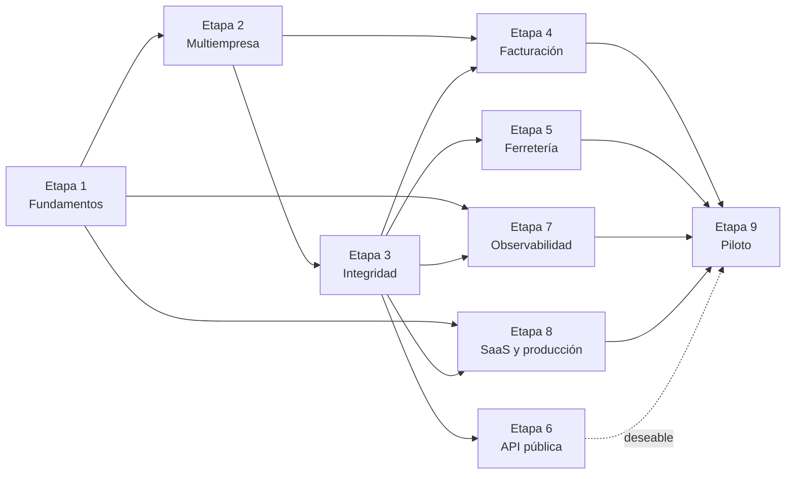
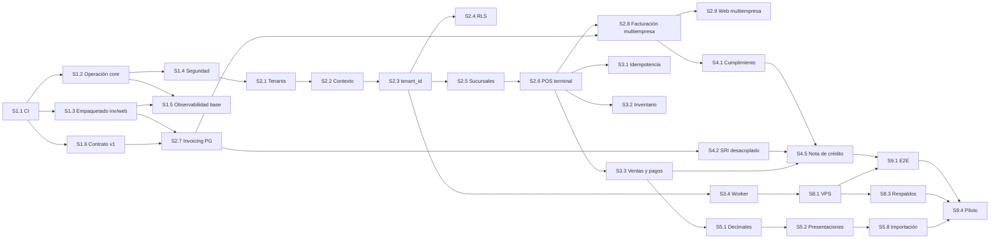

# Roadmap de evolución

> 9 etapas y 57 sesiones. Cada sesión cabe en una conversación nueva de Claude Code, siempre que sus
> dependencias estén terminadas. El detalle (15 campos y prompt listo para usar) está en
> [`sessions/`](sessions/README.md). Las brechas (`G-xx`, `F-xx`) están en [GAP_ANALYSIS.md](GAP_ANALYSIS.md).
>
> Tamaño relativo: **S** (cambio acotado), **M** (varios módulos de un repo), **L** (transversal o
> varios repos).

## 1. Etapas

| Etapa | Objetivo | Resultado verificable |
|---|---|---|
| 0. Auditoría | Diagnóstico, arquitectura objetivo y plan | Esta carpeta (terminada el 2026-10-14) |
| 1. Fundamentos | Poder cambiar con seguridad: CI, imágenes, configuración, seguridad base, observabilidad base y contrato de eventos | CI en verde en los cuatro repos; imagen de producción segura; contrato v1 probado en ambos servicios |
| 2. Multiempresa y multisucursal | Aislamiento por empresa, sucursales, puntos de emisión, terminales y facturación por emisor | Suite de aislamiento en verde; dos empresas facturan con secuenciales propios |
| 3. Integridad transaccional | Reintentos seguros, inventario y caja correctos, mensajería que no se bloquea, auditoría | Pruebas de concurrencia e idempotencia; ningún mensaje bloquea la cola |
| 4. Facturación robusta | Cumplimiento, desacople del SRI, conciliación, RIDE y nota de crédito | Flujo venta → factura → nota de crédito autorizado en el ambiente de pruebas del SRI |
| 5. Operación de ferretería | Decimales, presentaciones, precios, cotizaciones, crédito, costo, importación, cierre de caja | Escenarios de ferretería cubiertos por pruebas |
| 6. API pública | Credenciales de integración, `/api/v1`, webhooks, portal y sandbox | Un integrador externo sincroniza catálogo y crea ventas solo con la documentación |
| 7. Observabilidad completa | Métricas de negocio, frontend, infraestructura, dashboards y alertas | Alertas que se disparan en pruebas de fallo controladas |
| 8. SaaS y producción | VPS, CI/CD, respaldos, planes, onboarding, SigNoz, protección de datos | Despliegue reproducible y restauración probada |
| 9. Piloto | Pruebas integrales, carga, seguridad y puesta en marcha con un cliente | Cliente piloto facturando en producción |

### Ajustes al orden propuesto en el encargo

- **El contrato de eventos v1 (S1.6) se adelanta a la Etapa 1.** El cambio multiempresa modifica el
  mensaje `sales.confirmed`; sin pruebas de contrato se rompería la facturación en silencio, como ya
  ocurrió (G-08).
- **La persistencia de facturación en PostgreSQL (S2.7) va en la Etapa 2.** Es requisito para
  secuenciales por establecimiento y para correr en el VPS. Por eso **no** se corrige la carrera del
  secuencial en DynamoDB (G-09): esa persistencia se reemplaza.
- **La Etapa 8 puede empezar en paralelo** desde la Etapa 3 (S8.1 a S8.3) para tener staging pronto.
  El orden de la tabla es el lógico, no el único posible.
- **Ferretería (Etapa 5) va después de multiempresa e integridad** para no construir módulos nuevos
  sobre un esquema que va a cambiar. Las capacidades imprescindibles (F-01 a F-05) son requisito del
  piloto.

## 2. Dependencias

Camino crítico hasta el piloto:

## 3. Sesiones

| ID | Título | Objetivo | Depende de | Repos | Brechas | Tamaño |
|---|---|---|---|---|---|---|
| [S1.1](sessions/S1.1-ci-minima.md) | CI mínima | Lint, tipos, pruebas y build en cada PR de los cuatro repos | — | core, invoicing, web, infra | G-53, G-56, G-60, G-78 | M |
| [S1.2](sessions/S1.2-operacion-del-core.md) | Operación del core | Imagen de producción segura, salud, configuración por entorno, PostgreSQL 17 | S1.1 | core | G-38, G-40, G-41, G-51, G-54, G-55, G-58 | M |
| [S1.3](sessions/S1.3-empaquetado-invoicing-y-web.md) | Empaquetado de invoicing y web | Dockerfiles y configuración por entorno sin valores fijos | S1.1 | invoicing, web | G-07, G-56 | M |
| [S1.4](sessions/S1.4-seguridad-del-api.md) | Seguridad del API | Actor desde el token, sesión segura, bloqueo de login, errores y logs sin secretos | S1.2 | core, web | G-39, G-42, G-43, G-44, G-45, G-46, G-47 | M |
| [S1.5](sessions/S1.5-observabilidad-base.md) | Observabilidad base | Correlación de logs y trazas, recurso, sampler, redacción, spans de Kafka | S1.2, S1.3 | core, invoicing, infra | G-61 a G-67, G-71 | M |
| [S1.6](sessions/S1.6-contrato-de-eventos-v1.md) | Contrato de eventos v1 | JSON Schema versionado y pruebas de contrato; corrige los nulos | S1.1 | core, invoicing | G-08, G-76 | M |
| [S2.1](sessions/S2.1-tenants-y-membresias.md) | Tenants y membresías | Empresas, membresías, token con `tid`, alta por comando | S1.4 | core | G-01 | L |
| [S2.2](sessions/S2.2-contexto-de-tenant.md) | Contexto de tenant | `TenantContext` en requests, mensajes y tareas; repositorio base que filtra y asigna | S2.1 | core | G-01 | M |
| [S2.3](sessions/S2.3-tenant-id-en-modulos.md) | `tenant_id` en todos los módulos | Columnas, restricciones compuestas y nueva línea base de migraciones | S2.2 | core | G-01, G-06 | L |
| [S2.4](sessions/S2.4-rls-y-aislamiento.md) | RLS y aislamiento | Políticas RLS, roles de base y pruebas negativas por ruta | S2.3 | core | G-01 | M |
| [S2.5](sessions/S2.5-sucursales-y-puntos-de-emision.md) | Sucursales y puntos de emisión | Sucursales, puntos de emisión, terminales, bodegas por sucursal, acceso por sucursal | S2.3 | core | G-02 | L |
| [S2.6](sessions/S2.6-pos-por-terminal.md) | POS por terminal | Turno por terminal, cajero del token, stock por ubicación, numeración de ventas | S2.5 | core | G-03, G-04 | L |
| [S2.7](sessions/S2.7-invoicing-en-postgresql.md) | Invoicing en PostgreSQL | Reemplazar DynamoDB con el mismo comportamiento | S1.3, S1.6 | invoicing, infra | G-18, G-74 | L |
| [S2.8](sessions/S2.8-facturacion-multiempresa.md) | Facturación multiempresa | Perfil fiscal, certificados y secuenciales por empresa y punto de emisión | S2.6, S2.7 | invoicing, core | G-05, G-09, G-23 | L |
| [S2.9](sessions/S2.9-frontend-multiempresa.md) | Frontend multiempresa | Selección de empresa y sucursal, terminal POS, administración de sucursales | S2.5, S2.6, S2.8 | web | G-02, G-03 | L |
| [S3.1](sessions/S3.1-idempotencia.md) | Idempotencia | `Idempotency-Key` en POS y pagos | S2.6 | core, web | G-26 | M |
| [S3.2](sessions/S3.2-reglas-de-inventario.md) | Reglas de inventario | Sin stock negativo, disponibilidad real, ajustes correctos | S2.6 | core | G-27, G-28, G-29, G-32, G-36 | M |
| [S3.3](sessions/S3.3-ventas-pagos-y-precision.md) | Ventas, pagos y precisión | Pagos válidos, vuelto, anulación con factura en curso, dinero sin tope bajo | S2.6 | core, web | G-16, G-20, G-30, G-31, G-33 | M |
| [S3.4](sessions/S3.4-worker-y-mensajeria-resiliente.md) | Worker y mensajería resiliente | Worker separado, límites, mensajes fallidos, estado de facturación en la venta | S2.3 | core | G-21, G-24, G-25, G-35 | M |
| [S3.5](sessions/S3.5-bitacora-de-auditoria.md) | Bitácora de auditoría | Registro inmutable de operaciones sensibles | S2.3, S1.4 | core, web | G-50, F-16 | M |
| [S4.1](sessions/S4.1-cumplimiento-de-la-factura.md) | Cumplimiento de la factura | Ambiente por emisor, autorización guardada, XSD, campos tributarios | S2.8 | invoicing, core | G-10, G-15, G-16, G-17, G-19, G-22 | L |
| [S4.2](sessions/S4.2-sri-desacoplado.md) | SRI desacoplado | Cola en PostgreSQL y worker para firmar y enviar | S2.7 | invoicing | G-13, G-14 | M |
| [S4.3](sessions/S4.3-conciliacion-y-reproceso.md) | Conciliación y reproceso | Detección de discrepancias y herramientas de reproceso | S3.4, S4.2 | core, invoicing, web | G-21 | M |
| [S4.4](sessions/S4.4-ride-y-correo.md) | RIDE y correo | PDF del comprobante y envío al cliente | S4.1 | invoicing, web | G-12 | M |
| [S4.5](sessions/S4.5-nota-de-credito.md) | Nota de crédito | Emisión desde devoluciones y anulaciones | S4.1, S4.2, S3.3 | invoicing, core, web | G-11, G-20, G-22, F-04 | L |
| [S5.1](sessions/S5.1-cantidades-decimales.md) | Cantidades decimales | Cantidades con precisión configurable en todo el flujo | S3.3 | core, web, invoicing | F-01 | L |
| [S5.2](sessions/S5.2-unidades-y-presentaciones.md) | Unidades y presentaciones | Conversiones, presentaciones y códigos de barras | S5.1 | core, web | F-02, F-03 | L |
| [S5.3](sessions/S5.3-listas-de-precios.md) | Listas de precios | Minorista, mayorista, por volumen y por sucursal | S5.2 | core, web | F-06 | M |
| [S5.4](sessions/S5.4-cotizaciones.md) | Cotizaciones | Proformas con vigencia y conversión a venta | S5.3 | core, web | F-07 | M |
| [S5.5](sessions/S5.5-credito-y-cuentas-por-cobrar.md) | Crédito y cuentas por cobrar | Venta a crédito, abonos, estado de cuenta | S5.3, S3.3 | core, web | F-08, G-34 | L |
| [S5.6](sessions/S5.6-costo-promedio-y-kardex.md) | Costo promedio y kárdex | Costo ponderado por bodega y kárdex valorizado | S5.1, S3.2 | core, web | F-09 | M |
| [S5.7](sessions/S5.7-compras-devoluciones-e-iva.md) | Compras: devoluciones e IVA | Devoluciones a proveedor, IVA en compras, cuentas por pagar básicas | S5.6 | core, web | F-11, F-12, G-37 | M |
| [S5.8](sessions/S5.8-importacion-masiva.md) | Importación masiva | Productos, clientes, proveedores y saldos iniciales desde CSV | S5.2, S5.3 | core, web | F-05 | M |
| [S5.9](sessions/S5.9-cierre-de-caja.md) | Cierre de caja | Cierre Z numerado e inmutable con arqueo | S2.6, S3.5 | core, web | F-10 | M |
| [S6.1](sessions/S6.1-jwt-asimetrico-y-jwks.md) | JWT asimétrico y JWKS | Firma asimétrica, rotación y validación por JWKS | S2.1 | core, invoicing | G-48 | M |
| [S6.2](sessions/S6.2-credenciales-de-integracion.md) | Credenciales de integración | OAuth 2.0 *client credentials*, scopes y alcance por sucursal | S6.1, S2.5, S3.5 | core | G-72 | M |
| [S6.3](sessions/S6.3-api-v1.md) | API v1 | Fachada `/api/v1`, convenciones y límites de solicitudes | S6.2, S3.1 | core, invoicing | G-72, G-73, G-42 | L |
| [S6.4](sessions/S6.4-webhooks.md) | Webhooks | Suscripciones, firma, entregas y reintentos | S6.2, S3.4 | core | G-72 | M |
| [S6.5](sessions/S6.5-portal-documentacion-y-sandbox.md) | Portal, documentación y sandbox | Gestión de integraciones y guía para integradores | S6.3, S6.4 | web, core | G-72 | M |
| [S7.1](sessions/S7.1-metricas-del-core.md) | Métricas del core | Métricas técnicas y de negocio | S1.5, S3.4 | core | G-68 | M |
| [S7.2](sessions/S7.2-metricas-de-facturacion.md) | Métricas de facturación | SRI, transiciones, tiempos, certificados | S1.5, S4.2 | invoicing | G-68, G-23 | M |
| [S7.3](sessions/S7.3-observabilidad-del-frontend.md) | Observabilidad del frontend | Trazas desde el navegador, errores y web vitals | S1.5 | web, core | G-69 | M |
| [S7.4](sessions/S7.4-collector-e-infraestructura.md) | Collector e infraestructura | Collector con métricas de host, Docker, PostgreSQL y Kafka | S1.5 | infra | G-68 | M |
| [S7.5](sessions/S7.5-dashboards-y-alertas.md) | Dashboards y alertas | Seis dashboards, alertas y runbooks como código | S7.1, S7.2, S7.3, S7.4 | infra | G-70 | M |
| [S7.6](sessions/S7.6-observabilidad-en-pruebas.md) | Observabilidad en pruebas | Pruebas de spans y logs; definición de terminado | S7.1, S7.2 | core, invoicing | — | S |
| [S8.1](sessions/S8.1-stack-de-produccion-en-vps.md) | Stack de producción | Compose de producción en el VPS con Caddy y secretos | S1.2, S1.3, S2.7, S3.4 | infra | G-49, G-59 | L |
| [S8.2](sessions/S8.2-entrega-continua.md) | Entrega continua | Imágenes versionadas, despliegue y reversión | S8.1, S1.1 | todos | G-57 | M |
| [S8.3](sessions/S8.3-respaldos-y-recuperacion.md) | Respaldos y recuperación | PITR, archivo de comprobantes y simulacro de restauración | S8.1 | infra | G-59 | M |
| [S8.4](sessions/S8.4-planes-y-limites.md) | Planes y límites | Planes, suscripciones y límites de uso | S2.5 | core, web | — | M |
| [S8.5](sessions/S8.5-onboarding-y-consola.md) | Onboarding y consola | Alta guiada de empresas y consola de plataforma | S8.4, S2.8, S5.8 | core, web, invoicing | — | L |
| [S8.6](sessions/S8.6-signoz-en-operacion.md) | SigNoz en operación | Despliegue, acceso, retención y respaldo de SigNoz | S7.5, S8.1 | infra | G-52, G-70 | M |
| [S8.7](sessions/S8.7-proteccion-de-datos.md) | Protección de datos | Exportación y eliminación de datos por empresa, políticas | S8.3 | core, invoicing | — | M |
| [S9.1](sessions/S9.1-e2e-flujo-completo.md) | E2E del flujo completo | Venta → factura → nota de crédito con servicios reales | S4.5, S8.1 | todos | G-77 | M |
| [S9.2](sessions/S9.2-carga-y-linea-base.md) | Carga y línea base | Capacidad del POS y umbrales de alertas | S8.1, S7.5 | core | G-77 | M |
| [S9.3](sessions/S9.3-revision-de-seguridad.md) | Revisión de seguridad | Revisión de seguridad, dependencias y aislamiento | S6.3, S8.1 | todos | — | M |
| [S9.4](sessions/S9.4-puesta-en-marcha-del-piloto.md) | Puesta en marcha del piloto | Primer cliente en producción | S9.1, S9.2, S9.3, S8.3, S8.5 | todos | — | L |
| [S9.5](sessions/S9.5-cierre-del-piloto.md) | Cierre del piloto | Lecciones, ajustes y backlog siguiente | S9.4 | docs | — | S |

## 4. Primera sesión recomendada

**S1.1 — CI mínima.** Es barata y no toca el dominio. Hoy ningún repositorio la tiene (G-53), y es la
red de seguridad indispensable para el cambio multiempresa, que toca las 34 tablas del core.

## 5. Cómo usar este roadmap

1. Elegir la siguiente sesión cuyas dependencias estén terminadas (columna *Estado* del archivo de la
   sesión).
2. Abrir una conversación nueva de Claude Code en el repositorio principal de la sesión y pegar el
   bloque **Prompt** del archivo.
3. Al terminar, la sesión actualiza su propio archivo (*Estado: terminada*, fecha y PR), esta tabla si
   cambió algo, el ADR correspondiente (*aceptado*) y las brechas resueltas en GAP_ANALYSIS.
4. Si una sesión descubre que el plan no se ajusta a la realidad, documenta el ajuste aquí antes de
   seguir.
