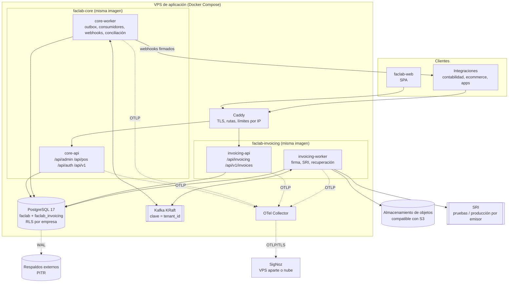
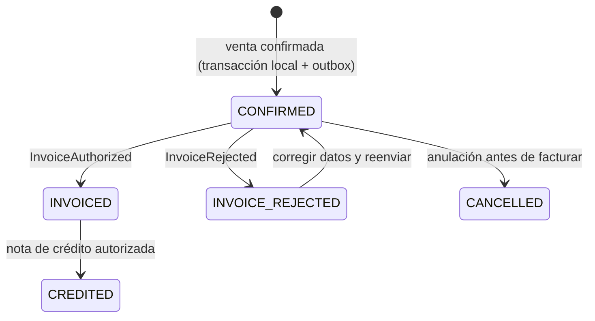

# Arquitectura objetivo

> Propuesta práctica para evolucionar lo que existe, sin reescrituras generales. Cada decisión de
> fondo tiene su ADR en [`ADR/`](ADR/README.md). Evidencia del estado actual en
> [CURRENT_STATE.md](CURRENT_STATE.md) y brechas en [GAP_ANALYSIS.md](GAP_ANALYSIS.md).

## 1. Vista general

Principios:

1. **Pocos servicios, límites claros.** Un monolito modular para el negocio y un servicio para el
   dominio tributario ([ADR-0001](ADR/0001-monolito-modular-y-servicio-de-facturacion.md)).
2. **La empresa viene de la identidad**, nunca del cuerpo de la solicitud
   ([ADR-0003](ADR/0003-identidad-global-y-contexto-de-sucursal.md)).
3. **La base de datos defiende el aislamiento** además de la aplicación
   ([ADR-0002](ADR/0002-multiempresa-base-compartida-con-rls.md)).
4. **Consistencia eventual solo entre servicios**. Dentro del core, la transacción es la unidad de
   consistencia ([ADR-0005](ADR/0005-kafka-outbox-y-consumidores-idempotentes.md)).
5. **Todo contrato que cruza un límite está versionado y probado**: eventos, API pública y webhooks
   ([ADR-0006](ADR/0006-contratos-de-eventos-versionados.md)).

## 2. Propiedad de los datos

| Dato | Dueño (fuente de verdad) | Quién más lo tiene | Cómo se sincroniza |
|---|---|---|---|
| Empresas, planes, membresías, usuarios | core | invoicing (solo `tenant_id` y el RUC del mensaje) | Claims del token y campos del mensaje |
| Sucursales, códigos de establecimiento y punto de emisión, terminales | core | invoicing (en cada mensaje) | Envelope de `sales.confirmed` |
| Productos, precios, clientes, proveedores | core | invoicing (copia en el comprobante) | Copia inmutable dentro del mensaje |
| Ventas, pagos, stock, movimientos, caja | core | — | — |
| Perfil fiscal (contribuyente especial, RIMPE, obligado a llevar contabilidad, ambiente SRI) | invoicing | — | Pantalla de configuración (frontend → invoicing) |
| Certificados de firma | invoicing | — | — |
| Secuenciales SRI, comprobantes, estado ante el SRI, XML autorizado, RIDE | invoicing | core (estado resumido de la venta) | Tópico `invoices` |
| Integraciones, scopes, webhooks | core | — | — |

Regla: un servicio nunca lee la base del otro. Los datos que necesita del otro viajan en el mensaje o
en el token.

## 3. Recomendaciones

Cada recomendación sigue el formato: estado actual, problema, alternativa recomendada, ventajas y
desventajas, impacto, complejidad, y prioridad con dependencias.

### R-1 Monolito modular más servicio de facturación

- **Estado actual:** ya es así. Venta, stock, caja y outbox se escriben en una transacción [V].
- **Problema:** la tentación de separar más servicios para escalar o "ordenar".
- **Recomendación:** conservar. Reforzar los límites internos con reglas (eventos entre módulos de
  administración, POS como composición) y mover la mensajería a un `worker`.
- **Ventajas:** atomicidad, bajo costo, un solo despliegue del negocio. **Desventajas:** escalado del
  API en bloque (suficiente para el volumen esperado).
- **Impacto:** ninguno inmediato.
- **Complejidad:** baja.
- **Prioridad:** transversal. ADR-0001.

### R-2 Multiempresa con `tenant_id`, RLS e identidad con membresías

- **Estado actual:** no existe (G-01, G-06).
- **Problema:** no se puede vender como SaaS ni aislar empresas.
- **Recomendación:** base compartida, `tenant_id` en cada tabla de negocio, restricciones compuestas,
  RLS, tokens por empresa y acceso por sucursal. Detalle en [MULTI_TENANCY.md](MULTI_TENANCY.md).
- **Ventajas:** un esquema, migraciones únicas, defensa en profundidad. **Desventajas:** cambio amplio
  en el core; disciplina con `SET LOCAL`.
- **Impacto:** todas las tablas, repositorios, handlers, eventos, frontend y facturación.
- **Complejidad:** alta.
- **Prioridad:** P0. Depende de CI (S1.1) y seguridad base (S1.4). ADR-0002 y ADR-0003.

### R-3 Organización multisucursal, terminales y POS por ubicación

- **Estado actual:** turno global, stock sin ubicación en el POS (G-03, G-04).
- **Problema:** dos cajas no pueden operar y el stock por bodega es incorrecto.
- **Recomendación:** sucursal (establecimiento SRI) → punto de emisión → terminal POS con bodega y
  ubicación por defecto. Turno por terminal, con un solo turno abierto por terminal garantizado por un
  índice único parcial. Cajero tomado del token.
- **Ventajas:** modelo fiel al SRI y a la operación. **Desventajas:** configuración inicial más larga
  (se resuelve con el onboarding).
- **Impacto:** POS, inventario, reportes, frontend.
- **Complejidad:** media.
- **Prioridad:** P0. Depende de R-2.

### R-4 Facturación en PostgreSQL y multiempresa

- **Estado actual:** PostgreSQL propio desde S2.7, con factura activa única por venta. Todavía un
  emisor y un secuencial global, que puede retroceder si se fija a mano (G-05, G-09; S2.8).
- **Problema:** no corre en el VPS y no soporta varios emisores ni secuenciales correctos.
- **Recomendación:** PostgreSQL propio, perfil fiscal y certificados por empresa, secuencial por
  establecimiento, punto de emisión y tipo, y restricción única de factura activa por venta.
- **Ventajas:** transacciones, consultas, un solo respaldo. **Desventajas:** reescribir unas 510 líneas
  de persistencia.
- **Impacto:** solo faclab-invoicing y faclab-infra.
- **Complejidad:** media.
- **Prioridad:** P0. Depende de S1.3 y S1.6. ADR-0004.

### R-5 Mensajería resiliente

- **Estado actual:** outbox y consumidor sin límites (G-24, G-25); hilos dentro del API (G-35);
  llamadas al SRI dentro del consumidor (G-13). *S3.4 resolvió los tres primeros en el core* (estado
  `failed`, `dead_letters`, proceso `worker`); queda G-13 en facturación (S4.2).
- **Problema:** un mensaje dañado detiene la facturación; un SRI lento frena las ventas entrantes.
- **Recomendación:** límites de intentos y estado `failed`, tabla de mensajes fallidos con reproceso,
  clave por empresa, `worker` separado, y en facturación una cola en PostgreSQL para el trabajo con el
  SRI.
- **Ventajas:** fallos aislados y visibles. **Desventajas:** un contenedor más por servicio.
- **Impacto:** core (outbox y consumidor), invoicing (consumidor y recuperación), compose.
- **Complejidad:** media.
- **Prioridad:** P0/P1. ADR-0005 y ADR-0007.

### R-6 Contratos de eventos versionados

- **Estado actual:** sin versión ni pruebas cruzadas; nulos incompatibles (G-08, G-76).
- **Problema:** se rompen integraciones en silencio.
- **Recomendación:** envelope con `schema_version`, JSON Schema en `contracts/`, pruebas de contrato en
  los dos CI.
- **Ventajas:** errores detectados antes del despliegue. **Desventajas:** mantener esquemas.
- **Impacto:** core e invoicing.
- **Complejidad:** baja.
- **Prioridad:** P0, antes de la Etapa 2. ADR-0006.

### R-7 Endurecimiento de seguridad

- **Estado actual:**
  - Actor tomado del cuerpo de la solicitud y secretos en la imagen.
  - Sin límite de intentos, refresh sin rotación y tokens en `localStorage`.
  - Secreto HS256 compartido con facturación.
  - (G-38 a G-48)
- **Problema:** suplantación, fuga de credenciales y fuerza bruta.
- **Recomendación:**
  - Actor desde el token y `.dockerignore`.
  - Rotación del refresh token con detección de reutilización. El refresh va en una cookie
    `HttpOnly; Secure; SameSite=Strict` limitada a `/api/auth` y el access token se queda en memoria.
  - Bloqueo progresivo de login.
  - Mensajes de error genéricos y redacción de logs.
  - Firma asimétrica con JWKS (S6.1).
- **Ventajas:** cierra los riesgos más probables. **Desventajas:** el frontend cambia su manejo de
  sesión.
- **Impacto:** auth del core, middlewares, frontend.
- **Complejidad:** media.
- **Prioridad:** P0/P1.

### R-8 Observabilidad uniforme

- **Estado actual:** instrumentación parcial con defectos de correlación (G-61 a G-71).
- **Problema:** los incidentes se descubren por los clientes.
- **Recomendación:** estándar común, Collector local, métricas de negocio, dashboards y alertas como
  código. Detalle en [OBSERVABILITY.md](OBSERVABILITY.md).
- **Ventajas:** detección temprana. **Desventajas:** costo de SigNoz.
- **Impacto:** los tres componentes y la infraestructura.
- **Complejidad:** media.
- **Prioridad:** P1. ADR-0010.

### R-9 API pública y webhooks

- **Estado actual:** solo rutas internas (G-72).
- **Problema:** las integraciones se acoplarían al contrato del frontend.
- **Recomendación:** `/api/v1` como fachada, OAuth 2.0 *client credentials*, scopes por sucursal,
  webhooks firmados. Detalle en [PUBLIC_API.md](PUBLIC_API.md).
- **Ventajas:** contrato estable y seguro. **Desventajas:** superficie adicional que mantener.
- **Impacto:** core (módulo nuevo `integrations`), invoicing (recursos públicos), frontend (portal).
- **Complejidad:** media-alta.
- **Prioridad:** P1, después de la Etapa 3. ADR-0008 y ADR-0009.

### R-10 Plataforma de despliegue en VPS

- **Estado actual:** solo desarrollo local; healthcheck roto; PostgreSQL 14 (G-53 a G-59).
- **Problema:** no hay forma segura de operar ni de recuperarse.
- **Recomendación:**
  - Imágenes por servicio con usuario sin privilegios, endpoints de salud y CI/CD con tags.
  - Compose de producción con Caddy y PostgreSQL 17.
  - Respaldos PITR y simulacros de restauración.
- **Ventajas:** simple y reproducible. **Desventajas:** sin alta disponibilidad automática.
- **Impacto:** los cuatro repositorios.
- **Complejidad:** media.
- **Prioridad:** P0 antes del piloto. ADR-0011.

### R-11 Capacidades de ferretería

- **Estado actual:** sin decimales, conversiones, listas de precios, cotizaciones, crédito ni nota de
  crédito (sección 3 de GAP_ANALYSIS).
- **Recomendación:** módulos nuevos dentro del core (Etapa 5), después de multiempresa e integridad
  para no rehacerlos.
- **Complejidad:** media cada uno.
- **Prioridad:** imprescindibles F-01 a F-05 antes del piloto.

## 4. Comunicación síncrona y asíncrona

| Interacción | Tipo | Motivo |
|---|---|---|
| Frontend → core / invoicing | HTTP síncrono | Interacción de usuario |
| Venta confirmada → factura | Asíncrono (Kafka) | El SRI puede tardar o caer; la venta no debe esperar |
| Resultado de la factura → venta | Asíncrono (Kafka) | Mismo motivo |
| Venta → inventario, caja (dentro del core) | Síncrono en la misma transacción | Consistencia estricta |
| Core → integraciones | Webhooks asíncronos | El receptor puede estar caído |
| Integraciones → core | HTTP síncrono con `Idempotency-Key` | Reintentos seguros |
| Core ↔ invoicing para consultas | No existe; el frontend consulta a cada servicio | Evita acoplamiento síncrono entre servicios |

## 5. Consistencia y recuperación

- **Garantía:** toda venta confirmada termina facturada, rechazada con motivo visible o anulada con su
  nota de crédito.
- **Mecanismos:** outbox, consumidores idempotentes, mensajes fallidos con reproceso, conciliación
  periódica (ventas confirmadas sin resultado después de X minutos y facturas autorizadas de ventas
  anuladas) y alertas sobre esa conciliación.
- **Cancelar una venta con factura en curso:** se bloquea mientras la factura no tenga resultado. Si ya
  está autorizada, la anulación exige nota de crédito (S3.3, S4.5).

## 6. Configuración y secretos

- Configuración por variables de entorno validadas al arrancar, en los dos servicios. El servicio no
  arranca si falta un valor obligatorio en producción, como ya hace el core con `JWT_SECRET`.
- Valores que dependen del entorno (CORS, URLs del SRI, brokers, documentación pública) **nunca** fijos
  en el código.
- Secretos fuera de las imágenes, en `.env` cifrados (sops y age) o Docker secrets. Rotación
  documentada para claves JWT, clave de cifrado de certificados y credenciales de base de datos.
- Secretos por empresa (contraseña del certificado, secretos de webhooks): cifrados en la base con una
  clave maestra del entorno.

## 7. Estrategia de pruebas

| Nivel | Core | Invoicing | Web |
|---|---|---|---|
| Unitarias | Existentes (983) | Ampliar: XML, firma, clave de acceso, mapeos | Existentes (234) |
| Integración con PostgreSQL | Existentes (64) + aislamiento multiempresa | Repositorios y secuenciales | — |
| Contrato | Productor valida JSON Schema | Consumidor valida ejemplos | OpenAPI completo (no solo enums) |
| E2E | — | — | Playwright con mocks + flujo real en S9.1 |
| Carga | k6 o Locust sobre el POS (S9.2) | Cola del SRI simulada | — |
| Observabilidad | Exportador en memoria: spans y logs de flujos críticos | Ídem | — |

Todo se ejecuta en CI. Un PR no se integra si falla lint, tipos, pruebas o contrato.

## 8. Evolución del esquema

- **Core:**
  - Alembic con nueva línea base multiempresa (S2.3), porque no hay datos productivos.
  - Después, migraciones compatibles hacia adelante: agregar columnas nulas, rellenar los datos y
    recién entonces volverlas obligatorias.
  - Nunca se renombra ni elimina en el mismo despliegue que deja de usar el campo.
- **Invoicing:** migraciones SQL con node-pg-migrate (`migrations/`, `npm run migrate up`), como paso
  aparte antes de arrancar (S2.7).
- **Prueba de migraciones en CI:** `upgrade` sobre una base vacía y `upgrade` desde la versión anterior.

## 9. Costos y complejidad

| Elemento | Costo operativo | Complejidad de mantenimiento |
|---|---|---|
| Core + worker | Bajo | Media (base de código grande) |
| Invoicing + worker | Bajo | Media (dominio tributario cambiante) |
| PostgreSQL 17 | Bajo | Media (respaldos, actualizaciones) |
| Kafka con un nodo | Bajo-medio (memoria) | Media |
| SigNoz | Medio (8 GB o más) o suscripción | Media |
| Caddy y Collector | Bajo | Baja |

Para mantener baja la complejidad, conviene evitar:

- Kubernetes.
- Schema Registry.
- Orquestadores de tareas.
- Más microservicios.
- Bases por empresa.
- Redis antes de la API pública.
